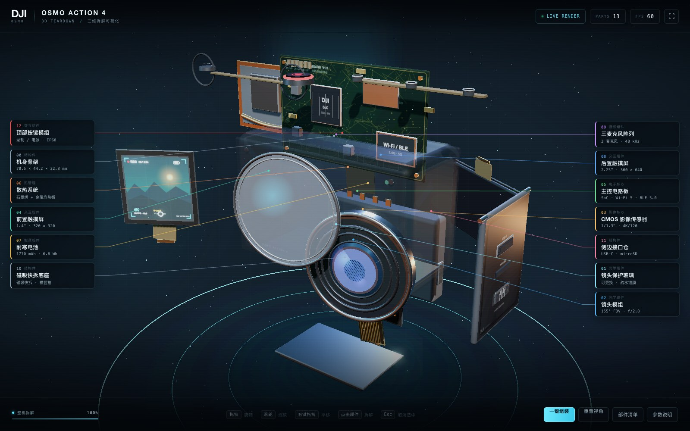

# DJI Osmo Action 4 · 3D Teardown

一个完全由代码生成的、可交互的 DJI Osmo Action 4 三维拆解可视化页面。  
使用 **Three.js + HTML + CSS + JavaScript**，不加载任何外部 3D 模型或图片贴图 —— 机身、镜头、屏幕、主板、电池、纹理与 UI 全部在浏览器中实时生成。



## 快速开始

直接双击 `index.html` 即可（全部资源已本地化，经典 `<script>` 加载，支持 `file://` 直接打开，无需联网）。

也可以启动一个本地静态服务器：

```bash
cd dji-action4-3d
python3 -m http.server 8080
# 打开 http://localhost:8080
```

推荐使用最新版 Chrome / Edge / Safari（需要 WebGL2；不支持时会显示错误提示）。

## 交互说明

| 操作 | 效果 |
| --- | --- |
| 拖拽 | 旋转视角 |
| 滚轮 / 双指捏合 | 缩放 |
| 右键拖拽 | 平移 |
| 点击部件 | 触发该部件的独立拆解动画，并打开参数详情 |
| `E` | 整机拆解 / 一键组装 |
| `R` | 重置视角 |
| `L` | 显示 / 隐藏部件标注 |
| `Space` | 自动旋转开 / 关 |
| `Esc` | 取消选中；再按一次退出拆解模式 |

### 拆解模式（Teardown Mode）

点击「拆解整机」或按 `E` 后：

- 13 个部件沿独立方向分层飞出，机身骨架变为半透明「幽灵壳体」，内部结构一览无余；
- 两侧面板自动收起，让出完整的标注空间；底栏出现「一键组装 / 重置视角 / 部件清单 / 参数说明」快捷按钮；
- 所有部件显示名称与关键参数标注，并带发光描边与引线；
- 点击任意部件，右侧自动滑出该部件的完整参数与设计说明。

## 功能清单

- **程序化模型**：按官方 70.5 × 44.2 × 32.8 mm 比例建模，包含镜头模组、保护玻璃、1/1.3" CMOS、前后触摸屏、主控板、电池、散热系统、三麦克风阵列、磁吸快拆底座、侧边接口仓、顶部按键与机身骨架。
- **拆解动画**：每个部件独立位移 + 缓动 + 延迟级联，拆解/组装可逆；屏幕在拆解时朝向观察者旋转。
- **视觉反馈**：青色 HUD 选择框 + 低强度边缘自发光 + 光晕 + Bloom 泛光；机身等大面积部件不使用整面自发光，避免过曝。
- **数据驱动面板**：13 个部件的名称、分类、摘要、技术参数、设计说明，以及整机核心规格与产品特性。
- **智能标注**：按左右列自动避让、引线锚定 3D 部件、面板遮挡时自动收缩布局；移动端仅展示当前选中部件标注，避免拥挤。
- **引导与快捷键**：首次进入引导卡片、底部操作提示、Toast 模式提示、键盘快捷键。
- **自适应布局**：桌面双面板 / 平板 / 手机抽屉式面板 + 响应式相机距离，移动端可直接操作。
- **零外部资产**：所有几何体由 Three.js 基础几何组合；屏幕 UI、PCB 走线、电池标签、镜头纹理等均由 Canvas2D 绘制。

## 技术实现

- **渲染**：Three.js r147（本地 `vendor/three/`，MIT License）
- **后处理**：`EffectComposer` → `RenderPass` → `UnrealBloomPass` → 自定义 ShaderPass（ACES filmic tone mapping + sRGB OETF）
- **材质**：`MeshPhysicalMaterial` + 程序化 PMREM 环境贴图（Canvas 等距柱状投影）实现金属/玻璃反射
- **交互**：`OrbitControls`、自定义 Raycaster 拾取、悬停/选中高亮、键盘快捷键
- **拆解动画**：damping + smoothstep 插值；部件独立 delay，支持爆炸/收缩
- **标注**：3D 锚点 `project()` 投影到屏幕 → DOM 标签 + SVG 引线 → 左右列碰撞避让
- **纹理**：`CanvasTexture`（屏幕 UI、PCB、电池铭牌、麦克风网孔、DJI 标识等），无图片依赖
- **文件加载**：使用经典脚本而非 ES Module，保证 `file://` 双击可运行

## 目录结构

```
dji-action4-3d/
├── index.html                 # 页面结构 / HUD / 三种遮罩层
├── css/
│   └── style.css              # 深色科技 HUD 视觉系统、响应式布局
├── js/
│   ├── data.js                # 整机规格 + 13 个部件的数据与拆解向量
│   ├── model.js               # 程序化几何、材质、Canvas 纹理
│   └── app.js                 # Three.js 场景、拆解动画、拾取、标注、UI 绑定
├── vendor/three/              # Three.js r147 + 所需 addons（本地化）
│   ├── LICENSE
│   ├── build/three.min.js
│   └── examples/js/...
├── preview/                   # 效果预览图（非运行时依赖）
└── README.md
```

## 参数来源

整机规格参考 DJI Osmo Action 4 官方规格页：  
<https://www.dji.com/osmo-action-4/specs>

3D 模型为交互式可视化目的的艺术化还原，比例与主要结构参考真机，并非工程级图纸。

## 已验证

使用 Headless Chrome（Apple Metal GPU，1600 × 1000 与 390 × 844）完成自动化验证：

- 13 个部件清单、13 个标注、13 条引线全部渲染；
- 点击 3D 部件可拾取并展示对应详情；拖拽不会误触发选中；
- 拆解 / 组装、退出拆解、面板开合、标注开关、自动旋转、重置视角均正常；
- 无 console 错误、无外部网络请求、无资源 404；
- 桌面 1920 / 1440 / 1280 / 1024 与平板 / 手机布局均在视口内无溢出。

## License

页面代码可自由使用与修改。  
Three.js 版权归 three.js authors 所有，遵循 MIT License（见 `vendor/three/LICENSE`）。
