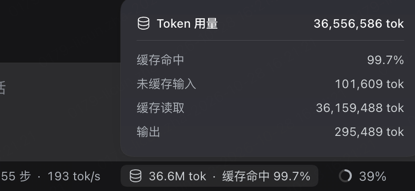

/goal 使用Three.js创建一个完整、可交互的DJI action4 3D拆解可视化页面：
1. 模型主体：精准还原DJI action4 的外观，摄像头等核心部件
2. 交互功能：支持点击部件触发拆解动画、自由旋转缩放视角、查看部件详情
3. 视觉风格：深色科技背景，部件拆解时带有发光高亮效果，标注各部件名称和参数
4. 技术要求：仅使用Three.js、HTML、CSS和JavaScript，不依赖外部3D模型文件，所有元素由代码生成
5. 附加功能：包含部件清单面板、参数说明、操作引导提示

token消耗情况:
