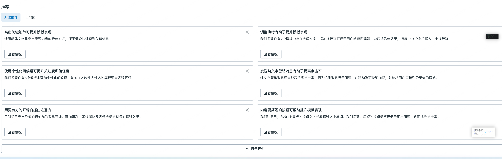
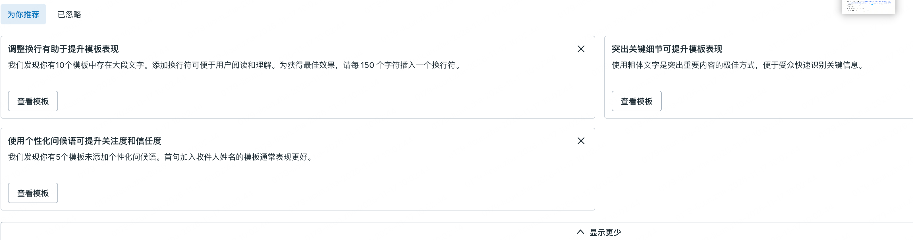

# 截图建议来源分析与规则打标页面导入配置

> 首次写入工具：Codex
> 最近写入工具：Codex
> 整理日期：2026-11-18
> 状态：配置内容已整理并进行格式校验，未执行导入或打标。

## 一、规则来源与原始建议分析

### 1. 来源及整理口径

规则判断内容仅依据用户提供的两张截图，不增加项目衍生规则或其他外部建议。项目代码仅用于确认页面批量导入的字段与数据格式。

以下“原始建议”按截图标题和说明引用；“规则拆解”是为形成可判定标签所做的操作性解释，不能当作截图原文。两张截图的重复建议合并，模板数量差异保留在各自原文中，数量不作为命中阈值。





### 2. 原始建议一：突出关键细节可提升模板表现

> 使用粗体文字是突出重要内容的极佳方式，便于受众快速识别关键信息。

两张截图均包含此建议。拆解为“关键内容加粗识别”，标签为“正向：关键信息加粗”。只强调实际关键内容，普通星号不视为加粗。

### 3. 原始建议二：调整换行有助于提升模板表现

截图一原文：

> 我们发现你有7个模板中存在大段文字。添加换行符可便于用户阅读和理解。为获得最佳效果，请每 150 个字符插入一个换行符。

截图二原文：

> 我们发现你有10个模板中存在大段文字。添加换行符可便于用户阅读和理解。为获得最佳效果，请每 150 个字符插入一个换行符。

拆解为“正文长段落识别”，标签为“负向：存在长段落”。操作性阈值定为某一行超过150个字符；恰好150个字符不命中。不另设正文换行、空行分段或无长段落标签。AI精确计数可能存在误差，临界样本应人工复核。

### 4. 原始建议三：使用个性化问候语可提升关注度和信任度

截图一原文：

> 我们发现你有6个模板未添加个性化问候语。首句加入收件人姓名的模板通常表现更好。

截图二原文：

> 我们发现你有5个模板未添加个性化问候语。首句加入收件人姓名的模板通常表现更好。

拆解为“首句姓名问候识别”，标签为“正向：首句姓名问候”。需要明确姓名证据；普通问候、泛称或用途未知的占位符不等同于姓名。没有姓名证据时不命中，不新增普通问候标签。

### 5. 原始建议四：发送纯文字营销消息有助于提高点击率

> 纯文字营销消息通常能获得高点击率，因为这类消息易于阅读、在移动端可快速加载，并能将用户直接引导至您的网站。

拆解为“纯文字消息识别”，标签为“正向：纯文字消息”。按完整消息判断，没有完整消息证据时不作肯定推断。该规则保留在本批配置中，不因具体项目当前输入能力而删除。

### 6. 原始建议五：用更有力的开场白抓住注意力

> 用简短且突出价值的语句作为消息开场。添加福利、紧迫感以及表情或标点符号来增强效果。

拆解为五条独立规则：价值开场、开场福利、开场紧迫感、开场表情、开场标点强调，均标记为正向。各项分别命中，不要求五项同时具备，也不因为出现表情就同时赋予福利或紧迫感标签。只判断开场，不能扩大为全文特征。

### 7. 原始建议六：内容更简短的按钮可帮助提升模板表现

> 我们注意到，你有1个模板的按钮文字长度超过 2 个单词。我们发现，简短的按钮标签更便于用户阅读，进而提升点击率。

拆解为“按钮文案过长识别”，标签为“负向：按钮文案过长”。任一实际按钮超过2个单词时命中，不能把不同按钮拼接计数，也不能用正文代替按钮内容；不能可靠分词时不判断。

### 8. 规则与标签总表

共10条规则，其中8条正向、2条负向。仅保留检测到特征就打标签的一套规则，不增加“不包含”或相反标签。正负向表示截图建议对应的优化方向，不表示已经验证的点击率、阅读率等效果。

| 序号 | 来源 | 规则名称 | 标签编码 | 标签名称 | 命中示例 | 不命中示例 |
| --- | --- | --- | --- | --- | --- | --- |
| 1 | 原始建议一 | 关键内容加粗识别 | `positive:key-info-bold` | 正向：关键信息加粗 | 关键权益被明确加粗 | 只有普通星号或格式信息不可见 |
| 2 | 原始建议二 | 正文长段落识别 | `negative:has-long-paragraph` | 负向：存在长段落 | 一行包含一百五十一个字符 | 最长一行恰好一百五十个字符 |
| 3 | 原始建议三 | 首句姓名问候识别 | `positive:first-sentence-name-greeting` | 正向：首句姓名问候 | 首句问候明确使用收件人姓名 | 普通问候或用途不明的占位符 |
| 4 | 原始建议四 | 纯文字消息识别 | `positive:text-only-message` | 正向：纯文字消息 | 完整消息明确无媒体，仅包含文字及文字链接 | 只有正文片段或消息包含图片 |
| 5 | 原始建议五 | 价值开场识别 | `positive:value-opening` | 正向：价值开场 | 开场直接简短说明核心价值 | 开头只有空泛介绍 |
| 6 | 原始建议五 | 开场福利识别 | `positive:opening-benefit` | 正向：开场福利 | 开场明确提出优惠或奖励 | 福利仅出现在后文 |
| 7 | 原始建议五 | 开场紧迫感识别 | `positive:opening-urgency` | 正向：开场紧迫感 | 开场突出最后机会或限时领取 | 开场仅陈述日期 |
| 8 | 原始建议五 | 开场表情识别 | `positive:opening-emoji` | 正向：开场表情 | 开头使用表情符号 | 表情只出现在结尾 |
| 9 | 原始建议五 | 开场标点强调识别 | `positive:opening-punctuation-emphasis` | 正向：开场标点强调 | 开场用感叹号表达强调语气 | 开场只有普通逗号或句号 |
| 10 | 原始建议六 | 按钮文案过长识别 | `negative:long-button-copy` | 负向：按钮文案过长 | 一个按钮含三个单词 | 按钮只有两个单词或未提供按钮文字 |

## 二、页面可直接导入的 JSON

### 1. 页面入口与导入格式

进入“AI打标 → 规则管理 → 批量导入”，复制本节完整JSON数组到文本框，页面应识别出10条记录，再确认导入。也可复制同目录[JSON附件](./2026-11-18-截图建议来源分析与规则打标页面导入配置.json)的全部内容。

接口：`POST /admin/api/material/ai/tagRule/batchImport`。顶层为数组，不需要添加`action`、`target`、`items`等Job外层字段。此格式已依据当前本地页面与后端代码核对，未执行远端接口验证。

| 字段 | 本批填写值及含义 |
| --- | --- |
| `name` | 规则名称，作为后续定位和维护的名称 |
| `scope` | 固定为`RULE` |
| `materialCategoryCode` | 空字符串，不绑定品类 |
| `isRequired` | `0`，按条件命中，不要求所有素材必打 |
| `sort` | 10至100，按十递增 |
| `status` | `1`，启用 |
| `promptDesc` | JSON字符串；内部含`condition`和`tags` |

`condition`为AI阅读的命中条件，不是数据库独立字段，也不是服务端表达式。`tags`指定命中后的标签；后端会绑定该规则中配置的全部标签，因此每条规则只配置一个对应标签。`tagCode`中的冒号为英文冒号`:`，`tagName`中的冒号为中文冒号`：`；标签名称仅含中文和中文冒号，中文开头且不超过64字符。

### 2. 完整导入内容

以下代码块可整段复制，去掉Markdown代码块围栏即可导入。`promptDesc`内的双引号已经转义，请勿手动去掉反斜杠或改为对象。

```json
[
  {
    "name": "关键内容加粗识别",
    "materialCategoryCode": "",
    "scope": "RULE",
    "isRequired": 0,
    "sort": 10,
    "status": 1,
    "promptDesc": "{\"condition\":\"输入中有明确加粗格式，且加粗对象为核心信息、关键权益、时间或行动要求时命中。普通星号、项目符号、乘法符号不视为加粗。仅加粗无实质意义的装饰内容不命中。若输入丢失格式且无法确认是否加粗，不命中。 内容为空、不可读或证据不足时不命中；未命中不生成相反标签。标签方向仅表示截图建议对应的优化方向，不证明实际效果。\",\"tags\":[{\"tagCode\":\"positive:key-info-bold\",\"tagName\":\"正向：关键信息加粗\"}]}"
  },
  {
    "name": "正文长段落识别",
    "materialCategoryCode": "",
    "scope": "RULE",
    "isRequired": 0,
    "sort": 20,
    "status": 1,
    "promptDesc": "{\"condition\":\"按原始文本的真实换行划分行。任一行去除首尾空白后超过150个字符时命中，恰好150个字符不命中。行内标点与空格计入；只按提供的原始内容计算，不猜测变量替换后的长度。页面自动折行不算原文换行。无法确认完整文本或字符数时不命中。 内容为空、不可读或证据不足时不命中；未命中不生成相反标签。标签方向仅表示截图建议对应的优化方向，不证明实际效果。\",\"tags\":[{\"tagCode\":\"negative:has-long-paragraph\",\"tagName\":\"负向：存在长段落\"}]}"
  },
  {
    "name": "首句姓名问候识别",
    "materialCategoryCode": "",
    "scope": "RULE",
    "isRequired": 0,
    "sort": 30,
    "status": 1,
    "promptDesc": "{\"condition\":\"第一句向收件人问候，并明确加入收件人姓名时命中。实际姓名或已明确说明绑定收件人姓名的变量都可作为证据。普通问候、泛称客户、品牌名称及无法确认用途的变量不命中。不得仅凭问候语后有匿名变量就认定其为姓名。 内容为空、不可读或证据不足时不命中；未命中不生成相反标签。标签方向仅表示截图建议对应的优化方向，不证明实际效果。\",\"tags\":[{\"tagCode\":\"positive:first-sentence-name-greeting\",\"tagName\":\"正向：首句姓名问候\"}]}"
  },
  {
    "name": "纯文字消息识别",
    "materialCategoryCode": "",
    "scope": "RULE",
    "isRequired": 0,
    "sort": 40,
    "status": 1,
    "promptDesc": "{\"condition\":\"能够确认输入代表完整营销消息，且消息只使用文字内容，没有图片、视频、音频、文档、媒体卡片等非文字内容时命中。文字链接本身不视为媒体。仅提供正文片段、未明确提供完整消息结构或无法确定是否包含媒体时不命中，不得因当前只看见文字就推断整条消息是纯文字。 内容为空、不可读或证据不足时不命中；未命中不生成相反标签。标签方向仅表示截图建议对应的优化方向，不证明实际效果。\",\"tags\":[{\"tagCode\":\"positive:text-only-message\",\"tagName\":\"正向：纯文字消息\"}]}"
  },
  {
    "name": "价值开场识别",
    "materialCategoryCode": "",
    "scope": "RULE",
    "isRequired": 0,
    "sort": 50,
    "status": 1,
    "promptDesc": "{\"condition\":\"忽略独立问候语与开头装饰后，消息第一句实质正文以简短、直接的表达突出对收件人的明确价值时命中。核心价值应在开场直接可见，不需要阅读后文才能理解。只有空泛宣传、冗长铺垫或价值仅在后文出现时不命中。简短按语义判断，不新增截图之外的字数阈值。 内容为空、不可读或证据不足时不命中；未命中不生成相反标签。标签方向仅表示截图建议对应的优化方向，不证明实际效果。\",\"tags\":[{\"tagCode\":\"positive:value-opening\",\"tagName\":\"正向：价值开场\"}]}"
  },
  {
    "name": "开场福利识别",
    "materialCategoryCode": "",
    "scope": "RULE",
    "isRequired": 0,
    "sort": 60,
    "status": 1,
    "promptDesc": "{\"condition\":\"忽略独立问候语与开头装饰后，消息第一句实质正文明确表达收件人可获得的福利、优惠或奖励时命中。福利仅在后文出现、只介绍一般功能、仅陈述义务或否定存在福利时不命中。只识别文案中明确表达的福利，不推断实际资格或真实性。 内容为空、不可读或证据不足时不命中；未命中不生成相反标签。标签方向仅表示截图建议对应的优化方向，不证明实际效果。\",\"tags\":[{\"tagCode\":\"positive:opening-benefit\",\"tagName\":\"正向：开场福利\"}]}"
  },
  {
    "name": "开场紧迫感识别",
    "materialCategoryCode": "",
    "scope": "RULE",
    "isRequired": 0,
    "sort": 70,
    "status": 1,
    "promptDesc": "{\"condition\":\"忽略独立问候语与开头装饰后，消息第一句实质正文通过限时、稀缺或催促行动表达紧迫感时命中。单纯陈述日期、状态或普通事实且没有紧迫表达时不命中。后文才出现紧迫表达不命中。仅判断文案表达，不推断实际稀缺性。 内容为空、不可读或证据不足时不命中；未命中不生成相反标签。标签方向仅表示截图建议对应的优化方向，不证明实际效果。\",\"tags\":[{\"tagCode\":\"positive:opening-urgency\",\"tagName\":\"正向：开场紧迫感\"}]}"
  },
  {
    "name": "开场表情识别",
    "materialCategoryCode": "",
    "scope": "RULE",
    "isRequired": 0,
    "sort": 80,
    "status": 1,
    "promptDesc": "{\"condition\":\"消息开头或第一句实质正文使用实际表情符号以吸引注意时命中。开头独立装饰性表情也属于开场。表情仅出现在正文中后段时不命中；普通标点、字母、数字、变量和URL字符不算表情。无法确认开场内容时不命中。 内容为空、不可读或证据不足时不命中；未命中不生成相反标签。标签方向仅表示截图建议对应的优化方向，不证明实际效果。\",\"tags\":[{\"tagCode\":\"positive:opening-emoji\",\"tagName\":\"正向：开场表情\"}]}"
  },
  {
    "name": "开场标点强调识别",
    "materialCategoryCode": "",
    "scope": "RULE",
    "isRequired": 0,
    "sort": 90,
    "status": 1,
    "promptDesc": "{\"condition\":\"消息开头或第一句实质正文通过感叹号、强调性问号或其他有明确强调作用的标点吸引注意时命中。仅出现普通句号、逗号、金额小数点、URL符号或格式分隔符时不命中；标点只在后文出现也不命中。应有明确强调语气，不因存在任意标点就命中。 内容为空、不可读或证据不足时不命中；未命中不生成相反标签。标签方向仅表示截图建议对应的优化方向，不证明实际效果。\",\"tags\":[{\"tagCode\":\"positive:opening-punctuation-emphasis\",\"tagName\":\"正向：开场标点强调\"}]}"
  },
  {
    "name": "按钮文案过长识别",
    "materialCategoryCode": "",
    "scope": "RULE",
    "isRequired": 0,
    "sort": 100,
    "status": 1,
    "promptDesc": "{\"condition\":\"输入明确提供实际按钮展示文案，且至少一个按钮的文字超过2个单词时命中，恰好2个单词不命中。只计算按钮展示文字，不计算URL、按钮类型、代码或正文中的行动要求。多个按钮分别判断，不合并词数。对无法可靠划分单词的语言或缺少按钮文案的输入，不命中，不以字符数代替单词数。 内容为空、不可读或证据不足时不命中；未命中不生成相反标签。标签方向仅表示截图建议对应的优化方向，不证明实际效果。\",\"tags\":[{\"tagCode\":\"negative:long-button-copy\",\"tagName\":\"负向：按钮文案过长\"}]}"
  }
]
```

### 3. 导入后的核对

- 确认识别到10条规则，范围均为`RULE`、品类为空、状态为启用。
- 核对8个正向标签、2个负向标签，尤其是中文冒号与英文编码冒号的区别。
- 当前导入按“品类编码＋规则名称”匹配已有规则；同名且品类为空会更新提示词、范围、排序等配置，修改名称后再次导入可能新增规则。
- 导入成功只代表规则配置保存成功，不代表已经为素材生成标签。没有足够输入证据的规则应不命中，不得编造消息结构、姓名或按钮文案。

### 4. 格式核验记录

已检查顶层数组、10条唯一规则名称、10个唯一标签编码、每条`promptDesc`的二次JSON解析、固定字段、标签名称与编码格式；每条提示词长度均不超过500字符。未执行数据库写入、页面导入、模型调用或素材回填。
