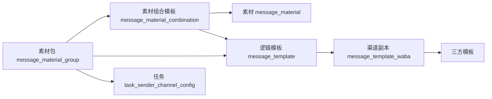
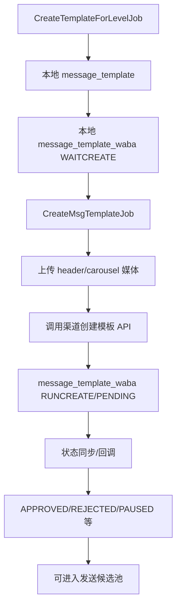
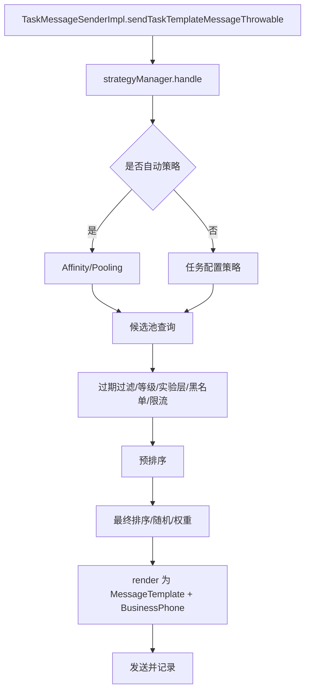

# 素材包、素材组合模板、渠道模板创建与发送现状说明

> 文档日期：2026-11-02  
> 适用范围：本仓库当前工作区代码  
> 文档性质：现状说明与排查手册，不是改造方案  
> 统一口径：`message_material_group`=素材包（原素材模板），`message_material_combination`=素材组合模板（原素材组合），`message_material`=素材

## 0. 结论先行

1. 素材包不会在渠道侧被“原地替换”。每次补渠道库存，通常是新增一条 `message_template` 逻辑模板，再新增一条或多条 `message_template_waba` 渠道副本。
2. `CreateTemplateForLevelJob` 只生成本地 `message_template + message_template_waba(WAITCREATE)`，不直接调用三方；`CreateMsgTemplateJob` 才消费 `WAITCREATE` 并向 YCloud/NXCloud/ADA/GPI/8x8 等渠道提交。
3. 生成渠道模板的核心不是“按素材包创建时间选择”，而是：
   - 素材包启用状态；
   - `ACTIVE + NORMAL` 的素材组合模板；
   - 任务/lane 的预计发送量；
   - WABA 层级和 lane 交集；
   - 每个 WABA 的状态水位；
   - 每日、并发、连续失败等创建闸门。
4. 默认 `alwaysUseNewTemplate=true`，补水位时倾向新建模板副本，而不是复用池中尚未登记到该 WABA 的模板。
5. 发送时会判断时间，判断对象是 `message_template_waba.ctime`，不是素材包 `ctime`，也不是最终 `MessageTemplate.ctime`。
6. 发送过滤只负责“淘汰过老副本”；剩余候选仍按模板质量、WABA/BP 等级、实验层、WABA 成功率、组合权重或配置策略选择，不存在统一的新模板优先规则。
7. 单商品普通 BODY 的 emoji 处理是**等量替换已有 emoji**，不是新增；同一原 emoji 在单次调用内固定映射到同一目标，不同原 emoji 不保证映射到不同目标。实际替换范围由 `emojiSourceGroup` 决定，替换候选由 `emojiTargetGroups` 决定。

---

## 1. 领域对象与数据关系

### 1.1 核心对象

| 对象 | 表/存储 | 作用 |
| --- | --- | --- |
| 素材包 | `message_material_group` | 一组可组合素材的业务容器，配置语言、模板类型、组合模式、关联任务、lane 等 |
| lane 配置 | `message_material_group_lane` | 素材包在某个 lane 的预计发送量和启用关系 |
| 素材组合模板 | `message_material_combination` | header/body/footer/buttons/LTO/carousel body 等素材引用组成的可发送组合 |
| 素材 | MongoDB `message_material` | 单个组件内容，`element` 中保存实际 `OpayTemplateComponent` |
| 素材-模板关系 | `message_material_template` | 某渠道逻辑模板由哪些素材组成，也用于反查素材包下生成过哪些模板 |
| 渠道逻辑模板 | `message_template` | CRM 侧的模板定义，保存 `material_group_id`、`material_combination_id`、组件 JSON、类型、实验层等 |
| 渠道模板副本 | `message_template_waba` | 某逻辑模板在某个 WABA 上的创建/审批/质量状态，以及三方模板 ID |
| 任务渠道配置 | `task_sender_channel_config` | 任务发送策略、素材包、备用素材、去重期、组合权重等配置 |

### 1.2 关系链



辨析：

- “素材包没有表情”并不等价于“该素材包下每个素材组合模板使用的 body 都没有表情”。
- 生成渠道模板时真正取的是**某个素材组合模板**的内容，不是只看素材包详情页中的某一个 body。
- 一个素材包可以有多个 body、多个组合；随机/手动组合模式下组合内容可能不同。

---

## 2. 总体创建链路

### 2.1 两段式创建



关键类：

- Job 入口：`whatsapp-crm-job2-1-1/src/main/java/com/opay/occ/whatsapp/job/job/task/CreateTemplateForLevelJob.java`
- 素材方案生成：`CreateTemplateJobService`
- 渠道副本生成：`CreateTemplateForLevelJobService`
- 三方提交：`CreateMsgTemplateJobService`
- 三方路由：`OpayManageServiceImpl.createMessageTemplate`
- 状态同步：`UpdateMsgTemplateJobService`、模板状态回调链路

### 2.2 `CreateTemplateForLevelJob` 一次调度的实际边界

- `CreateTemplateJobService.createTemplate` 会从所有匹配的 `素材包 × lane` config 中随机遍历。
- 当前方法每次调用最多处理到一个 config 返回 `true` 后结束；因此按现有循环语义，一次 run 不能把全部缺口补齐，需要周期性调度逐步补。
- 同一个 config 单次最多登记一条 `message_template_waba`。
- 这一终止条件是 `CreateTemplateJobService` 的方法级语义；其他直接调用 `tryCreateForMaterialConfig` 的入口不受该外层 early-return 约束。

入口：`CreateTemplateForLevelJobService.createTemplateForLevelJob(String param)`  
配置构建：`CreateTemplateJobService.buildMaterialTemplateConfigs`

---

## 3. 生成策略细化

### 3.1 Job 参数

`CreateTemplateParam`：

| 字段 | 作用 |
| --- | --- |
| `scenario` | 场景，控制过滤和命名前缀 |
| `recentMinutes` | 仅选择最近 N 分钟创建的 `ENABLED` 素材包 |
| `taskWindowStartMinutes` | `UTILITY_FIRST` 任务窗口起点，默认 `-30` 分钟 |
| `taskWindowEndMinutes` | `UTILITY_FIRST` 任务窗口终点，默认 `90` 分钟 |
| `taskIds` | `SPECIFIED_TASK` 场景指定任务 |
| `materialTemplateNames` | `SPECIFIED_MATERIAL_TEMPLATE_NAME` 场景指定素材包名 |
| `poolMode` | `COMBINED`、`NORMAL_ONLY`、`TIER_ONLY` |

参数解析：`CreateTemplateForLevelJobService.parseParam`

### 3.2 素材包过滤

1. 默认查询 `message_material_group.status = ENABLED`。
2. `recentMinutes > 0` 时追加 `message_material_group.ctime >= now - recentMinutes`。
3. `UTILITY_FIRST`：
   - 解析素材包 `related_tasks`；
   - 查关联 `task_sub` 最新 `ctime`；
   - 用最新任务开始时间，判断当前时刻是否落在 `开始时间 + taskWindowStartMinutes` 到 `开始时间 + taskWindowEndMinutes` 的区间；
   - 窗口内才保留。
4. `SPECIFIED_TASK`：素材包关联任务中至少有一个命中指定 taskId。
5. `SPECIFIED_MATERIAL_TEMPLATE_NAME`：素材包 `name` 精确匹配。
6. `TIER_ONLY`：只保留配置在实验层创建范围中的素材包。

关键方法：

- `getAllEnabledMaterialGroups`
- `filterByRecentTasks`
- `filterBySpecifiedTask`
- `filterBySpecifiedMaterialTemplateName`
- `isExperimentMaterialGroup`

### 3.3 config 构建：素材包 × lane

`CreateTemplateJobService.buildMaterialTemplateConfigs`：

1. 每个素材包查询 `message_material_group_lane`。
2. 没有 lane 配置直接跳过。
3. 有 `related_tasks` 时：
   - 查任务昨日发送量 `taskSubCountInfoService.getLastDayCnt(taskIdList)`；
   - 按 `TaskBase.laneCode` 聚合成 `lane -> taskIds`。
4. `estimatedSendCount = max(lane.estimated_send_count, 该 lane 关联任务昨日发送量)`。
5. `estimatedSendCount <= 0` 跳过。
6. AI 备用且无关联任务：
   - 仅在 `DEFAULT` / `RECENT_MINUTES` 场景生效；
   - 预计发送量乘 `0.1`；
   - 最低为 `1`。
7. 每个 `素材包 × lane` 形成一个 `MaterialTemplateConfig`。
8. 默认层级固定：`LARGE, MEDIUM, SMALL, WARM`。
9. 所有 config 随机打乱，依次尝试，首个成功即结束。

### 3.4 预计发送量换算为 WABA 水位

核心公式：

```text
levelCountHeight =
  ceil(estimatedSendCount × levelPercent / 100 / 800)

baseDemandWaterLevel =
  max(levelCountHeight × 2 / levelWabaCount, 1)

normalDemandWaterLevel =
  max(ceil(baseDemandWaterLevel × oldCreateFactor), 1)
```

解释：

- `800`：单副本预计承载消息量。
- `×2`：冗余系数，避免库存不足。
- `/ levelWabaCount`：把整个层需求摊到该层 WABA。
- `oldCreateFactor`：配置项 `task.send.template.oldCreateFactor`，按素材包 ID 配系数，默认 `1.0`。
- 整数运算会先截断，再 `ceil`；小比例时可能由最低水位 `1` 兜底。

实验分层：

```text
tierTarget = ceil(maxLevelBaseWaterLevel × tierCreateFactor[tier])
```

- `L1-L4` 独立建池。
- 层目标为 `0` 时不建该层。
- 正常池和实验池分别计算可用高度，不互相消耗水位。

关键方法：

- `levelBaseWaterLevel`
- `resolveOldCreateFactor`
- `maxLevelBaseWaterLevel`
- `effectiveTierTargets`
- `loadTierTargets`

### 3.5 候选 WABA

最终 WABA 候选 = `level 对应 WABA 集合 ∩ lane 对应 WABA 集合`。

层级来源 `LevelWabaConfig`：

- `task.execute.waba.useScore=true`：按 BpScore 聚合 agentName 最高分，再按分数阈值划分 LARGE/MEDIUM/SMALL；WARM 来自配置映射；缓存 5 分钟。
- 否则直接使用 `task.send.strategy.automatic.waba.category.mapping`。

lane 来源 `LaneWabaConfig`：

- 配置 `lane.waba`；
- 叠加 `business_phone.support_chat_type` 为 `MARKETING_CHAT` / `COLLECTION_CHAT` 的 agentName。

关键方法：`getLevelWabaList`

### 3.6 WABA 水位：`getWabaHeight`

高度不是简单 count，而是按状态计算：

```text
height = approvedCount + failureSlots
failureSlots = floor(连续 REJECTED/CREATEFAIL 批次数)
每 3 次连续失败算 1 个失败槽
中断后连续失败计数清零
PENDING/WAITCREATE 等不计高度，由并发守卫处理
```

创建候选时：

1. 遍历候选 WABA，逐个算该素材包在该 WABA 上的高度。
2. 找高度最小的 WABA 集合。
3. 如果最小高度已经达到目标水位，放弃。
4. 否则在最小高度 WABA 集合中随机选一个。

关键方法：

- `getWabaHeight`
- `calcHeight`
- `getWabaForWaterLevel`

### 3.7 选择素材组合模板

`putMaterialNew2Pool` 是“一个素材包一直生成渠道模板”的关键方法。

步骤：

1. 查素材包下 `ACTIVE + NORMAL` 素材组合模板：`getCanCreateMaterialCombination`。
2. 对组合随机打乱。
3. 查这些组合已有的全部 `message_template`。
4. 过滤为当前正常/实验层模板。
5. 查这些逻辑模板在目标 WABA 下已有的 `message_template_waba`。
6. 统计：`素材组合模板 -> 在该 WABA 下已有渠道模板数`。
7. 优先选择在该 WABA 下“尚未出现”的组合。
8. 若所有组合都出现过，选已有数量最少的组合。
9. 未选到则失败退出。

明确没有：

- 没有按素材组合模板 `ctime` 排序；
- 没有按素材包 `ctime` 排序；
- 没有只选最近 N 天素材组合模板；
- 素材组合模板数据本身没有以 `ctime` 做淘汰；模板候选 ID 缓存和模板关系缓存有 TTL，见第 11 节。

关键方法：

- `putMaterialNew2Pool`
- `MessageMaterialCombinationServiceImpl.getCanCreateMaterialCombination`

### 3.8 是否复用已有渠道逻辑模板

入口：`doCreate` -> `getValidSubTmp`

配置：`job.createTemplateForLaneJobV2.alwaysUseNewTemplate`，默认 `true`。

行为：

- `true`：即使池中有尚未登记到该 WABA 的模板，也返回 `null`，后续新建。
- `false`：取同池中尚未登记到该 WABA 的第一条模板复用。

注意：

- “同池”包含正常/实验层过滤；
- 只能复用一个没有该 WABA 关系的模板；
- 已登记过该 WABA 的模板不会因 `false` 被重复使用。

### 3.9 创建闸门

`checkBeforeCreate`：

1. 今日创建数达到 `autoMaxCreateCntOneDay`：停止；有实验预留时，正常池可能先停。
2. 单 WABA 运行中模板数达到 `autoTempWindow`：停止。
3. 全局运行中模板数达到 `allAutoTempWindow`：停止。
4. 最近曾拒绝且 `rejectedPauseMinute > 0`：暂停。
5. 全局 `RateLimiter.tryAcquire()`：限流。
6. `type=material` 且存在同 WABA 运行中素材包：`existRunning=true`，不再新增。

每日创建数及告警使用 Redis 计数；告警有当日标记，避免无限刷。

### 3.10 本地模板组装

`assembleTemplate`：

1. 模板名 = 素材包名 + 场景前缀 + 唯一后缀。
2. 类型：
   - carousel/LTO 固定 MARKETING；
   - `UTILITY_FIRST` 且素材包本身 MARKETING 时，可改 UTILITY；
   - 否则用 per-combination / 素材包类型。
3. 组件顺序：
   - LTO；
   - header；
   - body；
   - footer；
   - buttons。
4. carousel 分支：
   - carousel body；
   - carousel cards。
5. 保存 `material_group_id`、`material_combination_id`、`experiment_tier`、`ctime`、`utime`。
6. 写 `message_material_template` 关系。
7. 插入 `message_template_waba(status=WAITCREATE)`。

### 3.11 三方提交

`CreateMsgTemplateJobService`：

1. 取 `WAITCREATE` 列表；普通模板和复制/素材包分开取。
2. 控制每小时、每日创建数。
3. 创建前按创建场景的自动废弃配置再过滤一次。
4. `doCreate`：
   - 更新 WABA/BP 信息；
   - 上传 header/carousel 媒体；
   - 调 `OpayManageService.createMessageTemplate`；
   - 保存三方模板 ID、状态、媒体 ID、ext。
5. 三方返回后：
   - `message_template_waba` 从 `WAITCREATE` 进入 `RUNCREATE/PENDING/APPROVED` 等；
   - 失败按 `CREATEFAIL` 处理。
6. 所有副本都审批通过后，`message_template.status` 更新为 `APPROVED`。
7. 有 rejected / createfail 时按规则更新逻辑模板状态。

`OpayManageServiceImpl.createMessageTemplate` 路由：

- `unifiedProviderService.supportedAgent(TEMPLATE)` → 统一 provider；
- 否则按 NXCLOUD / ADA / YCLOUD / GPI 旧实现路由；
- 三方错误通常会转成 `CREATEFAIL`；
- 8x8 特殊：创建返回空 ID 时可保持 `PENDING`，等待 webhook 按名称回填。

---

## 4. 表情替换机制说明

> 渠道模板表情处理是**替换**，不是新增。
> 原 BODY 中命中 `emojiSourceGroup` 的 emoji 会从 `emojiTargetGroups` 中随机选择不同目标进行等量替换；未命中的字符保持原样。

### 4.1 普通单商品 BODY：只做替换，数量、位置不变

核心方法：`CreateStrategyTemplateJobService.shuffleEmojisWithFullPool(String text)`

执行逻辑：

1. 用 `emojiSourceGroup` 在当前文本中扫描已有 emoji；
2. 记录每个已出现 emoji 的位置和组；
3. 对**每一种首次出现的原 emoji**随机选一个不同于自身的 `emojiTargetGroup`；
4. 同一原 emoji 后续再次出现时，直接复用已选好的目标 emoji；
5. 用目标 emoji 替换原 emoji；
6. 文本中没有命中 `emojiSourceGroup` 的字符原样保留。

结论：

```text
原文本没有可识别 emoji → 原样保留
原文本有可识别 emoji   → 用另一个 emoji 等量替换，位置和数量不变
```

### 4.1.1 “一对一替换”具体指什么？

当前实现不是严格的全局“每个 emoji 一一对应到唯一不同目标”，准确口径分成三层：

1. **同一原 emoji 在单次调用内一对一映射**
   - 例：`🔥 原文本 🔥` 中的两个 🔥，会映射成同一个目标，例如两个 💡；
   - 同一原 emoji 不会在同一段文本中被替换成两个不同 emoji。

2. **不同原 emoji 允许映射到同一个目标**
   - 例：🔥 → 💡，🎉 → 💡 是允许的；
   - 当前实现只禁止“替换成自身”，没有禁止“不同原表情映射到同一个目标”。

3. **替换次数固定**
   - 原文本有几个可识别 emoji，目标文本就仍是几个；
   - 当前替换是逐个位点等量替换，不会为了保持某个总数而增删 emoji。

最小示例：

```text
输入：🔥 Buy now 🎉
可能输出：💡 Buy now 🤩

输入：🔥 Buy now 🔥
可能输出：💡 Buy now 💡
```

### 4.1.2 `emojiSourceGroup` 与 `emojiTargetGroups` 的关系

两个配置职责不同：

| 配置 | Java 字段 | 作用 | 是否要求与原 emoji 一致 |
| --- | --- | --- | --- |
| `task.send.strategy.automatic.template.emoji.source.group` | `emojiSourceGroup` | **识别池**：扫描原 BODY，决定哪些 emoji 被认定为可替换 | 原 emoji 必须命中此池才会进入替换 |
| `task.send.strategy.automatic.template.target.emoji.groups` | `emojiTargetGroups` | **候选目标池**：为每个已识别原 emoji 随机抽取替换值 | 不要求与原 emoji 一致，但禁止抽到自身 |

处理顺序可以理解为：

```text
原 BODY
  → 用 emojiSourceGroup 扫描，找出可替换的 emoji
  → 每个不同的原 emoji 只随机一次
  → 从 emojiTargetGroups 随机抽一个“不等于该原 emoji”的目标
  → 同一原 emoji 的所有出现位点统一替换为该目标
```

二者不是一一映射表，也不是“source 第 1 个对应 target 第 1 个”。`emojiSourceGroup` 只决定“识别范围”，`emojiTargetGroups` 只决定“可随机选择的目标范围”。

特殊边界：

- 两个配置都为空时，代码都会回退到同一套内置 emoji 组；
- 回退后两个池相同，**不会**因此死循环；
- 对每个命中的原 emoji，目标池通常还有其他元素可选，因此可以抽到“不等于自身”的目标；
- 只有目标池中不存在任何与当前原 emoji 不同的值时，`do...while (replacement.equals(original))` 才会无法退出；

内置 emoji 组：🚀 💪 ✅ 💸 💡 🎉 💰 ✨ 🌟 💎 🎊 💓 🤝 🤑 😊 😍 🥰 🤩 🏆 🔄 🔍 ⚡️ ❤️ 🔥。

### 4.2 调用位置

普通 body：

- `CreateTemplateForLevelJobService.getTemplateComponents` 对 `body.getElement().getText()` 调 `shuffleEmojisWithFullPool`。
- `CreateTemplateForLaneV2JobService.getTemplateComponents` 同逻辑。
- `CreateStrategyTemplateJobService.handleTemplateComponents` 复制模板时同逻辑。

carousel：

- 主 carousel body 会经过 emoji 替换。
- 卡片 body 当前直接 `bodyComp.setText(card.getBodyText())`，**没有经过** `shuffleEmojisWithFullPool`。
- 因此普通 body 与卡片 body 使用不同的组装路径：普通 body 会执行 emoji 替换，卡片 body 当前直接使用原始文本。

---

## 5. 发送策略细化

### 5.1 发送链路总览



关键类：

- 发送入口：`TaskMessageSenderImpl`
- 策略分发：`StrategyManagerImpl.handle`
- 自动策略：`AffinityAutomaticStrategyImpl`、`PoolingAutomaticStrategyImpl`
- 回落策略：`FallbackStrategyImpl`
- 任务配置策略：`HistoryPriorityConfigStrategy`、`HistoryWeightConfigStrategy`、`HistoryPriorityLoopWeightedConfigStrategy`
- 公共选择器：`AutomaticStrategySupport`
- 三方召回策略：`CallBackStrategyFactory` 及其 `Send*Strategy`

### 5.2 策略优先顺序

`StrategyManagerImpl.handle` 实际顺序：

1. 尝试自动策略：
   - 自动策略是否启用由任务 strategy / `automaticStrategyTaskConfig` 决定；
   - `AUTOMATIC_MATERIAL` 默认走自动策略。
2. 自动策略失败：
   - 回到任务配置策略 `configStrategyFactory.getStrategy(...)`。
3. 配置策略失败：
   - 进入 `FallbackStrategyImpl` 回落。
4. 每层都可能先通过 `CallBackStrategyFactory.getAllStrategiesByTask` 选出召回策略：
   - 默认：`SendNotLimitStrategy`；
   - UTILITY 优先 lane：先 `SendUtilityStrategy`；
   - 配置了 DS 策略时：按 `dsStrategyType`、`dsRange` 和实验百分比组合 `SendUtilityStrategy`、`SendEverUtilityByDirectSendStrategy`、`SendMarkingByDirectSendStrategy`、`SendTrueUtilityByDirectSendStrategy`。

### 5.3 候选模板来源

`TaskSenderChannelConfigServiceImpl.getAutoStrategyTemplateIdList(TaskSenderContext)`：

- `AUTOMATIC_MATERIAL`：
  - 用 `effectiveMaterialGroupId`；
  - 默认取 `message_material_template` 非 DELETED 的逻辑模板；
  - 关系表只负责建立素材包与逻辑模板的关联；真正的发送可用性还要求 `material_combination_id` 对应素材组合模板仍可发送；
  - 有去重期时，按客户手机号 + 任务查最近已发送消息，排除命中的素材组合模板对应的模板。
- 其他历史策略：
  - 从任务配置模板 ID，经 `getCopyTemplateListByIdListWithCache` 查副本；
  - 模板 ID 集合和结果都有本地缓存。

关键点：

- 发送候选是逻辑模板 ID 集合，不是“渠道关系表直接按时间全表捞”；
- 去重期排除的是素材组合模板维度，一个组合命中后，其关联模板都被排除；
- 备用重试阶段会切换到备用素材包或动态备用素材包。
- 去重期是“同一客户 + 同一任务 + 已成功发送记录”的素材组合模板过滤，不是渠道模板 `ctime` 淘汰。
- 未配置 `deduplication_period` 时，不执行这层已发送组合排除。
- 去重期只排除已发送消息里记录的 `material_combination_id` 对应模板；若历史消息没有组合 ID，则不会按该字段排除。

### 5.4 候选池查询与时间过滤

`SourcePoolServiceImpl.getSourceGradeList`：

1. 根据模板 ID 查 `message_template_waba` 有效状态。
2. 必须有非空 `agent_template_id`。
3. 调 `filterMessageTemplateWaba(..., isSendMsg=true, lane)` 做过期过滤。
4. 校验 WABA 是否属于 lane。
5. 校验有可用 BP。
6. 生成 WABA、BP、模板三元组 `Candidate`。
7. 通过策略给 `Candidate.grade` 赋值。

时间过滤公式：

```text
baseDiscardDay =
  素材包名精确配置
  > lane 配置
  > defaultDay

discardDay = isSendMsg ? baseDiscardDay + bufferDay : baseDiscardDay

valid:
  message_template_waba.ctime > now - discardDay
```

核心判断：`messageTemplateWaba.getCtime() > thresholdTime`。

- 配置来源：`job.taskDataPullJob.sendAutoDiscordTempConfigs`。
- 创建场景用 `job.createTemplateForLaneJobV2.autoDiscordTempConfigs`，不加 `bufferDay`。
- 发送场景多一层 `bufferDay`。
- 这个判断只决定“是否过期”，不决定新旧排序。
- 异常时直接返回原列表，属于不过滤降级。

### 5.4.1 不同发送策略的时间过滤边界

上面的 `filterMessageTemplateWaba(isSendMsg=true)` 主要出现在素材包自动策略的候选池查询链路，以及部分配置策略的候选准备链路中。不能把它概括成“所有发送策略都会统一判断自动废弃时间”。

当前至少存在两类路径：

1. **素材包自动策略链路**
   - 通过 `SourcePoolService` 查询候选；
   - 会进入 `filterMessageTemplateWaba(..., true, lane)`；
   - 受 `job.taskDataPullJob.sendAutoDiscordTempConfigs` 的 `defaultDay + bufferDay` 影响。

2. **指定模板配置策略的部分路径**
   - `HistoryConfigStrategy` 通过配置里的模板/三方模板 ID 组装 `TemplateWithBP`；
   - 主要看模板是否属于 `INVALID_STATUS`、BP 是否有效、WABA 是否为 `RESTRICT` 等；
   - 不应默认认为一定执行了素材包自动废弃规则；
   - 排查“指定模板仍被发送”时，先确认任务策略和对应选择器路径。

因此判断“发送是否会因为模板老而不用”之前，先确认任务实际命中的是哪一种策略和召回路径。

### 5.5 模板等级

`SourceGradeEnum` 有 `GREEN/YELLOW/RED/DISABLE` 等。

等级方法由 `source.pool.result.gradeMethod` 决定：

- `hardCode` → `SourceGradeServiceHardCodeImpl`；
- 默认 `spel` → `SourceGradeSpelServiceSpelImpl`。

hardCode 逻辑：

- 素材包/渠道模板状态、质量、WABA metaStatus、BP 状态/质量、恢复时长、发送限制、负反馈次数等共同决定；
- 任一 DISABLE → DISABLE；
- 任一 RED → RED；
- 全 GREEN → GREEN；
- 其余 → YELLOW。

模板质量分：

- GREEN / 三方 GREEN → 1.0；
- YELLOW → 0.5；
- RED / PAUSED / UNKNOWN → 0。

### 5.6 WABA 分类选择

`PoolingAutomaticStrategyImpl.match`：

适用 lane：

- `UTILITY`
- `CUSTOMER_NEW`
- `CUSTOMER_OLD`
- `MARKETING_DEFAULT`
- `MARKETING_CHAT`

顺序：

1. LARGE：
   - `shouldUseWabaCategory` 按 lane 配置比例命中后，优先选 LARGE。
2. MEDIUM：
   - LARGE 无结果时，按比例命中后选 MEDIUM；
   - `MARKETING_DEFAULT` 走 rightWingChoice，其余走 leftWingChoice。
3. WARM：
   - 前面无结果时，选 WARM。
4. SMALL：
   - 最后选 SMALL。
5. 仍无结果：
   - `choiceGeneral` 按 GREEN/YELLOW/RED 权重兜底。

WABA 分类比例 `getPercentConfig`：

- LARGE：CUSTOMER_NEW/OLD 默认 80%，其他默认 0%；
- MEDIUM：UTILITY 默认 100%，其他默认 10%；
- SMALL：仅 CUSTOMER_NEW 默认 10%，其他 0%；
- WARM：默认 0%；
- 配置 `task.send.strategy.automatic.lane.waba.cate.percent` 可覆盖；
- DS 场景还会把 `dsSupportStatus != TRUE` 的类别权重置 0；
- 最后按权重归一化抽取 WABA 类别。

leftWingChoice 与 rightWingChoice 区别：

- leftWing：先按类别取 BP，再查指定 BP 候选，适合大/中型 WABA；
- rightWing：先查模板候选池，再按类别过滤，适合 WARM/SMALL/部分 MEDIUM。

### 5.7 候选池公共过滤

`AutomaticStrategySupport.baseFilter`：

1. 任务 WABA 黑名单；
2. WABA 从 RESTRICT/FLAGGED 恢复后的发送量限制；
3. DS 切换 BSP 过滤；
4. lane 维度 WABA 日发送量、已发送量过滤；
5. 手机号分层实验池过滤。

`plusFilter`：

1. BP 当日发送量超过 `sendLimit × bpDaySendLimitPercent` 时去掉；
2. 模板连续发送时长超过 lane 配置时去掉；
3. 删除 BP/模板为空候选。

`orangePoolFilter`：

- 主要针对 `MARKETING_CHAT`；
- WABA FLAGGED 时，根据 lane 配置和当日发送量进一步去掉。

### 5.8 实验层选择

`filterByPhoneLayerCandidatePool`：

- 先做手机号分层归因；
- 实验流量：当前候选中若存在匹配当前 L1-L4 tier 的副本，只保留该 tier；否则只保留正常池副本。
- 实验层回退正常池的前提是候选中确实有正常池副本；没有正常池副本时最终仍会无候选。
- 非实验流量：只保留正常池副本，排除实验层副本；
- 选定后写 `phoneLayerCandidatePool` 和 `bizInfo`，供后续统一使用。

这解释了为什么同一素材包生成多个实验层副本，但某个具体客户只会在自己的层内选。

### 5.9 预排序

`preRanking`：

1. 按 `max(topPercent% 候选数, 3)` 取 TopN。
2. 计算每个候选分数：
   - BP 最近分钟发送量越低越好；
   - BP 最近天发送量越低越好；
   - BP 质量越高越好；
   - 模板质量越高越好。
3. 按分数降序排列。
4. 只把 TopN 交给最终选择。

### 5.10 最终选择

`ranking`：

1. 按模板质量分桶：1.0 → 0.5 → 0。
2. 从高质量桶开始尝试。
3. 每个桶内：
   - 按 agentName 去重得到 WABA 列表；
   - 用 WABA 成功率权重随机选一个 WABA；
   - WABA 成功率默认 `65%`，缓存 1 分钟；
   - 在选中 WABA 的候选中，如果命中组合权重实验并有有效权重，则按素材组合模板权重抽；
   - 否则在候选内均匀随机。

`randomByCombinationWeight` 重点：

- 不是永远按组合权重。
- 只有 `templateCombinationWeightConfig.isAllOpen=true`，或当前 lane 在灰度列表且命中 `abPercent` 时才启用增强权重。
- 未命中实验：
  - 任务配置了 `CUSTOM_WEIGHT` 时，使用用户配置权重；
  - 否则退回均匀随机。
- 命中实验：
  - 先使用任务 `customCombinationWeight`；
  - 若无，则使用 `templateCombinationWeightJob` 基于阅读率、点击率算出的自动权重；
  - 配置权重缺失或非正的组合，用现有正权重平均值兜底；
  - 先按组合抽，再在命中的组合内等概率抽具体候选。

自动组合权重 Job：

- `TemplateCombinationWeightJobService`；
- 有效统计窗口 `template.combination.weight.stat.effective-days`，默认 7 天；
- 最大回看 `14` 天；
- 结果 TTL `14` 天；
- Redis Hash key 为 `taskId + materialGroupId`。

### 5.11 配置策略

#### `PRIORITY_ROUND_ROBIN`

- 候选按 priority 升序排列；
- 任务 Redis cursor 决定轮询位置；
- 当前 pointer 不可用时继续向后找，最多 `circleNum` 次；
- 选到模板后再按 BP 业务类型权重选 BP。

#### `WEIGHTED_ROUND_ROBIN`

- 先过滤可用模板/BP/WABA；
- 按模板 `weight` 概率抽取；
- 再按 BP 业务类型权重抽 BP。

#### `PRIORITY_LOOP_WEIGHTED_ROUND_ROBIN`

- 按 priority 分组；
- 每个 priority 内部先跑权重模板选择；
- 再按 priority 轮询位置决定用哪一组；
- 本质是“优先级层 + 层内加权”。

### 5.12 三方召回策略

`CallBackStrategyFactory.getAllStrategiesByTask`：

- 非 DS 或非受限 `dsStrategyType`：默认策略。
- UTILITY 优先 lane：先 Utility，再普通。
- DS 受限：
  - 可能先 True Utility DS；
  - 再 Utility；
  - 再 EverUtility DS；
  - 再 Marketing DS；
  - `UNRESTRICTED` / `PREFER_UTILITY` 最后追加默认策略尾。

几种召回策略的差异：

| 策略 | 过滤/行为 |
| --- | --- |
| `SendNotLimitStrategy` | 原样返回候选 |
| `SendUtilityStrategy` | `template.category == UTILITY` |
| `SendTrueUtilityByDirectSendStrategy` | Utility + `direct_send_enabled` + DS 能力/风险限制 |
| `SendEverUtilityByDirectSendStrategy` | `everUtility == 1` + shadow/多按钮规则 + DS 风险 0/1 |
| `SendMarkingByDirectSendStrategy` | 始终 Marketing（`everUtility=0`）+ DS 风险 0 + 配额和灰度比例 |

YCloud shadow：

- shadow 状态 `APPROVED`：模板名加 `_shadow`；有混合按钮类型时仅保留 URL 按钮。
- shadow 未审批且存在多种按钮类型：丢弃该候选。

### 5.13 `render` 与发送对象

`AutomaticStrategySupport.render`：

1. 从缓存读最终 `MessageTemplate`；
2. 复制一份，避免修改缓存；
3. 带上当前候选的 `agent_template_id`、`grade`、`everUtility`、`useDirectSend`、header media、ext、abStrategy；
4. 从缓存读 BP；
5. 返回 `MessageTemplate + BusinessPhone`。

时间指标：

- `TaskMessageSenderImpl.sendMessagePointData` 使用 `MessageTemplate.ctime` 统计有效天数。
- 这不是发送过滤所用的 `message_template_waba.ctime`。
- 对“复用逻辑模板、后来才登记到另一个 WABA”的副本，这两者会不同。

### 5.14 重试与备用素材

- 请求失败或回调失败可进 `TaskMessageRetry`。
- 达到备用切换条件后，retry stage 切到 backup。
- `TaskSenderContext.getEffectiveMaterialGroupId` 会返回备用素材包或动态备用素材 ID。
- 后续发送重新走候选查询和策略选择，不会沿用第一次的渠道模板。
- 因此同一条客户消息在重试阶段可能命中不同素材包、组合和渠道模板。

---

## 6. 创建时间相关结论（仅保留强相关部分）

1. 生成渠道模板时，素材包 `ctime` 只影响 `recentMinutes` 场景，不影响组合优先级和发送新旧优先级。
2. 发送自动废弃使用 `message_template_waba.ctime`。
3. 创建任务查询 `WAITCREATE` 时按 `message_template_waba.id` 升序，不是按 `ctime`。
4. 发送有效天数监控使用 `MessageTemplate.ctime`，与实际过滤口径不同。
5. 没有任何统一的 `ORDER BY ctime DESC` 决定发送使用最新模板。
6. 老模板是否被替换取决于：
   - 自动废弃配置是否启用；
   - 老副本是否超过可用天数；
   - 新副本是否已经审批且进入候选；
   - 质量、WABA、BP、实验层和权重是否满足。

---

## 7. 关键配置索引

| 配置 | 作用 |
| --- | --- |
| `job.createTemplateForLaneJobV2.alwaysUseNewTemplate` | 是否总新建模板副本，默认 true |
| `job.createTemplateForLaneJobV2.autoTempWindow` | 单 WABA 并发创建上限 |
| `job.createTemplateForLaneJobV2.allAutoTempWindow` | 全局并发创建上限 |
| `job.createTemplateForLaneJobV2.autoMaxCreateCntOneDay` | 每日创建上限 |
| `job.createTemplateForLevelJob.tierDailyReservedCount` | 实验层/正常池每日预留 |
| `job.createTemplateForLaneJobV2.rejectedPauseMinute` | 连续拒绝暂停窗口 |
| `task.send.template.oldCreateFactor` | 素材包维度水位系数 |
| `job.createTemplateForLaneJobV2.autoDiscordTempConfigs` | 创建场景自动废弃 |
| `job.taskDataPullJob.sendAutoDiscordTempConfigs` | 发送场景自动废弃 + buffer |
| `task.send.strategy.automatic.template.target.emoji.groups` | emoji 替换目标池 |
| `task.send.strategy.automatic.template.emoji.source.group` | emoji 扫描源池 |
| `task.execute.waba.useScore` | 是否按 BpScore 动态划分 WABA 层级 |
| `source.pool.result.gradeMethod` | `hardCode` / `spel` 等级算法 |
| `template.combination.weight.*` | 组合权重灰度、窗口、TTL |
| `task.send.strategy.automatic.lane.waba.cate.percent` | 各 lane 的 WABA 类别比例 |

---

## 8. 常见问题排查

### 8.1 为什么一个素材包一直在生成渠道模板？

按顺序核对：

1. `alwaysUseNewTemplate` 是否 true；
2. 预计发送量是否较大，公式算出水位大于当前高度；
3. 目标层级 WABA 数量是否很多；
4. 是否存在多个 lane，每个 lane 都要补库存；
5. 是否有 L1-L4 独立实验池；
6. 是否存在连续 REJECTED/CREATEFAIL，被折算为失败槽；
7. 旧模板是否在发送侧被自动废弃，导致调度持续补新；
8. 素材组合模板是否每次都在该 WABA 下没有副本，导致优先选“缺失组合”；
9. 每日/全局闸门是否只是限制速度，没有停止生成。

### 8.2 为什么发送没有用最新模板？

检查：

1. 最新模板是否 `APPROVED`；
2. 最新模板是否有目标 WABA 的 `message_template_waba`；
3. 最新模板是否属于当前 lane；
4. 是否属于当前客户实验层；
5. 是否被 WABA/BP 黑名单或限流过滤；
6. 是否命中组合权重但权重为 0；
7. 是否最终选中的 WABA 下没有该新模板；
8. 是否老模板仍在有效期内，并与新模板一起竞争。

### 8.3 为什么旧模板还在发送？

检查：

1. `sendAutoDiscordTempConfigs.enabled` 是否开启；
2. `defaultDay` / lane 配置 / 素材包名配置是否足够大；
3. `bufferDay` 是否额外延长了有效期；
4. 发送过滤是否因异常走了原列表返回；
5. 关系表缓存是否尚未失效；
6. 是否实际不是同一素材包名，导致命中了另一条更宽松的废弃配置。

### 8.4 模板状态为什么卡住？

检查：

1. `message_template_waba.status` 是 `WAITCREATE`、`RUNCREATE`、`PENDING` 还是 `CREATEFAIL`；
2. `CreateMsgTemplateJob` 是否被每日/每小时/单 WABA/全局限流；
3. 三方 API 是否返回空 ID；
4. 8x8 是否等待 webhook 按名称回填；
5. `UpdateMsgTemplateJobService` 是否拉取到最新状态；
6. `message_template.status` 是否因部分副本 rejected/createfail 未更新；
7. 本地缓存是否尚未过期。

---

## 9. 日志与检索关键词

常用日志关键词：

- `createTemplateForLevelJob`
- `createTemplateForLevelJob start`
- `materialGroupId`
- `poolTargetCalc`
- `tierTargetCalc`
- `tryCreateForMaterialConfig`
- `getWabaHeight`
- `getWabaForWaterLevel`
- `putMaterialNew2Pool`
- `doCreate create`
- `checkBeforeCreate`
- `createMsgTemplateJob`
- `getCreateTemplateWabalist`
- `filterMessageTemplateWaba`
- `create time too early`
- `create time meets requirements`
- `createStrategyTemplateJob`
- `shuffleEmojisWithFullPool`（方法本身通常不打日志，用 getTargetEmojiGroup/getSourceEmojiGroup 定位）
- `getTargetEmojiGroup`
- `getSourceEmojiGroup`
- `strategyManager.handle`
- `executeAutomaticStrategy`
- `expression Strategy`
- `choiceGeneral`
- `leftWingChoice`
- `rightWingChoice`
- `preRanking`
- `ranking`
- `randomByCombinationWeight`
- `template combination automatic getCombination`
- `filterWabaBlacklist`
- `orangePoolFilter`
- `filterByPhoneLayerCandidatePool`
- `no_template_via_cursor`
- `no_none_template_bp`

---

## 10. 关键类与方法索引

### 10.1 创建

| 类 | 关键方法 | 用途 |
| --- | --- | --- |
| `CreateTemplateForLevelJobService` | `createTemplateForLevelJob` | 生成入口 |
| `CreateTemplateForLevelJobService` | `tryCreateForMaterialConfig` | 单 config 创建尝试 |
| `CreateTemplateForLevelJobService` | `tryCreateForMaterialPool` | 层级/水位/创建 |
| `CreateTemplateForLevelJobService` | `doCreate` | 复用/新建/登记 |
| `CreateTemplateForLevelJobService` | `putMaterialNew2Pool` | 选组合、组装、落库 |
| `CreateTemplateForLevelJobService` | `getWabaHeight` | WABA 水位 |
| `CreateTemplateForLevelJobService` | `getTemplateComponents` | 组件和表情处理 |
| `CreateTemplateForLevelJobService` | `assembleTemplate` | 模板定义 |
| `CreateTemplateJobService` | `buildMaterialTemplateConfigs` | 素材包 × lane 配置 |
| `CreateMsgTemplateJobService` | `createMsgTemplateJob` | 三方提交入口 |
| `CreateMsgTemplateJobService` | `doCreate` | 三方创建 |
| `CreateMsgTemplateJobService` | `getCreateTemplateWabalist` | 待创建列表 |
| `OpayManageServiceImpl` | `createMessageTemplate` | 渠道路由 |

### 10.2 发送

| 类 | 关键方法 | 用途 |
| --- | --- | --- |
| `TaskMessageSenderImpl` | `sendTaskTemplateMessageThrowable` | 发送入口 |
| `StrategyManagerImpl` | `handle` | 策略总调度 |
| `StrategyManagerImpl` | `executeAutomaticStrategy` | 自动策略执行 |
| `AutomaticStrategySupport` | `baseFilter` | 公共过滤 |
| `AutomaticStrategySupport` | `plusFilter` | BP/模板限制 |
| `AutomaticStrategySupport` | `filterByPhoneLayerCandidatePool` | 实验层 |
| `AutomaticStrategySupport` | `preRanking` | 预排序 |
| `AutomaticStrategySupport` | `ranking` | 质量/WABA/组合选择 |
| `AutomaticStrategySupport` | `randomByCombinationWeight` | 组合权重 |
| `AutomaticStrategySupport` | `render` | 生成发送对象 |
| `PoolingAutomaticStrategyImpl` | `match` | 池策略主流程 |
| `AffinityAutomaticStrategyImpl` | `match` | 客户亲和策略 |
| `FallbackStrategyImpl` | `match` | 回落策略 |
| `SourcePoolServiceImpl` | `getSourceGradeList` | 候选池查询 |
| `SourcePoolServiceImpl` | `filterMessageTemplateWaba` | 自动废弃 |
| `TaskSenderChannelConfigServiceImpl` | `getAutoStrategyTemplateIdList` | 素材/模板候选源 |
| `CallBackStrategyFactory` | `getAllStrategiesByTask` | 三方召回策略列表 |
| `HistoryPriorityConfigStrategy` | `getTemplateAndBusinessPhone` | 优先级轮询 |
| `HistoryWeightConfigStrategy` | `getTemplateAndBusinessPhone` | 模板加权 |
| `HistoryPriorityLoopWeightedConfigStrategy` | `getTemplateAndBusinessPhone` | 优先级+层内加权 |
| `TemplateCombinationWeightJobService` | `execute` | 自动组合权重计算 |
| `TaskMessageRetry` | `doRetry` | 重试/备用素材切换 |

### 10.3 表情

| 类/方法 | 用途 |
| --- | --- |
| `CreateStrategyTemplateJobService.shuffleEmojisWithFullPool` | emoji 扫描和替换核心 |
| `CreateStrategyTemplateJobService.handleTemplateComponents` | 复制模板时处理 BODY |
| `CreateTemplateForLevelJobService.getTemplateComponents` | 新生成模板的 BODY 处理 |
| `CreateTemplateForLaneV2JobService.getTemplateComponents` | 旧 lane V2 生成/复制 BODY 处理 |
| `MessageMaterialServiceImpl.getFromTemplateComponent` | Mongo 素材保存位置 |
| `SourcePoolServiceImpl.getSourceTemplate` | 发送候选模板字段映射 |

---

## 11. 现状风险与易错点

1. **创建水位与发送废弃配置分离**
   - 创建用 `autoDiscordTempConfigs`；
   - 发送用 `sendAutoDiscordTempConfigs`；
   - 两边 `defaultDay`、lane 配置、buffer 不一致时，库存判断和实际可用量可能偏离。

2. **`alwaysUseNewTemplate=true` 会放大副本数量**
   - 即使池内有未登记副本，也会新建；
   - 这是“一模板持续生成渠道模板”的主要原因之一。

3. **有效天数指标口径不一致**
   - 发送过滤用 `message_template_waba.ctime`；
   - `sendMessagePointData` 用 `MessageTemplate.ctime`；
   - 本地 `render` 也不把渠道副本 `ctime` 带进发送对象。

4. **自动废弃异常时不过滤**
   - `filterMessageTemplateWaba` catch 异常后返回原始列表；
   - 配置解析、模板 ID 解析异常时，过期模板可能仍可发送。

5. **组合随机与手动模式差异**
   - Random 是笛卡尔积生成组合，创建时再随机打乱；
   - Manual 是用户指定的组合；
   - 看素材包页时要确认当前组合模式，否则容易误判 body 来源。

6. **模板缓存和页面延迟**
   - 模板定义缓存约 10 分钟；
   - 渠道关系缓存约 5 分钟；
   - 组合候选列表和组合权重也有本地/Redis 缓存；
   - 刚改完素材或组合，生成/发送结果可能短时间不变。

7. **不是所有模板路径都做 emoji 替换**
   - 普通 BODY 做等量替换；
   - carousel 卡片 body 当前不做；
   - header/footer/buttons 不走这个函数；
   - 因此同一个模板不同组件看到的表情处理结果可能不同。

8. **emoji 源/目标池配置存在死循环风险**
   - 当目标池中不存在任何与当前原 emoji 不同的元素时（例如目标池只有一个元素且恰好就是该原 emoji），替换随机循环永远选不到“不同于自身”的值；`source` 与 `target` 完全相同本身不会触发该问题；
   - 这类问题应优先查配置和线程栈，而不是把它当成渠道模板内容异常。

9. **`TemplateCreateCompletelyNotify` 当前未启用**
   - 类存在且测试存在；
   - `MessageTemplateWabaServiceImpl.updateTemplateStatus` 中调用被注释；
   - 不要把该通知当成当前生效的创建完成通知来源。

10. **模板状态是原样字符串，缓存和回调可能造成短暂不一致**
   - 读取时有多处本地缓存；
   - 状态更新后依赖缓存失效或 TTL；
   - 排查时要以数据库和三方模板 ID 为准。

11. **发送候选时间过滤不等于创建时间排序**
    - 过滤后仍按质量、WABA、组合、权重选择；
    - 不存在统一“越新越优先”的约束。

---

## 12. 一页流程总结

```text
素材包 ENABLED
  → 按 lane 计算预计发送量
  → 按层计算 WABA 目标水位
  → 选高度最低且未满的 WABA
  → 选该 WABA 下数量最少/缺失的素材组合模板
  → 组装 message_template
  → 写 message_template_waba(WAITCREATE)
  → CreateMsgTemplateJob 提交三方
  → PENDING/APPROVED
  → 发送时按 message_template_waba.ctime 淘汰过老副本
  → 按模板质量、WABA 分类、实验层、预排序、WABA 成功率、组合权重选择
  → render 发送
  → 失败重试可切备用素材和重新选模板
```

最需要记住的三句话：

1. **素材包负责组织素材，素材组合模板决定渠道模板内容。**
2. **渠道模板持续生成本质上是“发送量 × 层级 × WABA × 冗余 × 失败补偿”的水位补货。**
3. **发送会淘汰过老副本，但不会统一优先最新副本。**
