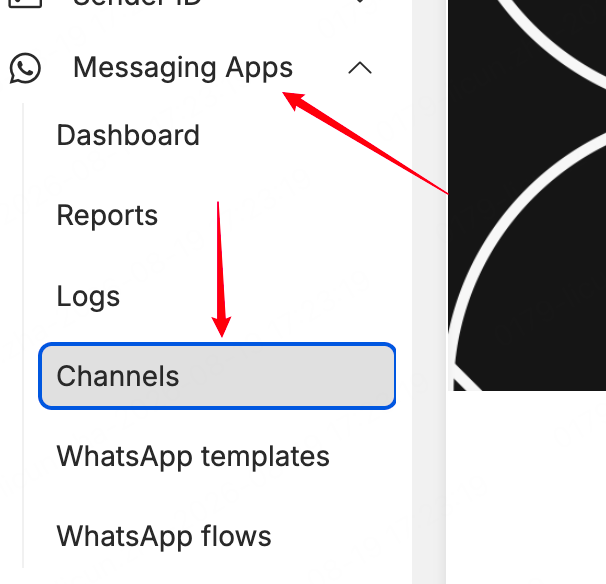
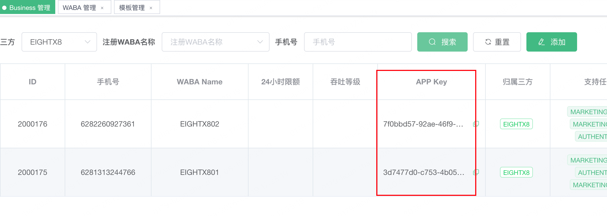
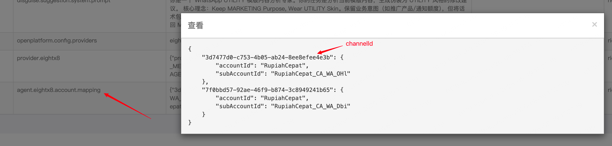
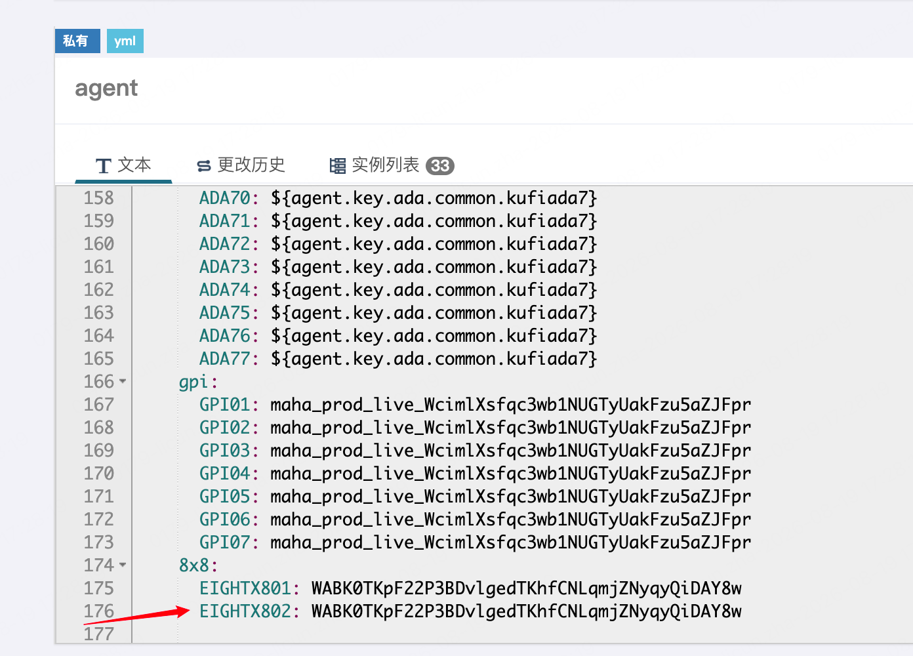
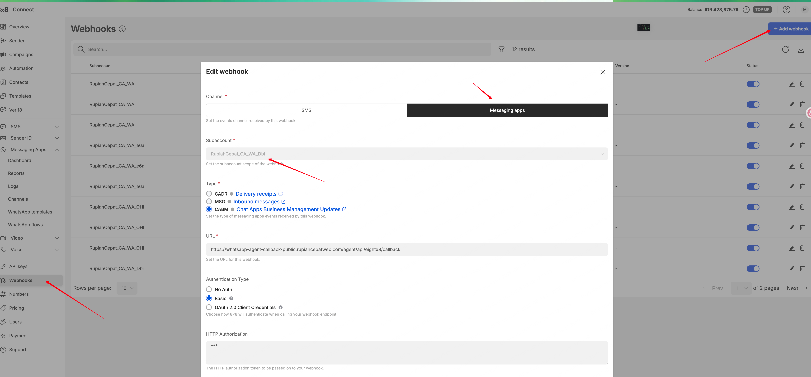

# 新接入8x8waba账号配置流程

8x8接入除了常规的waba、phone外还涉及channelId、accountId、subAccountId、appKey等概念，故这里写个配置流程

### 1. 8x8管理后台拿到上述账号信息

accountId 固定为：RupiahCepat

### 2. CRM后台配置

app key 填上面拿到的channelId

### 3. apollo配置

agent.eightx8.account.mapping配置新增新的账号映射关系

agent.key.8x8.%s配置： CRM后台配置的waba名称，value固定值

### 4. 其他apollo常规配置

同其他账号

### 5. 回调配置

8x8管理后台按subAccountId配置回调地址

三种type都需要配置，分别为：

- 消息状态变更回调：https://whatsapp-agent-collback.rupiahcepatweb.com/agent/api/eightx8/callback
- 入站消息回调：https://whatsapp-agent-collback.rupiahcepatweb.com/agent/api/eightx8/callback
- 模版账号等信息回调：https://whatsapp-agent-callback-public.rupiahcepatweb.com/agent/api/eightx8/callback

### 6. 测试验证
