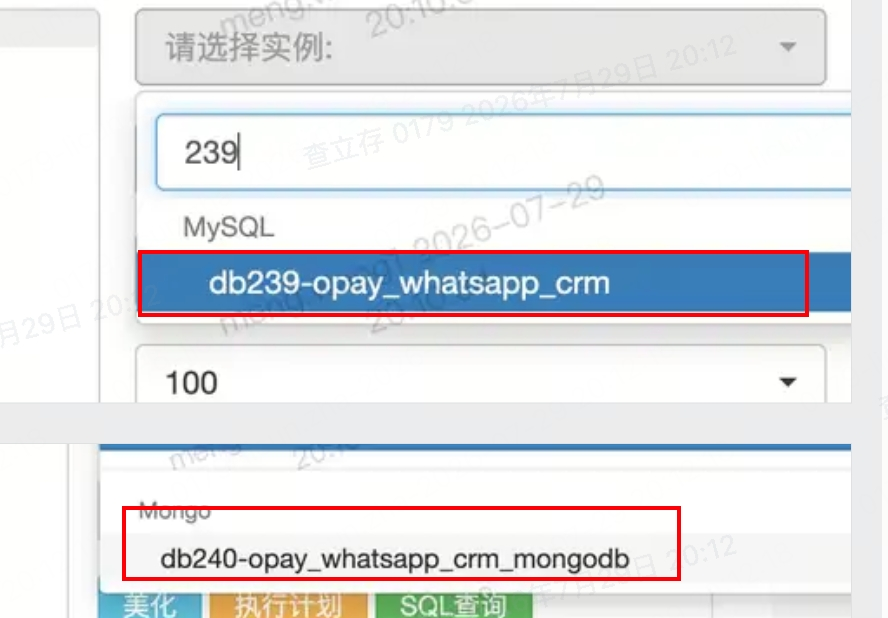

# 0714-环境信息

# 印尼

1. 平台地址：
   1. 测试环境：https://indonesia-whatapp-crm-test.rupiahcepatweb.com/?ticket=42301be6e8c9437d853bec01bf372215#/templates/index
   2. 生产环境：https://indonesia-whatsapp-crm.rupiahcepatweb.com/?ticket=320d5f4e7026452baad9d9161b7dc35b#/waba-account
2. 璇玑：https://indonesia-whatapp-crm-monitor.rupiahcepatweb.com/#/monitor/index
3. grafa:
   1. 印尼：https://grafana.rupiahcepatweb.com/login  admin QNbJYtjCw5fHdHLK
   2. 尼日：https://m.opaydev.com/d/7eoV7C2Dk/ni-ri-whatsappxiao-xi-ping-tai?orgId=1
4. 阿波罗配置：
   1. 测试环境：http://config-id-loan-test.opayweb.com:8070/index.html
   2. 生产环境：https://config-id-loan-hw-prod.rupiahcepatweb.com/config.html?#/appid=whatsapp-crm
5. 日志：https://log.rupiahcepatweb.com/app/discover#/?_g=(filters:!(),refreshInterval:(pause:!t,value:0),time:(from:now-9h,to:now))&_a=(columns:!(_source),filters:!(),index:'01267340-c9eb-11f0-afd7-3f1d4c29bfc4',interval:auto,query:(language:kuery,query:''),sort:!())
6. 数据库配置：
   1. 测试环境：
   2. 生产环境：https://dbs.rupiahcepatweb.com/queryapplylist/
7. 私服账号：https://repo.opayweb.com/repository/maven-releases/
8. 服务部署：https://id-c-deploy.rupiahcepatweb.com/#/dashboard
   - 后端测试test3 线上master
   - 后端：idn-center-occ-whatsapp-crm-xxxxx
   - indonesia-whatapp-crm-test CRM前端 分支dev
   - indonesia-whatapp-crm-prod CRM前端 分支master
9. 代码仓：
   1. 前端：https://git.opaydev.com/whatsapp/h5/whatsapp-crm
   2. 后端：https://git.opaydev.com/occ/proxy/whatsapp_crm
10. 服务器问题排查：arthas
   1. https://arthas.aliyun.com/doc/quick-start.html
11. job:
   1. 测试环境：https://job-test.rupiahcepatweb.com/xxl-job-admin/toLogin.
      ```text
      admin sM$y$BU5Np2TRedY
      ```
   2. 生产环境：https://job-indonesia.rupiahcepatweb.com/xxl-job-admin/joblog?jobId=141
      1. loan2     ^loan2@456$

# 尼日

1. 服务部署：https://aiops.opayweb.com/?ticket=d5ada5ee5685416098c7bd0b8658aeee#/application/index
2. 尼日部署文档：
   1. 测试：
   2. 生产：
3. 监控：https://m.opaydev.com/d/7eoV7C2Dk/ni-ri-whatsappxiao-xi-ping-tai?orgId=1
4. CRM平台-生产：
   1. OK CRM：https://ng-whatsapp-okash-center.risk.o-kash.com
   2. EM CRM：https://ng-whatsapp-em-center.easemoni.com
   3. Opay CRM:https://whatsapp-opay-center.opayweb.com/
5. CRM平台-测试：
   1. OK CRM：https://hw-ng-xd-test-h5-whatsapp-okash.frontends.opayweb.com/
   2. EM CRM：https://hw-ng-xd-test-h5-whatsapp-em.frontends.opayweb.com/
   3. Opay CRM：https://hw-test-h5-whatsapp-opay.frontends.opayweb.com/#/material-templates/index
6. 璇玑：
   1. OK：http://ng-whatsapp-okash-monitor.risk.o-kash.com/#/monitor/index
   2. EM: https://ng-whatsapp-em-monitor.easemoni.com/#/monitor/index
   3. OPay: https://whatsapp-opay-monitor.opayweb.com/#/monitor/index
7. apollo-测试：
   1. EM: https://apollo-mp.em.ng.fg-example.com/    apollo/Dz4Tca4z7SzxnJ2j
   2. OK：https://apollo-mp.okash.ng.fg-example.com/   apollo/Dz4Tca4z7SzxnJ2j
   3. OPay: https://config-hw-test.opayweb.com/config.html?#/appid=whatsapp-crm-api-opay
8. apollo-生产：
   1. 钱包：https://config.opayweb.com/#/appid=whatsapp-crm-api-opay
   2. EM&OK：https://config-ng-loan-prod.opayweb.com/
9. job-测试：(需要绑host：203.123.85.69 job-ng-risk.br-easeml.com)
   1. EM： http://110.238.72.134:8080/xxl-job-admin/jobinfo?jobGroup=9
   2. OK: http://110.238.72.134:8080/xxl-job-admin/jobinfo?jobGroup=9
   3. OPay: https://job-hw-test.opayweb.com/job-admin/jobinfo?jobGroup=435
10. job-生产：(需要绑host：203.123.85.69 job-ng-risk.br-easeml.com)
   1. EM: https://job-ng-risk.br-easeml.com/xxl-job-admin/jobinfo?jobGroup=10  admin/9fsvDq#Mun*uh#@C
   2. OK: https://job-ng-risk.br-easeml.com/xxl-job-admin/jobinfo?jobGroup=10  admin/9fsvDq#Mun*uh#@C
   3. OPay: https://job.opayweb.com/job-admin/jobinfo 飞书域账号
11. ELK日志： licun.zha
   1. OK：https://kibana-ng.i.o-kash.com/s/ng-ok/app/discover#/?_g=(filters:!(),refreshInterval:(pause:!t,value:0),time:(from:now-15m,to:now))&_a=(columns:!(),filters:!(),index:'4720a570-747a-11f1-a350-57e60bee5aa5',interval:auto,query:(language:kuery,query:''),sort:!(!('@timestamp',desc)))
   2. EM: https://kibana-ng.i.o-kash.com/s/ng-em/app/discover#/?_g=(filters:!(),refreshInterval:(pause:!t,value:0),time:(from:now-15m,to:now))&_a=(columns:!(),filters:!(),index:f3bfaa30-74f5-11f1-a350-57e60bee5aa5,interval:auto,query:(language:kuery,query:''),sort:!(!('@timestamp',desc)))
   3. Opay:  https://hw-app-es.opaydev.com/      es-user   /   l)SB77Bc1V8'49cL
12. MySQL-测试：
    ```text
    OK环境
    主库 10.220.2.99
    新库名称 whatsapp_crm
    字符集 utf8mb4
    新建账号 service
    访问权限 whatsapp_crm 数据库所有权限
    密码 id2kgDcNXZ
    本地连接
    159.138.174.6
    service_occ_task_gateway / Service_occ_task_gateway1
    EM环境
    主库 10.220.0.128
    新库名称 whatsapp_crm
    字符集 utf8mb4
    新建账号 service
    访问权限 whatsapp_crm 数据库所有权限
    密码 id2kgDcNXZ
    本地连接
    110.238.77.34
    service_occ_task_gateway / Service_occ_task_gateway1
    本地连接：新
    159.138.165.0:2883
    账号：whats_app_dev@loan_collection#ng_loan_public_test
    密码：Jzzv5qvvc8YR
    Opay:
    主库 172.16.22.231:3306
    新库名称 whatsapp_crm
    字符集 utf8mb4
    用户名：rootadmin
    密码：jARmmidminNr0Zusermte
    本地连接
    182.160.17.58
    用户名密码同上
    ```
13. MySQL-生产：
    1、[https://dbs.opaymfb.com/sqlquery/](https://dbs.opaymfb.com/sqlquery/)   EM&OK
    
    2、[https://dbs.opayweb.com/sqlworkflow/](https://dbs.opayweb.com/sqlworkflow/)   OPay
    
   1.

# 开发

1. 分支管理模式
   1. 开发、测试(test3)、上线分支(master)等

# 
