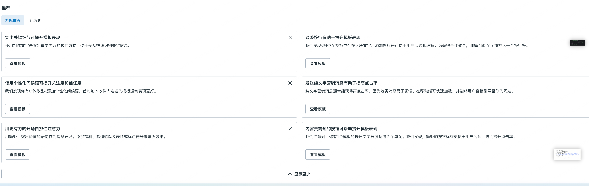
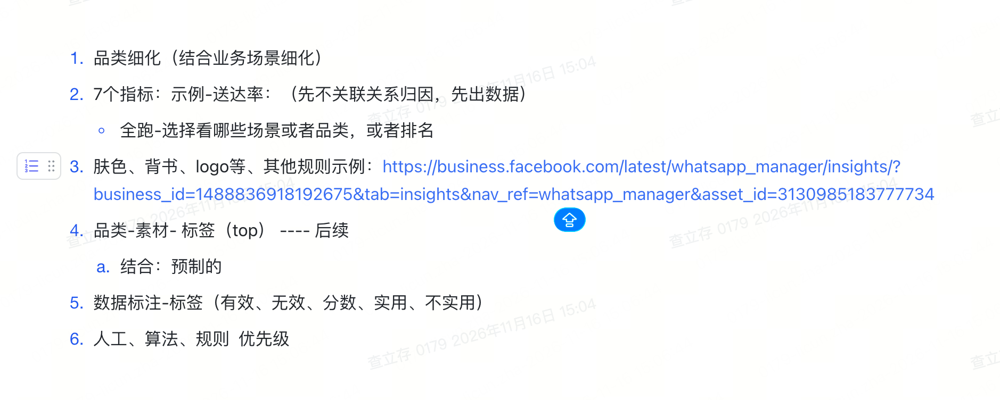
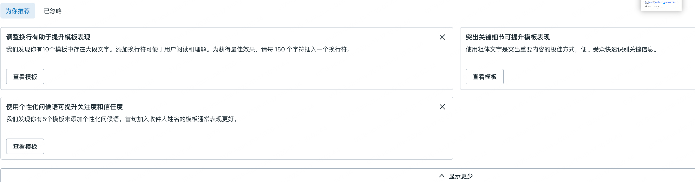

# 内容画像

- 品类：内容画像，是在现在已有场景维度基础上，更聚焦细节的场景用途画像，单选
   - 组合会在该维度下进行生成
   - 示例：
      - 快速放款卖点推广（ast-loan-disbursement-promotion）
      - 额度即将失效提醒（credit-limit-expiry-warning）
         - 行动:查看额度详情action:check-credit-limit-details
      - 免息权益尚未使用提醒（unused-interest-free-benefit-reminder）
         - 7天免息等
- 标签：更精细粒度的特征标签
   - 示例：
- 目的：
   - 添加内容画像能力，根据发送表现等，后续用于AI内容优化、归因分析等
   -
   - 建立从“素材内容识别、品类和标签归类”到“实际投放效果反馈”的闭环，帮助用户：
      - 了解不同内容类型的实际投放表现；
      - 对比同一品类下不同素材组合模板的效果；
      - 结合历史数据选择和优化后续素材；

[20261110_运营素材品类与标签细化方案_线上全量复查版](https://q6oisf77xb.feishu.cn/wiki/Rx9fwu8EuivtAskBunlc5280nef)

