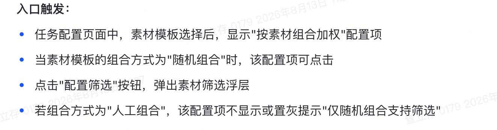
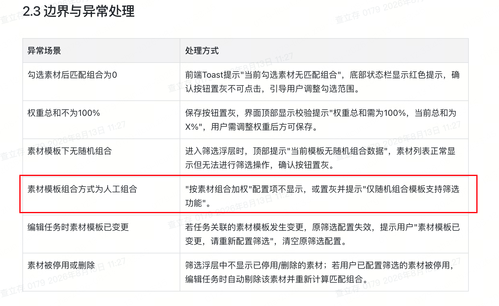
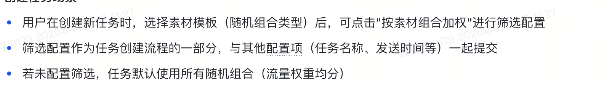
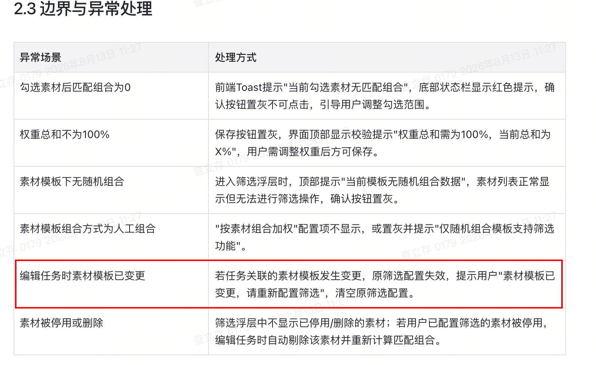
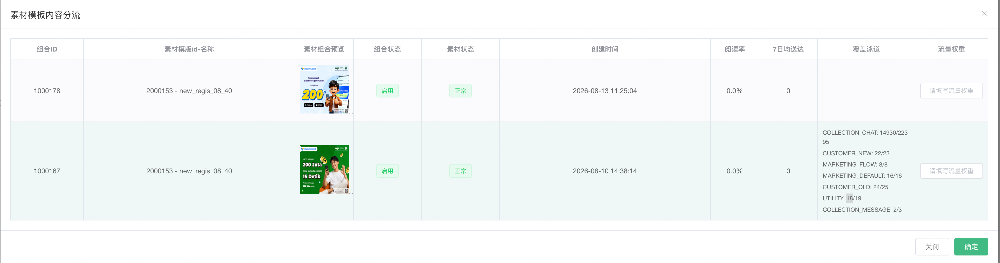

# 0720-素材模版筛选保留

[PRD：素材模板筛选保留功能](https://q6oisf77xb.feishu.cn/docx/NNgsdjBA2oSdpPxE22Oc2bbknQg)

feature/zlc/0813-material-customer-group

# 问题记录

1. 当前页面分流逻辑【随机分流/按素材组合加权】可选项是否和素材模版中【素材组合方式】有关
   1. 待梳理代码
2. 【任务配置】页面选择【随机分流】时，才支持【按素材组合加权】配置项？这是命名冲突？
   
3. 第4点是指哪个组合方式？素材模版的还是群发任务的？ 关联第一点问题
   
   
4. 创建任务一起提交，还是组合的问题，组合是否已经入库完成，关联问题1
   
5. 这点如何处理
   

## 数据参考




admin/api/material/combination/findTaskCombinationInfo?taskId=2000286&materialGroupId=2000153

```JSON
{
    "code": 200,
    "data": [
        {
            "id": 1000178,
            "materialGroupId": 2000153,
            "materialGroupName": "new_regis_08_40",
            "headerMaterialId": "6a7d3910ccd9c756c9b9b1b8",
            "bodyMaterialId": "6a7971d6e52dc342496be044",
            "footerMaterialId": "6a7971d6e52dc342496be045",
            "buttonsMaterialId": "6a7971d6e52dc342496be046",
            "status": "ACTIVE",
            "materialStatus": "NORMAL",
            "creator": "cindy.valensia",
            "updater": "cindy.valensia",
            "ctime": 1786591504878,
            "utime": 1786591504878,
            "headerMaterial": {
                "id": "6a7d3910ccd9c756c9b9b1b8",
                "materialGroupId": 2000153,
                "type": "HEADER",
                "subType": "IMAGE",
                "element": {
                    "type": "HEADER",
                    "format": "IMAGE",
                    "example": {
                        "custom_header_handle_url": "https://chattersquirrel.rupiahcepatweb.com/media/uploads/20260813102347/960_720-10.png"
                    },
                    "add_security_recommendation": false
                },
                "status": "ACTIVE"
            },
            "bodyMaterial": {
                "id": "6a7971d6e52dc342496be044",
                "materialGroupId": 2000153,
                "type": "BODY",
                "subType": "TEXT",
                "element": {
                    "type": "BODY",
                    "text": "\uD83D\uDCE2 Pemberitahuan Status Kredit Akun. \nBerdasarkan hasil evaluasi sistem, status kredit Anda diperbarui dengan potensi limit awal hingga 200juta dan memperoleh akses pemrosesan pencairan mulai dari 15 detik.\n\nDetail lebih lanjut tersedia pada aplikasi.",
                    "add_security_recommendation": false
                },
                "status": "ACTIVE"
            },
            "footerMaterial": {
                "id": "6a7971d6e52dc342496be045",
                "materialGroupId": 2000153,
                "type": "FOOTER",
                "subType": "TEXT",
                "element": {
                    "type": "FOOTER",
                    "text": "RupiahCepat",
                    "add_security_recommendation": false
                },
                "status": "ACTIVE"
            },
            "buttonsMaterial": {
                "id": "6a7971d6e52dc342496be046",
                "materialGroupId": 2000153,
                "type": "BUTTONS",
                "subType": "TEXT",
                "element": {
                    "type": "BUTTONS",
                    "buttons": [
                        {
                            "type": "URL",
                            "text": "Periksa Detail Saldo",
                            "url": "https://rcrating.onelink.me/6kIJ/iyxe217r",
                            "link_type": "dynamic",
                            "dynamic_type": "DynamicLinkTrackableForEveryUserClick"
                        }
                    ],
                    "add_security_recommendation": false
                },
                "status": "ACTIVE"
            },
            "readRate": "0.0%",
            "avg7dDeliveredCount": 0.0,
            "laneCodeTemplateCount": {}
        },
        {
            "id": 1000167,
            "materialGroupId": 2000153,
            "materialGroupName": "new_regis_08_40",
            "headerMaterialId": "6a7971d6e52dc342496be043",
            "bodyMaterialId": "6a7971d6e52dc342496be044",
            "footerMaterialId": "6a7971d6e52dc342496be045",
            "buttonsMaterialId": "6a7971d6e52dc342496be046",
            "status": "ACTIVE",
            "materialStatus": "NORMAL",
            "creator": "cindy.valensia",
            "updater": "cindy.valensia",
            "ctime": 1786343894720,
            "utime": 1786343894720,
            "headerMaterial": {
                "id": "6a7971d6e52dc342496be043",
                "materialGroupId": 2000153,
                "type": "HEADER",
                "subType": "IMAGE",
                "element": {
                    "type": "HEADER",
                    "format": "IMAGE",
                    "example": {
                        "custom_header_handle_url": "https://chattersquirrel.rupiahcepatweb.com/media/uploads/20260810133745/960_720-8.png"
                    },
                    "add_security_recommendation": false
                },
                "status": "ACTIVE"
            },
            "bodyMaterial": {
                "id": "6a7971d6e52dc342496be044",
                "materialGroupId": 2000153,
                "type": "BODY",
                "subType": "TEXT",
                "element": {
                    "type": "BODY",
                    "text": "\uD83D\uDCE2 Pemberitahuan Status Kredit Akun. \nBerdasarkan hasil evaluasi sistem, status kredit Anda diperbarui dengan potensi limit awal hingga 200juta dan memperoleh akses pemrosesan pencairan mulai dari 15 detik.\n\nDetail lebih lanjut tersedia pada aplikasi.",
                    "add_security_recommendation": false
                },
                "status": "ACTIVE"
            },
            "footerMaterial": {
                "id": "6a7971d6e52dc342496be045",
                "materialGroupId": 2000153,
                "type": "FOOTER",
                "subType": "TEXT",
                "element": {
                    "type": "FOOTER",
                    "text": "RupiahCepat",
                    "add_security_recommendation": false
                },
                "status": "ACTIVE"
            },
            "buttonsMaterial": {
                "id": "6a7971d6e52dc342496be046",
                "materialGroupId": 2000153,
                "type": "BUTTONS",
                "subType": "TEXT",
                "element": {
                    "type": "BUTTONS",
                    "buttons": [
                        {
                            "type": "URL",
                            "text": "Periksa Detail Saldo",
                            "url": "https://rcrating.onelink.me/6kIJ/iyxe217r",
                            "link_type": "dynamic",
                            "dynamic_type": "DynamicLinkTrackableForEveryUserClick"
                        }
                    ],
                    "add_security_recommendation": false
                },
                "status": "ACTIVE"
            },
            "readRate": "0.0%",
            "avg7dDeliveredCount": 0.0,
            "laneCodeTemplateCount": {
                "COLLECTION_CHAT": {
                    "key": 22395,
                    "value": 14930
                },
                "CUSTOMER_NEW": {
                    "key": 23,
                    "value": 22
                },
                "MARKETING_FLOW": {
                    "key": 8,
                    "value": 8
                },
                "MARKETING_DEFAULT": {
                    "key": 16,
                    "value": 16
                },
                "CUSTOMER_OLD": {
                    "key": 25,
                    "value": 24
                },
                "UTILITY": {
                    "key": 19,
                    "value": 18
                },
                "COLLECTION_MESSAGE": {
                    "key": 3,
                    "value": 2
                }
            }
        }
    ],
    "traceId": "042257a8-fdab-4e83-93c7-5ef6c4014e30",
    "success": true
}
```
