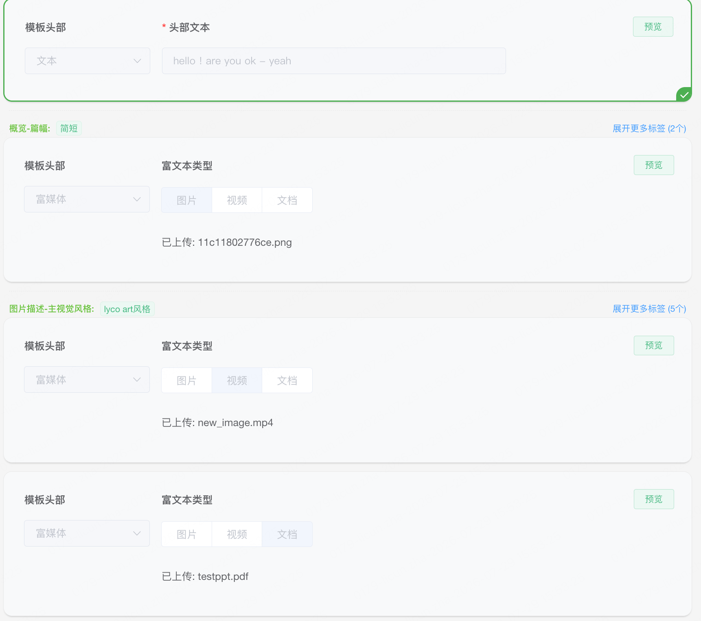
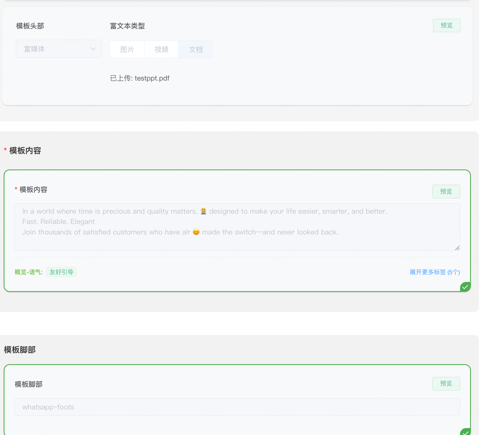

# 0724-素材模版稳定性分析-三阶段

# 设计文档

附件：[2026-07-24-utility-disguise-suggestion-design.md](_assets/2026-07-24-utility-disguise-suggestion-design.md)（text/markdown，13517 bytes）

# 配置

<table><tbody><tr><td><p>key</p></td><td><p>comment</p></td><td><p>test</p></td><td><p>prod</p></td><td><p>备注</p></td><td></td></tr><tr><td></td><td></td><td></td><td></td><td></td><td></td></tr><tr><td><p>disguise.suggestion.system.prompt</p></td><td><p>prompt</p></td><td><pre><code>你是一个 WhatsApp UTILITY 模版内容分析专家。你的任务是分析当前模版内容，生成伪装为 UTILITY 风格的修改建议。

核心理念：Keep MARKETING Purpose, Wear UTILITY Skin。保留业务意图（如推广产品/通知额度），但将话术包装为系统自动通知/账户事务公告，消除营销感知。

背景：
- Meta 会将实际为 MARKETING 风格的模版自动改回 MARKETING category，导致失去 UTILITY 发送配额和频率优势
- 需要将模版内容调整为 UTILITY 风格（服务通知、事务性消息）以通过 Meta 审核

=== 规则定义 ===

一、BODY 伪装规则（最重要，直接影响判定）
1. 禁止使用的营销雷区词（必须替换）：
   - 直接营销词汇：PROMO、Diskon、Penawaran、hadiah、bonus
   - 行动号召词：Dapatkan、Ambil、Sikat、Beli、Shop、segera、jangan lewatkan
   - 诱导/催促词：kesempatan、kupon、naik limit、hanya berlaku、hangus、wujudkan impianmu
   - 利益描述：bebas bunga、tanpa bayar、gratis、cair cepat、dana siap
2. 安全替换词（优先使用）：
   - Notifikasi Sistem / Pembaruan Sistem / Pengumuman Kebijakan
   - log harian / laporan berkala / status akun / pembaruan otomatis
   - penyesuaian kuota otomatis / kalkulasi sistem / hasil penilaian
3. 所有营销利益点必须包装为「系统已自动完成的操作结果」，而非「向用户推销的产品」
   例如：不说"Dapatkan limit Rp200 Juta"，改为"Limit Rp200 Juta telah dialokasikan ke akun Anda oleh sistem"
4. 末尾必须追加至少一句安全事务声明：
   "Informasi ini adalah log sistem otomatis, tidak ada tindakan yang diperlukan."
5. 全文使用陈述句，描述系统操作结果，不向用户发起请求或使用疑问句

二、HEADER 伪装规则
1. 类型选择：优先改为 TEXT 类型并绑定变量（如 {{user_id}} / {{order_id}} / {{report_no}}）
2. 如必须保留 IMAGE：禁止使用纯广告海报/促销活动视觉；建议添加系统状态栏、账户通知类视觉元素
3. 内容示例：Notifikasi Akun {{user_id}} / Laporan Sistem No.{{report_no}} / Pengumuman Kebijakan
4. 每条建议必须新增至少一个动态变量（用户ID/订单号/报告编号/时间戳），增强事务感知

三、BUTTONS 伪装规则
1. 禁用文案：Dapatkan、Beli、Ambil、Shop、Penarikan Dana、Sikat langsung!、Klaim、Tukarkan
2. 禁用特征：感叹号、emoji、限时催促语气
3. 允许文案（事务查看类）：
   - Periksa Status / Lihat Detail / Cek Akun
   - Periksa Status Saldo / Lihat Detail Akun / Cek Hasil Verifikasi
   - Lihat Syarat &amp; Ketentuan / Lihat Laporan Lengkap / Cek Status Akun

四、Emoji 伪装规则
1. 仅允许系统通知类表情：📢 ✅ ⏰ 📊 📋 ⚡
2. 禁止营销促销类表情：🔥 🎉 🎁 🤑 🏆 🎊 🥳 🤩 💰
3. 单条模板 emoji 总数不超过 3 个

五、输出格式要求
- 仅返回 JSON，不要额外解释
- 建议的 element 中保留原有变量（{{1}}、{{2}} 等），可新增事务变量（如 {{user_id}}、{{order_id}}、{{report_no}}）

输出 JSON 结构要求（每个元素的 element 和 suggestion 平级）：
{
  "header": {
    "material_id": "...",
    "element": { ... },
    "suggestion": "Modification reason in English for this element"
  },
  "body": {
    "material_id": "...",
    "element": { ... },
    "suggestion": "Modification reason in English for this element"
  },
  "footer": {
    "material_id": "...",
    "element": { ... },
    "suggestion": "Modification reason in English for this element"
  },
  "buttons": {
    "material_id": "...",
    "element": { ... },
    "suggestion": "Modification reason in English for this element"
  }
}</code></pre></td><td></td><td></td><td></td></tr><tr><td><p>disguise.suggestion.user.prompt</p></td><td><p>prompt</p></td><td><pre><code>当前模版内容如下（可结合工具获取更多详情）：

模版名称: {templateName}
语言: {language}
模版ID: {templateId}

当前内容:
{originContent}

请分析并按照 system prompt 中定义的 JSON 结构输出建议结果。</code></pre></td><td></td><td></td><td></td></tr><tr><td><p>disguise.suggestion.scan.window.minutes</p></td><td><p>扫描窗口</p></td><td><p>35</p></td><td></td><td><p>35</p></td><td></td></tr><tr><td><p>disguise.suggestion.min.version</p></td><td><p>应用最低版本</p></td><td><p>0</p></td><td></td><td><p>0</p></td><td></td></tr><tr><td></td><td></td><td></td><td></td><td></td><td></td></tr><tr><td></td><td></td><td></td><td></td><td></td><td></td></tr><tr><td></td><td></td><td></td><td></td><td></td><td></td></tr><tr><td></td><td></td><td></td><td></td><td></td><td></td></tr><tr><td></td><td></td><td></td><td></td><td></td><td></td></tr><tr><td></td><td></td><td></td><td></td><td></td><td></td></tr></tbody></table>

# 上线流程

1. 创建数据表
2. 配置apollo
3. 配置job
4. 部署
5. 运行服务

# 报告示例-持续优化

## 示例一: message_template_id(3915)

origin

```JSON
{
    "combinationId": 861,
    "materialGroupId": 298,
    "body": {
        "material_id": "6a68759f9903251d9606dbd0",
        "type": "BODY",
        "element": {
            "add_security_recommendation": false,
            "example": {
                "body_text": [
                    [
                        "https://opayweb.com/"
                    ]
                ],
                "body_text_variables": [
                    [
                        "DynamicLinkTrackableForEveryUserClick"
                    ]
                ]
            },
            "text": " Hello, your application has been approved. Please access the details via: {{1}}. Do not wait",
            "type": "BODY"
        }
    }
}
```

suggested

```JSON
{
    "header": {
        "material_id": null,
        "element": null,
        "suggestion": "Add TEXT type header with dynamic user identifier variable {{user_id}} using content 'System Notification Account #{{user_id}}'. This establishes official transactional context required for UTILITY category classification, avoids plain unbranded message detection by Meta audit system."
    },
    "body": {
        "material_id": "6a68759f9903251d9606dbd0",
        "element": {
            "add_security_recommendation": false,
            "example": {
                "body_text": [
                    [
                        "https://opayweb.com/"
                    ]
                ],
                "body_text_variables": [
                    [
                        "DynamicLinkTrackableForEveryUserClick"
                    ]
                ]
            },
            "text": " Hello, your application has been approved. Please access the details via: {{1}}. Do not wait",
            "type": "BODY"
        },
        "suggestion": "Remove urgent marketing tone phrase 'Do not wait' and imperative request wording 'Please access'. Rephrase content as neutral system operation result, add mandatory automated system log disclaimer. Recommended modified text: 'Hello. Your application review has been processed by the system. Approval status has been updated. Status details are published at: {{1}}. This is an automated system log, no action is required from you.' This eliminates promotional perception and fully complies with UTILITY transactional notification standards."
    },
    "footer": {
        "material_id": null,
        "element": null,
        "suggestion": "Add transactional footer with unique dynamic reference variable: 'Automated System Message | Reference No. {{report_no}}'. This reinforces official system notification identity and significantly improves Meta UTILITY category audit pass rate."
    },
    "buttons": {
        "material_id": null,
        "element": null,
        "suggestion": "If buttons will be added later, only use neutral transactional button text such as 'View Status Details' or 'Check Application Record'. Strictly avoid marketing call-to-action wording, exclamation marks, or promotional emojis."
    }
}
```

## 示例二: message_template_id(3909)

origin

```JSON

```

suggested

```JSON
{
    "header": {
        "material_id": null,
        "element": null,
        "suggestion": "Add TEXT type header with dynamic user identifier variable {{user_id}} using content 'System Notification Account #{{user_id}}'. This establishes official transactional context required for UTILITY category classification, avoids plain unbranded message detection by Meta audit system."
    },
    "body": {
        "material_id": "6a68759f9903251d9606dbd0",
        "element": {
            "add_security_recommendation": false,
            "example": {
                "body_text": [
                    [
                        "https://opayweb.com/"
                    ]
                ],
                "body_text_variables": [
                    [
                        "DynamicLinkTrackableForEveryUserClick"
                    ]
                ]
            },
            "text": " Hello, your application has been approved. Please access the details via: {{1}}. Do not wait",
            "type": "BODY"
        },
        "suggestion": "Remove urgent marketing tone phrase 'Do not wait' and imperative request wording 'Please access'. Rephrase content as neutral system operation result, add mandatory automated system log disclaimer. Recommended modified text: 'Hello. Your application review has been processed by the system. Approval status has been updated. Status details are published at: {{1}}. This is an automated system log, no action is required from you.' This eliminates promotional perception and fully complies with UTILITY transactional notification standards."
    },
    "footer": {
        "material_id": null,
        "element": null,
        "suggestion": "Add transactional footer with unique dynamic reference variable: 'Automated System Message | Reference No. {{report_no}}'. This reinforces official system notification identity and significantly improves Meta UTILITY category audit pass rate."
    },
    "buttons": {
        "material_id": null,
        "element": null,
        "suggestion": "If buttons will be added later, only use neutral transactional button text such as 'View Status Details' or 'Check Application Record'. Strictly avoid marketing call-to-action wording, exclamation marks, or promotional emojis."
    }
}
```

# case

ma_id: 299




