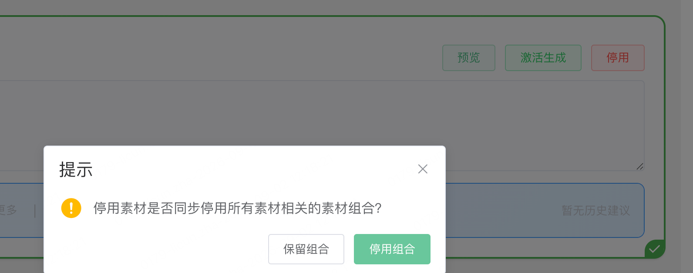
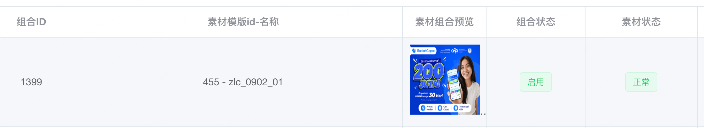
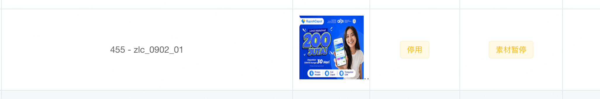

# 启停联动

- 素材模版启用接口：admin/api/material/enable
- 素材模版停用接口：admin/api/material/disable
- 素材模版中指定元素停止生成/激活生成（素材模版更新时触发）：admin/api/material/update  （status字段）
- 素材模板中指定元素停用按钮：admin/api/material/update
   - 页面操作：
     
   - 停用-停用组合参数：
     ```JSON
     {
         "name": "zlc_0902_01",
         "templateType": "MARKETING",
         "language": "id",
         "laneConfigList":
         [
             {
                 "sourceLane": "CUSTOMER_NEW",
                 "estimatedSendCount": 1
             }
         ],
         "combinationMode": "RANDOM",
         "headerList":
         [
             {
                 "status": "ACTIVE",
                 "type": "HEADER",
                 "subType": "TEXT",
                 "id": "6a978982d080f910d544d884",
                 "element":
                 {
                     "type": "HEADER",
                     "format": "TEXT",
                     "text": "head1"
                 }
             },
             {
                 "status": "ACTIVE",
                 "type": "HEADER",
                 "subType": "IMAGE",
                 "id": "6a978982d080f910d544d885",
                 "element":
                 {
                     "format": "IMAGE",
                     "type": "HEADER",
                     "example":
                     {
                         "custom_header_handle_url": "https://whatsapp-crm-test.rupiahcepatweb.com/media/uploads/20260902092626/material-test.png"
                     }
                 }
             }
         ],
         "bodyList":
         [
             {
                 "id": "6a978982d080f910d544d886",
                 "status": "DELETED",
                 "confirmDisableCombination": true
             },
             {
                 "type": "BODY",
                 "subType": "TEXT",
                 "id": "6a978a09d080f910d544d88e",
                 "status": "ACTIVE",
                 "element":
                 {
                     "type": "BODY",
                     "text": "body2"
                 },
                 "clientMaterialKey": "ee9e0687-dcab-4ac8-b5ee-4804ab35b3a6"
             },
             {
                 "type": "BODY",
                 "subType": "TEXT",
                 "id": "6a978a09d080f910d544d88f",
                 "status": "ACTIVE",
                 "element":
                 {
                     "type": "BODY",
                     "text": "body3"
                 },
                 "clientMaterialKey": "10c1828c-a1de-453e-bd64-793041615533"
             }
         ],
         "footerList":
         [
             {
                 "type": "FOOTER",
                 "subType": "TEXT",
                 "id": "6a978982d080f910d544d887",
                 "status": "ACTIVE",
                 "element":
                 {
                     "type": "FOOTER",
                     "text": "foot1"
                 }
             }
         ],
         "buttons":
         {
             "type": "BUTTONS",
             "subType": "TEXT",
             "id": "6a978982d080f910d544d888",
             "element":
             {
                 "type": "BUTTONS",
                 "buttons":
                 [
                     {
                         "type": "URL",
                         "text": "click",
                         "url": "https://tools.gzyunke.cn/json.html",
                         "link_type": "dynamic",
                         "dynamic_type": "DynamicLinkTrackableForEveryUserClick"
                     }
                 ]
             }
         },
         "id": 455
     }
     ```
- 素材组合页面停用接口：admin/api/material/combination/deactivate
- 素材组合页面启用接口：admin/api/material/combination/activate
   - 启用一：
     
   - 启用二：
     
- 素材模版编辑中素材组合的启停：
  ```JSON
  {
      "name": "zlc_0902_02",
      "templateType": "MARKETING",
      "language": "id",
      "laneConfigList":
      [
          {
              "sourceLane": "CUSTOMER_NEW",
              "estimatedSendCount": 1
          }
      ],
      "combinationMode": "MANUAL",
      "headerList":
      [],
      "bodyList":
      [
          {
              "type": "BODY",
              "subType": "TEXT",
              "id": "6a97c18134efe75efe2eef37",
              "status": "ACTIVE",
              "element":
              {
                  "type": "BODY",
                  "text": "body1"
              },
              "clientMaterialKey": "88a47a1c-7fbb-42a4-87cc-7ae2fd9274ae"
          },
          {
              "type": "BODY",
              "subType": "TEXT",
              "id": "6a97c18134efe75efe2eef38",
              "status": "ACTIVE",
              "element":
              {
                  "type": "BODY",
                  "text": "body2"
              },
              "clientMaterialKey": "d0ef5d06-7b17-4aae-bb11-f8aaf06c6e2e"
          }
      ],
      "footerList":
      [],
      "manualCombinations":
      [
          {
              "headerMaterialRef": null,
              "bodyMaterialRef": "6a97c18134efe75efe2eef37",
              "footerMaterialRef": null,
              "buttonsMaterialRef": null,
              "id": 1413,
              "status": "INACTIVE"
          }
      ],
      "id": 459
  }
  ```

1. 点击更多默认勾选拒绝改为默认不勾选拒绝，同步修改提交卡控文案
2. 变量规则校验（校验不通过按生成失败算)
   1. 变量个数、变量名称（实际{{1}}、{{2}}、{{3}}  ）校验和原内容是否一致
   2. 变量内容，根据AI理解
3. AI素材模版-编辑-功能先禁用
4. 取消勾选接受，关联AI备用素材模版中该素材按照【停止生成】处理，停用不能恢复

# 问题

期间调用了两个接口：第一个接口响应后调用的第二个接口

1. admin/api/ai-suggestion/batchGenerate
   1. 参数：{"materialGroupId":483,"suggestType":"AI_BACKUP_MATERIAL_GROUP","materialType":"BODY","language":"en_US","sourceLanes":[],"materialContents":[{"clientMaterialKey":"b7190d40-fa6a-464c-b2d8-857b01d496f9","content":"body1","lastSuggestedContent":"","userFeedback":"","suggestionId":360,"status":"APPLIED_TO_AI_BACKUP"},{"clientMaterialKey":"0b37c386-b307-4592-92d8-8cf7e40e136f","content":"body2","lastSuggestedContent":"","userFeedback":"","suggestionId":null,"status":"ACCEPTED_FOR_AI_BACKUP"}]}
2. 接口：admin/api/material/update
   1. 参数：{"name":"zlc_0903_10","templateType":"MARKETING","language":"en_US","laneConfigList":[{"sourceLane":"CUSTOMER_NEW","estimatedSendCount":1}],"combinationMode":"RANDOM","headerList":[],"bodyList":[{"type":"BODY","subType":"TEXT","id":"6a99170a517b8d3b4fb3f8a6","status":"ACTIVE","element":{"type":"BODY","text":"body1"},"clientMaterialKey":"b7190d40-fa6a-464c-b2d8-857b01d496f9"},{"type":"BODY","subType":"TEXT","id":"","status":"ACTIVE","element":{"type":"BODY","text":"body2"},"clientMaterialKey":"0b37c386-b307-4592-92d8-8cf7e40e136f"}],"footerList":[],"carouselBodyList":[],"cardIds":[],"id":483}

```JSON
整体review代码逻辑，
总体原则：
1. 各个接口或者内部操作不影响主用素材模版以及相关组合、素材等
2. 在主用素材模版上勾选接受的，备用素材模版上才能使用，不接受的在备用素材模版上不能使用
3. 主用素材模版上停止生成或者停用的，备用素材模版上状态应该一致
统一概念：
1. message_material_group表：素材模版
2. message_material_combination表：素材组合
2. message_material表：素材
```
