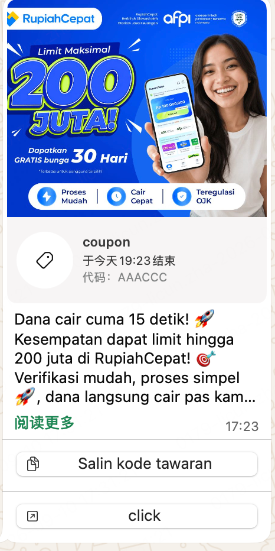
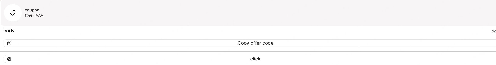
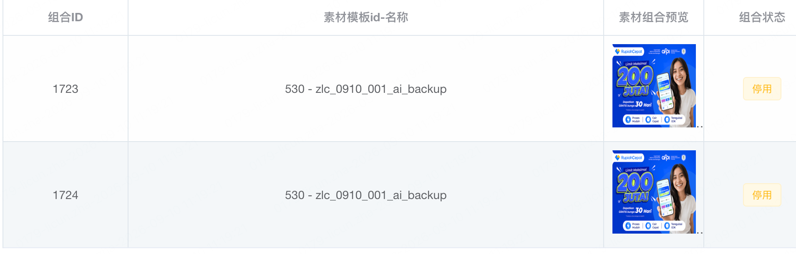

# todo-lto

1. AI备用素材模板，LTO类型模板无法支持AI备用素材模板，因为LTO模板必须是MARKETING类型
   1. 去掉LTO组合 - done
2. 同步的组合也有问题 - done
   1. 包含LTO的组合也被同步了
3. LTO区域 预览效果
   **〔分栏 1，宽度约 25%〕**
   
   **〔分栏 2，宽度约 27%〕**
   
   **〔分栏 3，宽度约 25%〕**
   
   **〔分栏 4，宽度约 24%〕**
   
   1. 绝对、相对两种模式, 下面第4张实际我设置的是25号4点
4. 创建-素材模板-复制优惠码按钮没有被复制到备用素材模板
   1. 复制了，是因为ADA不支持，页面做了特殊限制不展示
   2.

- 普通模板创建校验foot
   - 有foot时怎么不要LTO区域：不输入优惠文案即可

- 验证没有head是否可以创建LTO类型成功
   - 创建、发送成功

- 按钮校验: todo
   - 设置过期
      - 必须同时有【复制优惠码】、【访问网址】按钮，且顺序固定优惠码第一位，访问网址第二位
         - NX: message: Required Buttons Missing, URL is required at index 1 when Limited Time Offer is present
   - 不设置过期
      - 必须有按钮：访问网址按钮是必须的，复制优惠码按钮非必须，没有复制优惠码按钮时，访问网址按钮要放在第一位；有复制优惠码按钮时，复制优惠码按钮必须第一位，访问网址按钮必须第二位
         - 只有访问网址按钮：优惠码区域显示的是URL内容：zlc_0909_no_expire_3
           
         - 只有优惠码按钮（不行）：Required Buttons Missing, URL is required at index 1 when Limited Time Offer is present
         - 有优惠码、访问网址按钮，显示区域无倒计时：zlc_0909_no_expire_4
           
   - 其他按钮类型？
      - 设置过期：zlc_0910_test_button4   实测加电话排在第三位没有问题
      - 不设置过期：zlc_0910_test_button3   实测加电话排在第三位没有问题

- 普通模板-创建非营销类型
   - 回归正常

- 不支持的通道，会显示创建失败的模板
  
- 模板管理页面默认过期时间
   - 已修改为120分钟

- 创建-素材模板-复制优惠码按钮没有被复制到备用素材模板?
   - 还是页面不展示，有的展示，有的不展示？

- 备用素材同步了两个组合，一个有head、body、foot，一个只有head、body，没有foot
   - done-同步了含lto的组合，但是没有同步lto元素

- ADA 不支持 COPY_CODE 按钮，会返回REJECTED，且会触发META，这个需要处理下
   - done
- 8x8支持COPY_CODE
   - done
