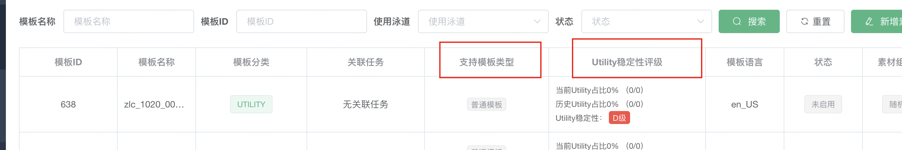
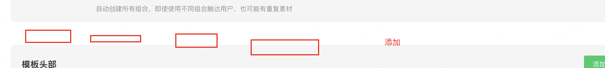
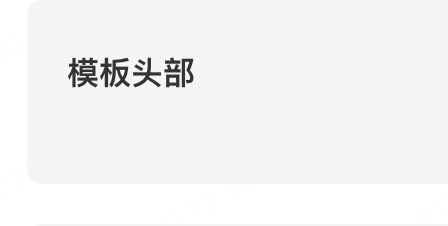

# 1015-模板内容

# todo

1. 前端分支合了环境迁移分支的代码，要处理
2.

# plan

人群大分类：泳道

小分类：画像

1. 模板内容画像：-prd  - category
   - 大分类：RM1 、RM2 - 需要 运营确定  （维度：组合）
      - 营销拉新：A分类
      - 老客留存：B分类
      - 营销拉新-老客留存：A-B分类
      - 配置化（有新的RD来管理入口）
   - 小分类：（非包含关系）(RD定义-根据业务）- tag
      - 组合关联到素材标签（暂不关联）
         - 业务添加（添加一个标签想干啥）
         - 算法分析结果标签： 已有
         - 根据业务规则细分定义：
            - 几段、几个表情、类似
2. 完善分类覆盖：跑数据
3. 数据分析
   1. 分析分类影响效果
   2. 结论
4. 优化AI生成
   1. 生成AI样例参考
   2. 优化AI内容

页面交互、

- 素材关联素材组合
- 素材组合包含稳定性评级
- 折叠展示

数据模型：模型定义

内容管理 -> 点击说明

素材包（原素材模板）一级内容

素材组合模板-二级内容

~~素材管理-三级内容 （目录位置不变，编辑素材包强化显示）~~

渠道模板-素材组合模板渠道副本

素材组合模板ID：类型

稳定性改为组合维度

模板头部-后面添加（经典模板、限时优惠模板共用）

组合-下面-添加不同类型预览区域（写死文档说明图）

预览效果修改：是否符合不同类型模板所有素材要求（前端规则）
