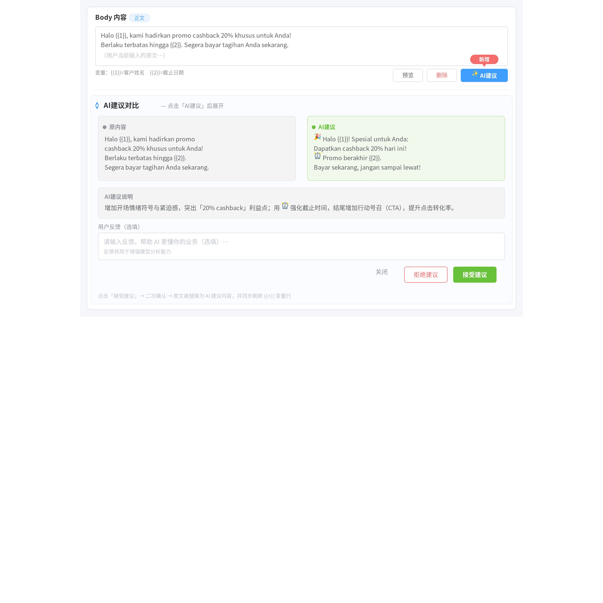

# 20260810_AI建议功能PRD

> 本文档为产品需求文档，不含代码改动。

## 一、文档信息

| 项 | 内容 |
|---|---|
| 文档版本 | v1.1 |
| 日期 | 2026-08-10 |
| 所属模块 | 素材模版管理（material-template） |
| 关联入口 | TemplateAction.vue 新增/编辑弹窗 → Body 元素 |
| 功能范围 | 仅 Body 元素新增「AI建议」功能；Header / Footer / Buttons 不在本期范围 |
| 依赖现状 | 复用 DisguiseSuggestionBar 的展开式交互风格、saveOperateLogAPI 的反馈采集思路 |

## 二、背景与目标

### 2.1 背景

当前「新增素材模版」时，运营人员在 Body 元素的文本框中手动编写文案，缺少实时的 AI 优化引导。系统已有两套相关能力，但均未覆盖 Body「新建态」的实时建议对比与反馈闭环：

- DisguiseSuggestionBar.vue：仅对已保存元素展示「伪装建议」，只读、无接受/拒绝、无反馈采集。
- AiCopyLabDialog.vue：独立的 AI 文案实验室，有生成+评分反馈，但不在素材模版表单内联，且不接受「原内容 vs 建议」对比。

### 2.2 目标

1. 在新建素材模版的 Body 元素按钮组中，于「删除」按钮后新增「AI建议」按钮，提供实时、按需的文案优化建议。
2. 以「原内容 ↔ AI建议」对比形式呈现，降低运营判断成本。
3. 通过「接受建议 / 拒绝建议 + 用户反馈」采集偏好数据，反哺模型分析能力，形成闭环。
4. 接受建议后，将原输入文本一键替换为 AI 建议内容，提升编写效率。

### 2.3 非目标（Out of Scope）

- 不在 Header / Footer / Buttons 元素上添加「AI建议」功能。
- 不改造现有 DisguiseSuggestionBar（已保存元素的只读建议）逻辑。
- 不改造 AiCopyLabDialog 独立文案实验室。
- 不实现建议的批量生成（一次仅针对当前 Body 元素）。

## 三、名词定义

| 术语 | 含义 |
|---|---|
| Body 元素 | 素材模版的正文组成部分，对应 `bodyList[index]` |
| 新建态 Body | `pageType === 'add'`，或 `pageType === 'edit' && !item.id`（编辑模式下新增的未保存 Body） |
| 原内容 | 用户当前在 Body 文本框中输入的文本，即 `bodyList[index].content` |
| AI建议 | 后端大模型针对原内容返回的优化文案 + 说明（note） |
| 反馈 | 用户在接受/拒绝时填写的文字说明，用于增强模型分析能力 |

## 四、用户故事

> 作为一名运营人员，  
> 在新增素材模版、填写 Body 文案时，  
> 我希望能点击「AI建议」查看我的文案与 AI 优化文案的对比，并阅读优化说明，  
> 以便我决定是否接受建议来替换我的文案；  
> 同时，我希望在接受或拒绝时能填写反馈，帮助 AI 越来越懂我们的业务。

## 五、功能范围

### 5.1 触发位置

「AI建议」按钮添加在 Body 元素按钮组 `item-btn-group` 内，紧跟「删除」按钮之后。仅涉及一个组件：

- TemplateContent.vue：文本字段为 bodyList[index].content，「删除」按钮位于该组件的按钮组内。

### 5.2 可见性规则

- 按钮显示条件与「删除」按钮一致：pageType === 'add' 或 pageType === 'edit' && !item.id。
- pageType === 'view' 时不显示。
- 原内容为空时，按钮置灰（disabled），tooltip 提示「请先输入文案」。

## 六、详细功能需求

### 6.1「AI建议」按钮

- 位置：Body 元素 item-btn-group 内，「删除」按钮之后。
- 样式：type="primary" / size="mini" / plain，文案「AI建议」，可带 el-icon-magic-stick 图标以区分。
- 文案走 i18n，新增 key（详见 6.7）。

### 6.2 点击行为 —— 获取建议

1. 点击按钮 → 按钮进入 loading 态。
2. 前端调用新增的 AI 建议接口（接口及参数待定，详见第七节），入参为当前 Body 元素的原内容（及模版基础信息）。
3. 接口返回：建议文案、建议说明（note）、建议唯一标识（suggestionId，用于反馈关联）。
4. 返回后，在当前 Body 元素卡片下方展开「AI建议对比面板」（详见 6.3），按钮恢复常态。
5. 异常处理见第八节。

### 6.3 AI建议对比面板（核心 UI）

面板在 Body 元素卡片内部、按钮组下方展开（参考现有 DisguiseSuggestionBar 的展开式风格，但交互更重）。结构自上而下：

**① 对比区（左右分栏 / 上下两块）**

| 区块 | 内容 | 样式 |
|---|---|---|
| 原内容 | 用户当前输入文本（只读展示） | 灰底 `#f4f4f5` |
| AI建议 | 接口返回的建议文案 | 绿底 `#f0f9eb`，与现有 `--suggested` 风格一致 |
| 差异高亮（可选，P1） | 文案差异处的简易标注 | — |

> 对比区需保留 `white-space: pre-wrap; word-break: break-word;`，与 DisguiseSuggestionBar 内容区一致。

**② AI建议说明**

- 展示接口返回的 note 字段，标题「AI建议说明」，样式参考 DisguiseSuggestionBar 的说明区（#f4f4f5 底）。
- note 为空时该区块不渲染。

**③ 反馈输入框**

- el-inputtype="textarea":rows="2"，placeholder「请输入反馈，帮助 AI 更懂你的业务（选填）」。
- 在接受/拒绝前可填写；为选填项。

**④ 操作按钮区**

- 【接受建议】type="success"：详见 6.4。
- 【拒绝建议】type="danger"plain：详见 6.5。
- 【关闭】text 按钮：收起面板，不提交任何反馈，原内容不变。

### 6.4 接受建议

1. 点击【接受建议】→ 二次确认（el-messagebox.confirm：「确认用 AI 建议内容替换当前文案？」）。
2. 确认后：
   - 将当前 Body 元素文本字段替换为 AI 建议内容：bodyList[index].content = suggestedText。
   - 替换后需同步触发变量解析：复用现有的 syncVariablesFromContent(index)，保证 {{n}} 变量行正确刷新。
   - 通过 $emit('input', list) 将变更同步到父组件 TemplateAction 的 templateForm。
3. 提交反馈（详见 6.6），action = accept。
4. 成功提示，收起面板。

### 6.5 拒绝建议

1. 点击【拒绝建议】→ 不替换原内容。
2. 提交反馈（详见 6.6），action = reject。
3. 成功提示，收起面板，原内容保持不变。

### 6.6 反馈采集（闭环关键）

- 无论接受还是拒绝，均将以下数据提交到反馈接口（接口及参数待定，详见第七节）：
   - suggestionId：建议标识
   - action：accept / reject
   - originalText：原内容
   - suggestedText：AI 建议内容
   - feedback：用户填写反馈（可为空）
   - elementType：BODY
   - materialTemplateId：编辑模式下若有已保存模版 id 则传，新增态传空
- 反馈为异步提交，失败仅 console.error，不阻断主流程（接受/拒绝的本地效果已生效）。

### 6.7 国际化（i18n）

在 lang/zh.js 与 lang/en.js 的 materialTemplate 命名空间新增：

| key | zh | en |
|---|---|---|
| aiSuggestionBtn | AI建议 | AI Suggestion |
| aiSuggestionOriginal | 原内容 | Original |
| aiSuggestionSuggested | AI建议 | AI Suggestion |
| aiSuggestionNote | AI建议说明 | Suggestion Note |
| aiSuggestionFeedbackPlaceholder | 请输入反馈，帮助 AI 更懂你的业务（选填） | Enter feedback to help AI understand your business (optional) |
| aiSuggestionAccept | 接受建议 | Accept |
| aiSuggestionReject | 拒绝建议 | Reject |
| aiSuggestionConfirmAccept | 确认用 AI 建议内容替换当前文案？ | Replace current text with AI suggestion? |
| aiSuggestionEmpty | 请先输入文案 | Please input text first |
| aiSuggestionLoading | AI 正在生成建议... | AI is generating suggestions... |
| aiSuggestionFailed | 获取 AI 建议失败，请稍后重试 | Failed to get AI suggestion, please retry |

## 七、数据流与接口设计（待定）

> 说明：本节涉及的接口路径、请求/响应字段均为待定，需与后端对齐后最终确定。以下为前端建议的字段语义，供后端联调参考。

### 7.1 新增接口：获取 AI 建议（待定）

- 用途：针对 Body 原内容，返回 AI 优化建议文案与说明。
- 建议归属模块：materialRag 或 material/ai（与现有 AI 能力同源）。
- 建议入参（待定）：elementType（固定 BODY）、originalText（原内容）、模版基础信息（如 templateType、language）。
- 建议出参（待定）：suggestionId、suggestedText（建议文案）、note（建议说明）。
- 超时建议：60s（大模型生成较慢，与现有 generateMarketingCopyWritingAPI 一致）。
- 最终接口路径与字段以后端定义为准。

### 7.2 新增接口：提交建议反馈（待定）

- 用途：采集用户接受/拒绝反馈及文字说明，反哺模型分析能力。
- 实现方式二选一（待定）：
   - 方案 A：复用并扩展现有 saveOperateLogAPI，扩展 operateType、suggestionId、originalText、suggestedText、feedback、elementType 等字段。
   - 方案 B：新增独立的反馈接口。
- 建议入参（待定）：suggestionId、action（accept/reject）、originalText、suggestedText、feedback、elementType、materialTemplateId。
- 最终接口路径与字段以后端定义为准。

### 7.3 前端数据流

```
TemplateAction.vue (templateForm, pageType, templateType, language)
        │  props
        ▼
TemplateContent.vue
        │  点击「AI建议」(index)
        │  → 调用获取建议接口(elementType=BODY, originalText, ...)
        │  → 本地展开对比面板 (per-index 状态)
        │  → 接受: 替换 bodyList[index].content + syncVariablesFromContent + $emit('input')
        │  → 接受/拒绝: 调用反馈接口(...)
        ▼
templateForm.bodyList 更新 → 预览组件联动
```

- 对比面板的展开态为 TemplateContent 本地 data（如 suggestionStateByIndex），结构：{ [index]: { loading, suggestionId, suggestedText, note, feedback } }，避免污染父级 form。

## 八、边界与异常处理

| 场景 | 处理 |
|---|---|
| 原内容为空 | 按钮置灰，hover 提示「请先输入文案」 |
| 接口超时/失败 | 面板不展开，message.error「获取 AI 建议失败，请稍后重试」，按钮恢复 |
| AI 建议文本为空 | 视为无建议，面板展示「暂无优化建议」，不显示接受/拒绝 |
| 变量替换冲突 | 接受后由 syncVariablesFromContent 重新解析 {{n}}，若建议文案变量数变化，变量行自动增减（现有逻辑已支持） |
| 字数超限 | AI 建议需遵守 Body maxlength 1024；后端保障，前端接受后不再二次校验长度（与现状一致） |
| 反馈提交失败 | 仅 console.error，不影响本地替换效果 |
| 重复点击 | 按钮加载中 disabled，防重复请求 |
| 关闭面板未操作 | 点【关闭】不提交反馈，原内容不变，可再次点击按钮重新获取 |

## 九、交互流程

```
[Body 元素卡片: 文本框 + 按钮组(预览/删除/AI建议)]
        │ 点击 AI建议 (原内容非空)
        ▼
[按钮 loading] ──调用获取建议接口──▶ [展开对比面板]
                                        │
                      ┌─────────────────┼──────────────────┐
                      ▼                 ▼                  ▼
                 [原内容]          [AI建议]           [AI建议说明]
                                        │
                          [反馈输入框(选填)]
                                        │
                      ┌─────────────────┴──────────────────┐
                      ▼                                    ▼
                [接受建议]                             [拒绝建议]
          confirm替换? ─是→ 替换文本+同步变量        保持原内容
          提交反馈(accept, feedback)         提交反馈(reject, feedback)
          收起面板, success                       收起面板, success
```

## 十、界面设计（线框描述）



> （飞书画板，token: SgVIwsFVzhEG1jbiSz1cYQDOnrd）

```
┌─ Body 元素卡片 (item-body-content) ──────────────────────────────┐
│  [文本框: 用户输入文案...]                          [预览][删除][AI建议]│
│  [变量行 ...]                                                     │
│                                                                  │
│  ┌─ AI建议对比面板（点击AI建议后展开）──────────────────────────┐ │
│  │ ┌─原内容─────────┐  ┌─AI建议─────────┐                      │ │
│  │ │ 用户原文...     │  │ 优化文案...     │                      │ │
│  │ └────────────────┘  └────────────────┘                      │ │
│  │ AI建议说明：增强紧迫感、突出优惠...                            │ │
│  │ ┌─反馈(选填)──────────────────────────────────────────┐     │ │
│  │ │ 请输入反馈，帮助 AI 更懂你的业务...                   │     │ │
│  │ └─────────────────────────────────────────────────────┘     │ │
│  │              [拒绝建议]   [接受建议]   关闭                   │ │
│  └────────────────────────────────────────────────────────────┘ │
└──────────────────────────────────────────────────────────────────┘
```

## 十一、埋点与指标（建议）

| 事件 | 参数 |
|---|---|
| ai_suggestion_click | elementType |
| ai_suggestion_shown | suggestionId, hasNote |
| ai_suggestion_accept | suggestionId, hasFeedback |
| ai_suggestion_reject | suggestionId, hasFeedback |
| ai_suggestion_failed | errorMsg |

核心指标：建议展示率、接受率、拒绝率、反馈填写率、接受后文案在后续任务中的效用表现。

## 十二、影响范围与兼容性

| 文件 | 改动类型 | 说明 |
|---|---|---|
| src/views/material-template/components/TemplateContent.vue | 新增 | Body 按钮组加「AI建议」+ 对比面板 |
| src/api/materialRag.js（或新模块） | 新增 | 获取建议接口、反馈接口（路径待定） |
| src/lang/zh.js / en.js | 新增 | 6.7 的 i18n key |
| 可选：新增 AiSuggestionPanel.vue | 新增 | 抽取对比面板为独立组件复用（推荐） |

- 不影响现有 DisguiseSuggestionBar（已保存元素建议）与 AiCopyLabDialog。
- 不影响提交逻辑 buildComponents（接受后文本已写入 form 字段，提交链路无感）。
- 不影响 ManualCombination（人工组合）模式：接受建议只改文本，不改元素结构与 tempKey。
- Header / Footer / Buttons 元素不受影响。

## 十三、设计决策与开放问题

| # | 决策/问题 | 本期建议 | 备注 |
|---|---|---|---|
| 1 | AI建议是否覆盖 Header / Footer | 否，仅 Body | 用户明确要求只做 Body |
| 2 | 编辑模式下新增的未保存 Body 是否支持 | 是 | 与「删除」按钮可见性一致 |
| 3 | 接受建议是否二次确认 | 是 | 防止误触覆盖用户文案 |
| 4 | 反馈是否必填 | 选填 | 降低使用摩擦，提升采纳率 |
| 5 | 对比面板用弹窗 vs 内联展开 | 内联展开 | 与 DisguiseSuggestionBar 风格统一，上下文不丢失 |
| 6 | 是否支持「重新生成」 | P2，本期不做 | 后续可加「换一个建议」按钮 |
| 7 | 差异高亮（diff） | P1，视前端成本 | 可用简易字符级 diff |
| 8 | Buttons 元素是否支持 AI建议 | 本期不支持 | Buttons 结构复杂，后续单独设计 |
| 9 | 获取建议/反馈接口路径与字段 | 待定 | 需与后端对齐 |

## 十四、验收标准（Acceptance Criteria）

1. 新建素材模版时，Body 元素按钮组在「删除」后出现「AI建议」按钮。
2. 原内容为空时按钮置灰并有提示。
3. 点击按钮 loading → 展开对比面板，正确展示原内容、AI建议、说明。
4. 面板含反馈输入框与「接受/拒绝/关闭」三个操作。
5. 接受建议：二次确认 → 原文本被替换 → 变量行正确刷新 → 预览联动 → 反馈提交（accept）。
6. 拒绝建议：原内容不变 → 反馈提交（reject）。
7. 关闭面板：不提交反馈，原内容不变。
8. 接口失败有友好提示且不阻断表单。
9. i18n 中英文均已补充。
10. Header / Footer / Buttons 元素无「AI建议」按钮，现有 DisguiseSuggestionBar、AiCopyLabDialog、提交流程无回归。
