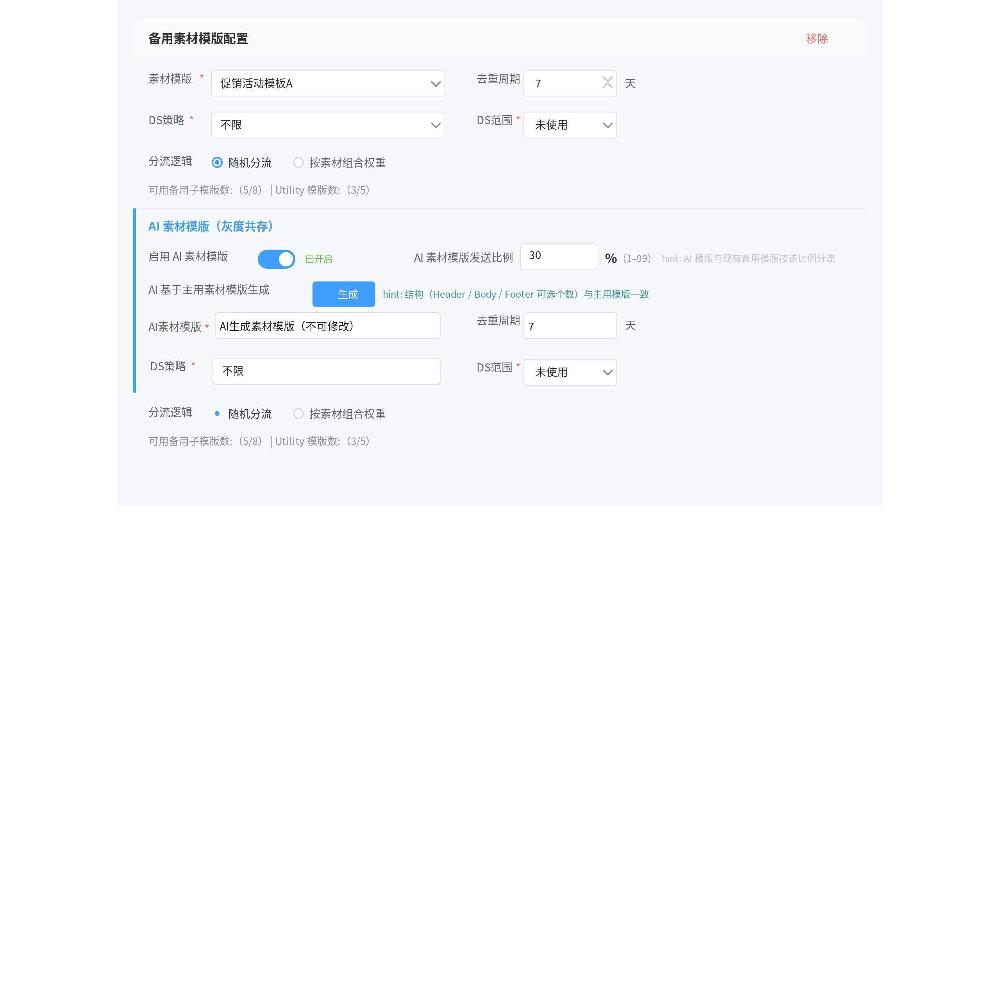

# 20260810_备用素材模版AI生成PRD

# 备用素材模版 AI 生成功能 PRD

> 本文档为产品需求文档，不含代码改动。采用方案二（灰度共存），含 UI 效果图。

## 一、文档信息

| 项 | 内容 |
|---|---|
| 文档版本 | v1.0 |
| 日期 | 2026-08-10 |
| 所属模块 | 群发任务 → 自动化素材策略（AUTOMATIC_MATERIAL）→ 备用素材模版 |
| 关联入口 | AccountDetail.vue 中 `material-config-section--secondary` 区块 |
| 现状字段 | `temp.secondaryMaterialConfig.{materialGroupId, dsStrategyType, dsRange, dsHeaderDegradation, deduplicationPeriod}`，提交时映射为 `backup*` 前缀字段 |

## 二、背景与目标

### 2.1 背景

当前「备用素材模版」区块仅支持从已创建的素材模版中选择一个作为备用（AccountDetail.vue#L468-L600）。运营需要预先在素材库创建好模版，存在两点问题：

1. 备用模版需要人工准备，成本高、覆盖窄。
2. 希望借助 AI 基于主用素材模版自动生成一个对齐结构的备用模版，提升效率与多样性。

但 AI 生成内容不可控，直接全量替换有风险，因此需要小流量灰度能力。

### 2.2 目标

保留现有「选已有模版」逻辑不变，额外增加「AI 素材模版」开关与「AI 素材模版发送比例」字段，与现有备用模版按比例分流，实现小流量灰度。

## 三、现状梳理（基于代码）

| 项 | 现状 |
|---|---|
| 主用模版 | `temp.materialGroupId`，区块标题「主用素材模版（必填）」 |
| 备用模版开关 | `secondaryMaterialConfigVisible`，由「添加备用素材模版」按钮触发 |
| 备用模版字段 | `materialGroupId`（选择已有模版）、`dsStrategyType`、`dsRange`、`dsHeaderDegradation`、`deduplicationPeriod` |
| 分流逻辑 | `secondaryDistributionLogic`：`RANDOM` / `CUSTOM_WEIGHT`（按素材组合加权） |
| 模版数量统计 | `fetchMaterialTemplateCount` 返回 `totalTemplateCount` / `approvedTemplateCount` / `utilityCount` / `everUtilityCount` |
| 提交字段 | `backupMaterialGroupId`、`backupTrafficSplit`、`backupCustomCombinationWeight`、`backupDeduplicationPeriod`、`backupDsStrategyType`、`backupDsRange`、`backupDsHeaderDegradation` |
| 校验 | 备用模版不能与主用模版相同；dsStrategyType / dsRange 必填 |
| 多语言 | `massTask.secondaryMaterialConfig`、`massTask.backupMaterialTemplateMustDiffer` 等 |

## 四、灰度共存（保留现有备用素材模版 + AI 比例灰度）

### 4.1 核心思路

不改变「选已有模版」现有逻辑，在备用模版区块内额外增加：

- 一个「AI 素材模版」开关（启用后出现 AI 相关配置）。
- 一个「AI 素材模版发送比例」字段，表示 AI 模版占备用总流量的百分比，剩余比例给现有备用模版。

### 4.2 字段与交互

- 新增开关 secondaryMaterialConfig.aiEnabled（默认关闭）。
- 开关关闭：完全等同现状。
- 开关启用：在现有备用模版配置下方展开「AI 素材模版」子区：
   - 只读说明「AI 基于主用素材模版生成，结构（Header/Body/Footer 可选个数）与主用模版一致」。
   - 【生成/重新生成】按钮（生成后只读回显模版预览/统计）。
   - 「AI 素材模版发送比例」el-input-number：0–100，单位 %，默认例如 10%。
   - 联动展示「现有备用模版发送比例」= 100% − AI 比例（只读）。
   - 分流逻辑：AI 子模版内部固定随机分流；外层（已有模版）分流逻辑沿用现状。
- 校验：启用 AI 时比例必填且 0 < 比例 < 100；主用模版必选。

### 4.3 提交字段（建议）

```
backupAiEnabled: true
backupAiTrafficRatio: 10            // AI 模版占比 %
backupAiBaseMaterialGroupId: <主用 materialGroupId>
backupMaterialGroupId / backupTrafficSplit / ... // 现有备用模版字段不变
```

## 五、UI 效果图

### 5.1 方案二 UI 效果图

四个关键状态：① AI 开启后的完整配置界面；② AI 生成中（loading）；③ AI 生成失败（错误提示 + 重试）；④ 流量分流示意（AI 比例 vs 现有备用模版比例）。



> （飞书画板，token: KPkkwaE3GhgMMZbcVK0cyAienmd）

下面状态暂时先不做，上面同步生成成功后，展示可选信息


## 六、数据流（建议）

```
AccountDetail.vue
  ├─ 主用模版: temp.materialGroupId (handleMaterialTemplateChange)
  └─ 备用模版: temp.secondaryMaterialConfig
       └─ aiEnabled + aiTrafficRatio
             └─ 启用 → 后端按主用 materialGroupId 生成 + 按 ratio 灰度分流
提交: buildSecondaryMaterialConfigSubmitData() 扩展 backupAi* 字段
```

## 七、边界与异常

| 场景 | 处理 |
|---|---|
| 主用模版未选 | AI 生成按钮置灰，提示「请先选择主用素材模版」 |
| AI 生成中 | 按钮 loading，禁用重复点击 |
| AI 生成失败 | message.error，可重试，不阻断已有模版逻辑 |
| AI 生成模版未通过审核 | 模版数量统计展示「0/0」，提示需等待审核 |
| 比例非法 | 0 < ratio < 100，否则提示「比例需在 1–99 之间」 |
| 编辑回显 | aiEnabled + ratio 需回显；AI 模版 id 不回填选择框，展示为「AI 生成」标记 |

## 八、国际化（i18n，massTask 命名空间）

| key | zh | en |
|---|---|---|
| aiGenerateBasedOnPrimary | AI 基于主用素材模版生成 | AI generated based on primary template |
| aiGenerateBtn | 生成 / 重新生成 | Generate / Regenerate |
| aiGenerating | AI 正在生成… | AI generating… |
| aiGenerateFailed | AI 生成失败，请重试 | AI generation failed, please retry |
| aiStructureAligned | 结构（Header/Body/Footer 可选个数）与主用模版一致 | Structure aligned with primary template |
| aiEnabled | 启用 AI 素材模版 | Enable AI Template |
| aiTrafficRatio | AI 素材模版发送比例 | AI Template Traffic Ratio |
| aiTrafficRatioPlaceholder | 请输入 1–99 | Enter 1–99 |
| aiTrafficRatioHint | AI 模版与现有备用模版按该比例分流 | AI template splits traffic with existing backup |
| selectPrimaryFirst | 请先选择主用素材模版 | Please select primary template first |

## 九、验收标准

1. AI 开关关闭时与现状完全一致；启用后出现 AI 子区与发送比例；比例联动展示剩余比例；比例校验 1–99。
2. 主用模版未选时 AI 生成不可用。
3. AI 生成有 loading / 失败重试。
4. 编辑回显正确（开关 / 比例）。
5. i18n 中英文齐全，现有备用模版逻辑无回归。

# 问题

1. AI创建素材模版耗时
2. 创建素材模版后，到按权重选择耗时
3. 任务保存多加了一个AI素材模版
4. 后端发送流程修改
