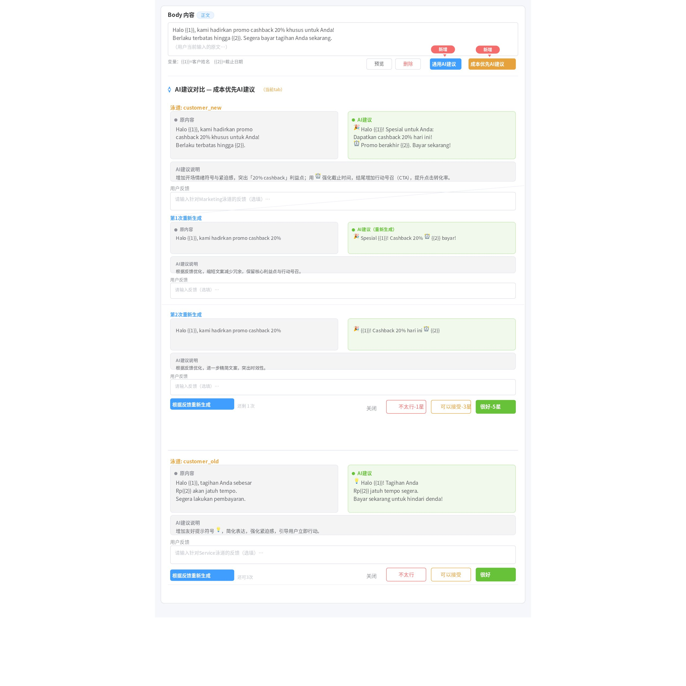

# 20260814_素材模版内容AI生成建议

# 1. 背景

素材模版创建、编辑时根据用户原输入body内容 生成AI建议body内容，用户可以选择是否使用AI建议内容，也可对AI内容进行反馈，用于后续AI生成内容增强；

- 目标：随着AI生成body质量越来越高，逐步实现通过utility发送大部分marketing消息

# 2. UI效果图

> （飞书画板，token: QKNLw6TEchM1XKbG79fcFbtKnRd）

# 3. 功能点补充

利益点不能冲突，明确利益点有哪些：

- 金额上限 等利益点
- 审核文档 等红线

ojk规定：https://docs.google.com/spreadsheets/d/1BvaDJh1DV7KygPdkRe9YaGZkh5M1GSD8XpIUPzlaIL0/edit?gid=728045375#gid=728045375

# 4. 技术-temp

## 规则

泳道级规则以及建议、业务级（营销）级规则以及建议、之前的AI分析总结建议

按钮：通用AI建议、成本优先AI建议

抽象：规则约束，先json，长远规划可视化

## 评估

1. 内容相似角度
2. 评分角度
