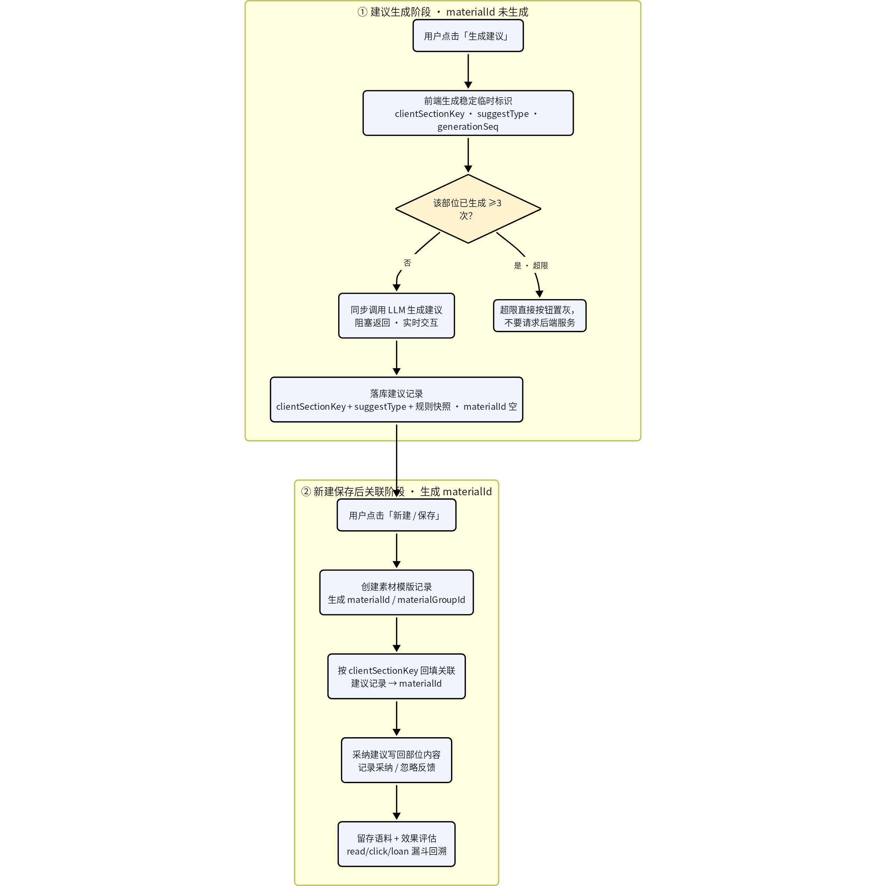

# 20260818_素材模版内容AI生成建议后端技术方案

# 一、背景与目标

素材模版（Material Group）创建 / 编辑时，根据用户录入的部位（body，后续 head/foot）原文，实时生成 AI 建议部位内容；用户可选择采用 / 忽略 / 打分反馈，这些记录沉淀下来用于后续 AI 增强学习，并支持评估 AI 生成效果。最终目标：AI 生成的部位内容质量越高，越能逐步用 utility 渠道发送更多 marketing 消息。

三个核心诉求拆解为三条链路：实时生成建议采用**同步阻塞返回**；记录留存与增强学习靠「建议记录表 + 规则表」，反馈回流作语料；~~效果评估走「离线评分 + 投放后业务漏斗」双闭环。~~

# 二、现状盘点（可复用能力）

本方案尽量复用现有能力，而非重造：

| 能力 | 位置 | 复用方式 |
|---|---|---|
| LLM Agent 框架 | DisguiseSuggestionAgentService（ReActAgent + ChatModelManager） | 复用 |
| 素材上下文构造 | MaterialCombinationContentBuilder | 复用 |
| 泳道枚举 | SourceLaneEnum（9 个泳道） | 只读复用 |
| 效果评估 | QualityEffectReviewServiceImpl（read/click/loan 漏斗） | 复用 |
| RAG / 知识库 | VikingDB 历史文案检索 | 复用 |

两点关键结论决定了数据模型：其一，**泳道是素材组必填属性**，validateLaneConfig 强制 laneConfigList 非空，存到 message_material_group_lane 表，因此规则必须按泳道区分；其二，**body material 的 id（Mongo ObjectId）在 mongoTemplate.insert() 时才生成**，生成建议阶段素材尚未落库，因此建议记录不能用 materialId 作为主标识，改用前端稳定临时 key。

# 三、整体架构

前端在素材模版编辑页对某个部位发起生成请求，后端同步完成规则加载与 LLM 生成后直接返回结果：

1. 前端 POST 生成建议接口，传入 sourceLane、clientMaterialKey、原部位内容、建议类型。
2. 后端用 Redis INCR 分配本轮序号，超过 3 次即拒绝（并发防超限）。
3. 按 sourceLane + materialType 加载该泳道+部位独立规则集，组装成规则快照并拼入 prompt。
4. 同步调用 Agent 生成建议部位内容与自评分。
5. 落建议记录（含规则快照、LLM 原始输出、自评分），同步返回结果。
6. 用户采纳 / 忽略 / 打分写回反馈，作为长期语料；采纳后随模版上线，按 materialId 回溯投放漏斗指标。

# 四、数据库设计

## （一）规则表 ai_material_suggestion_rule   泳道规则集

rule_level 对应 lane 内排序层级：LANE（泳道级规则 + 建议）、BUSINESS（业务 / 营销级规则 + 建议）、AI_SUMMARY（之前的 AI 分析总结建议），另加 RED_LINE（审核红线）、BENEFIT（利益点，如金额上限）。rule_content 先 JSON 化，为后续可视化编排预留。

> ai_material_suggestion_rule

```sql
CREATE TABLE `ai_material_suggestion_rule` (
  `id` bigint(20) NOT NULL AUTO_INCREMENT COMMENT 'primary key',
  `rule_code` varchar(64) NOT NULL COMMENT 'rule code, unique',
  `rule_name` varchar(128) NOT NULL COMMENT 'rule name',
  `source_lane` varchar(32) NOT NULL COMMENT 'source lane',
  `material_type` varchar(32) NOT NULL DEFAULT 'BODY' COMMENT 'material type, body/head/foot',
  `rule_level` varchar(32) NOT NULL COMMENT 'LANE/BUSINESS/AI_SUMMARY/',
  `rule_type` varchar(32) NOT NULL COMMENT 'CONSTRAINT hard / SUGGESTION soft / REFERENC/ ERED_LINE',
  `rule_content` text NOT NULL COMMENT 'rule content JSON',
  `priority` int(11) NOT NULL DEFAULT 0 COMMENT 'priority, higher first',
  `enabled` tinyint(1) NOT NULL DEFAULT 1 COMMENT 'enabled flag',
  `opeator` varchar(50) NOT NULL COMMENT 'opeator',
  `create_time` bigint(20) not null DEFAULT '0' COMMENT 'Creation time',
  `update_time` bigint(20) NOT NULL DEFAULT '0'  COMMENT 'Update time',
  PRIMARY KEY (`id`),
  UNIQUE KEY `uk_rule_code` (`rule_code`),
  KEY `idx_lane_material` (`source_lane`, `rule_level`, `priority`)
) ENGINE=InnoDB DEFAULT CHARSET=utf8mb4 COMMENT='AI material suggestion rule';
```

## （二）建议记录表 ai_material_suggestion

client_material_key 是业务主键，由前端生成（UUID），一个部位输入框一个稳定 key。生成阶段素材未落库，material_group_id / material_id 均允许为空，采纳保存后才回写。(client_material_key,suggest_type, generation_seq) 唯一索引硬保证每部位最多 3 条。

> ai_material_suggestion

```sql
CREATE TABLE `ai_material_suggestion` (
  `id` bigint(20) NOT NULL AUTO_INCREMENT COMMENT 'primary key',
  `client_material_key` varchar(128) NOT NULL COMMENT 'frontend stable temp key of one material',
  `material_type` varchar(32) NOT NULL DEFAULT 'BODY' COMMENT 'material type, body/head/foot',
  `generation_seq` tinyint NOT NULL DEFAULT 1 COMMENT 'generation round, 1-3',
  `source_lane` varchar(32) NOT NULL COMMENT 'source lane',
  `material_group_id` bigint(20) DEFAULT NULL COMMENT 'material group id, empty before saved',
  `material_id` varchar(64) DEFAULT NULL COMMENT 'real material id, empty before saved',
  `origin_content` text COMMENT 'user input material content',
  `suggested_content` text COMMENT 'AI suggested material content',
  `suggest_type` varchar(32) NOT NULL COMMENT 'GENERAL / COST_FIRST',
  `prompt` text COMMENT 'full prompt',
  `rule_snapshot` text COMMENT 'used rules JSON snapshot for attribution',
  `llm_raw_output` text COMMENT 'LLM raw output',
  `score` decimal(3,2) DEFAULT NULL COMMENT 'LLM self score 0-5',
  `score_reason` varchar(1024) DEFAULT NULL COMMENT 'score reason',
  `status` tinyint NOT NULL DEFAULT 0 COMMENT 'PENDING/PROCESSING/APPLIED/REJECTED/IGNORED',
  `feedback_type` tinyint DEFAULT NULL COMMENT '1 applied 2 rejected 3 ignored',
  `feedback_reason` varchar(1024) DEFAULT NULL COMMENT 'feedback reason',
  `user_score` decimal(3,2) DEFAULT NULL COMMENT 'user score 0-5',
  `creator` varchar(64) DEFAULT NULL COMMENT 'creator',
  `updater` varchar(64) DEFAULT NULL COMMENT 'updater',
  `create_time` bigint(20) not null DEFAULT '0' COMMENT 'Creation time',
  `update_time` bigint(20) NOT NULL DEFAULT '0'  COMMENT 'Update time',
  PRIMARY KEY (`id`),
  UNIQUE KEY `uk_client_material_seq` (`client_material_key`,`suggest_type` ,`generation_seq`),
  KEY `idx_material_id` (`material_id`),
  KEY `idx_lane` (`source_lane`)
) ENGINE=InnoDB DEFAULT CHARSET=utf8mb4 COMMENT='AI material material suggestion record';
```

# 五、接口设计

| 方法 | 路径 | 出参 | 说明 |
|---|---|---|---|
| POST | /ai-suggestion/generate | suggestionId、generationSeq、suggestedContent、score、scoreReason | 同步生成并返回完整建议 |
| POST | /ai-suggestion/list | 该部位全部建议（≤3 条） | 前端切换对比 |
| GET | /ai-suggestion/remain | remainCount | 控制「重新生成」按钮置灰 |
| POST | /ai-suggestion/feedback | success | 采纳 / 忽略 / 打分 |
| POST | /ai-suggestion/rule/page | 规则列表 | 按泳道管理规则 |
| POST | /ai-suggestion/rule/save | success | 按泳道增删改规则 |

「重新生成」即前端用同一 clientMaterialKey + suggest_type 再次调用 generate，后端分配下一个 generationSeq。generate 流程：校验 sourceLane / suggest_type 合法且该泳道+建议类型有规则 → Redis INCR 分配序号（超过 3 则回滚拒绝）→ 加载泳道规则并拼 prompt → 同步调 Agent 生成 → 落记录 → 同步返回。

---

**接口参数示例**。generate 入参可选 **materialGroupId**（用于泳道一致性校验与历史样例检索）；生成阶段素材尚未落库，故不传 materialId，身份标识统一用 **client****Material****Key**。

**POST /ai-suggestion/generate** —— 同步生成建议并返回完整结果

> 请求

```json
{
  "sourceLane": "MARKETING_DEFAULT",
  "materialGroupId": "mg_20260819_001",
  "clientMaterialKey": "body_header_abc123",
  "suggest_type": "COST_FIRST",
  "materialType": "BODY",
  "materialContent": {
    "type": "TEXT",
    "content": "资金周转困难？找我，最高可借 2000 万"
    "userFeedBack": "不能超高1500万"
  }
}
```

> 响应

```json
{
  "suggestionId": "sug_9f8e7d6c",
  "generationSeq": 1,
  "suggestedContent": "资金周转有压力？最高可借 2000 万，最快当天放款。",
  "score": 0.92,
  "scoreReason": "命中 R1 合规话术、R5 转化钩子"
}
```

**POST /ai-suggestion/list** —— 查询该 body 已生成的全部建议（≤3 条）

> 请求

```json
{
  "sourceLane": "MARKETING_DEFAULT",
  "clientMaterialKey": "body_header_abc123",
  "suggest_type": "COST_FIRST",
  "materialType": "BODY"
}
```

> 响应

```json
{
  "suggestions": [
    { "suggestionId": "sug_9f8e7d6c", "generationSeq": 1, "suggestedContent": "…", "score": 0.92, "scoreReason": "…" },
    { "suggestionId": "sug_1a2b3c4d", "generationSeq": 2, "suggestedContent": "…", "score": 0.88, "scoreReason": "…" }
  ]
}
```

**GET /ai-suggestion/remain** —— 查询剩余可生成次数（控制「重新生成」按钮置灰）

这个我理解不需要接口，因为生成只在素材模版创建时生成，页面请求一次减1即可；

在素材模版修改页面，不能对历史的素材进行修改，只能新增素材，所以不涉及显示次数

**POST /ai-suggestion/feedback** —— 采纳 / 忽略 / 打分（回流增强学习语料）

不需要单独打分，直接和feedbackType在一起就行

> 请求

```json
{
  "suggestionId": "sug_9f8e7d6c",
  "feedbackType": "ADOPT",
  "comment": "语义更贴合泳道风格，已采纳"
}
```

> 响应

```json
{ "success": true }
```

**POST /ai-suggestion/rule/page** —— 按泳道分页查询规则

> 请求

```json
{
  "sourceLane": "MARKETING_DEFAULT",
  "pageNo": 1,
  "pageSize": 20
}
```

> 响应

```json
{
  "total": 12,
  "rules": [
    { "ruleId": "r_1001", "ruleLevel": 1, "content": "禁用过度借贷诱导话术", "enabled": true },
    { "ruleId": "r_1002", "ruleLevel": 2, "content": "突出放款速度与额度", "enabled": true }
  ]
}
```

**POST /ai-suggestion/rule/save** —— 按泳道增删改规则

> 请求

```json
{
  "sourceLane": "MARKETING_DEFAULT",
  "rules": [
    { "ruleId": null, "ruleLevel": 1, "content": "新增：额度需写明上限", "enabled": true },
    { "ruleId": "r_1001", "ruleLevel": 1, "content": "修改后的规则内容", "enabled": false }
  ]
}
```

> 响应

```json
{ "success": true }
```

新增规则页面暂时先不做，先给我开发个job，用于新增规则

# 六、核心服务设计

**AiMaterialSuggestionService（编排）。**负责提交校验、次数管控、规则加载、调用 Agent、落库与反馈。次数管控采用 Redis 原子 INCR 分配 generationSeq 为主控，数据库 (client_material_key, feedbackType, generation_seq) 唯一索引兜底，快速连点「重新生成」时也不会突破 3 次。

**AiMaterialSuggestionRuleService（规则加载）。**querySnapshot(sourceLane, materialType) 仅加载该泳道+部位下全部启用规则，按 priority 排序组装成 JSON 快照，泳道/部位之间完全隔离，规则快照同步落库用于效果归因。

**AiMaterialSuggestionAgentService + Tools（生成）。**仿 DisguiseSuggestionAgentService 使用 ReActAgent，返回结构化结果（suggestedContent、score、scoreReason、llmRawOutput）。Tools 提供 getRuleSnapshot(sourceLane, materialType)、getHistorySamples 两个工具方法。prompt 固定四段：System 角色、泳道规则 JSON、用户原部位内容、历史优质样例。「通用 / 成本优先」按钮映射为 suggestType，通用和成本优先仅仅是不同规则拼装成的prompt不同

# 七、效果评估-暂时先不做

评估 AI 生成效果分两层闭环。离线层取「生成当时自评分」「人工打分反馈」「原部位与建议部位的向量相似度」，对应「1. 内容相似角度 2. 评分角度」。投放层在建议采纳回写真实 material_id 后，关联 qualityeffect 已有的 read/click/flowSubmit/applyCredit/loan 指标，回溯「某条建议 → 实际转化」。

| 维度 | 指标 | 来源 |
|---|---|---|
| 采纳率 | 采纳数 / 生成数 | ai_material_suggestion |
| 均分 | AVG(score)、AVG(user_score) | ai_material_suggestion |
| 相似度 | AVG(embedding 相似度) | 离线计算 |
| 第 N 轮采纳率 | 按 generation_seq 分组 | ai_material_suggestion |
| 转化效果 | read/click/applyCredit/loan rate | qualityeffect |

「重新生成」天然形成同一 body 的多轮对比样本，可进一步分析「第几轮生成质量最好」。

# 八、增强学习闭环-暂时先不做

- 优质样本：采纳且 user_score ≥ 4 的 suggested_content 回流 VikingDB 作正样本。
- 负样本归因：拒绝 + feedback_reason + rule_snapshot 定位「哪条泳道规则导致差评」，反哺该泳道规则迭代。
- Prompt 版本管理：rule_snapshot + prompt 全量落库，支持 A/B 对比。

# 九、落地清单

| 层 | 文件 |
|---|---|
| sql | ai_material_suggestion_rule.sql、ai_material_suggestion.sql |
| po | AiMaterialSuggestion.java、AiMaterialSuggestionRule.java |
| mapper | AiMaterialSuggestionMapper、AiMaterialSuggestionRuleMapper（含 XML） |
| service | AiMaterialSuggestionService、AiMaterialSuggestionRuleService（含 impl） |
| ai.service | AiMaterialSuggestionAgentService |
| ai.tools | AiMaterialSuggestionAgentTools |
| ai.dto | AiMaterialSuggestionResult |
| dto | 请求 / 响应 DTO |
| controller | AiMaterialSuggestionController |
| job | AiMaterialSuggestionQualityScanJob（可选，相似度 + 回流） |

# 十、关键决策小结

| 决策 | 结论 | 理由 |
|---|---|---|
| 实时交互 | 同步阻塞返回 | 内部编辑工具、并发低，无超时风险 |
| 业务标识 | clientMaterialKey（非 materialId） | 生成阶段素材未落库 |
| 泳道规则 | 每泳道+部位独立完整规则集 | 泳道诉求差异大，隔离清晰、易归因 |
| 次数限制 | clientMaterialKey + materialType + generationSeq 唯一索引 + Redis 双兜底 | 防并发超部位 3 次 |
| 效果评估 | 离线评分 + 投放指标双闭环 | 快反馈 + 真实验证 |

# 十一、建议生成与新建保存后关联流程



> （飞书画板，token: MS4LwNn1ihjJmZbo1zjcZszknph）

整个流程分两个阶段闭环。生成阶段素材尚未落库，前端用稳定的临时标识 **client****Material****Key**（配合 **generationSeq**）作为本次生成的身份，后端凭它做幂等与计数；保存阶段素材才真正创建，后端再按 clientMaterialKey 把建议记录回填关联到新生成的 materialId。

**建议生成阶段（materialId 未生成）。**前端先生成 clientMaterialKey 与 generationSeq，后端校验泳道并加载该泳道独立规则集，~~用 Redis 原子计数判断是否已生成 3 次，改为~~直接前端统计就行，不需要后端计数；未超限则同步阻塞调用 LLM 返回建议，并将建议落库到建议记录表，此时 materialId 为空，由 clientMaterialKey 充当幂等 / 计数主键。

**新建保存后关联阶段（生成 materialId）。**用户点击「新建 / 保存」后创建素材模版记录，此时才生成 materialId / materialGroupId；后端按 clientMaterialKey 回填关联建议记录，采纳内容写回部位并记录采纳 / 忽略反馈，最终作为增强学习语料，并按 materialId 回溯 read / click / loan 漏斗做效果评估。
