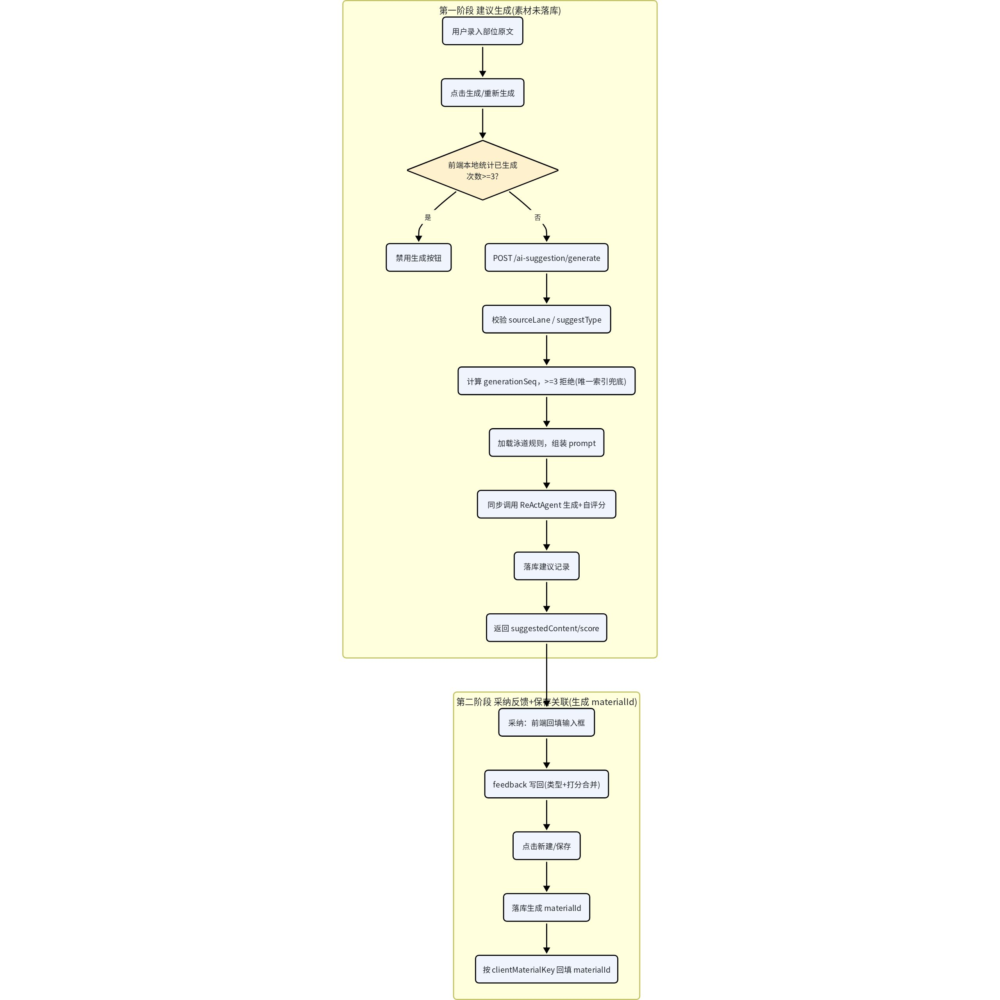

# 20260819_素材模版内容AI生成建议后端技术方案

## 一、背景与目标

素材模版（Material Group）创建 / 编辑时，根据用户录入的部位（body，后续 head/footer）原文，实时生成 AI 建议的部位内容；用户可选择采纳 / 忽略 / 打分反馈，这些记录沉淀用于后续 AI 生成增强。最终目标：AI 生成的部位内容质量越高，越能逐步通过 utility 渠道发送更多 marketing 消息。

按最终需求，本期拆分为两条闭环链路：

- 实时生成链路：前端对某个部位发起生成请求，后端同步阻塞加载泳道规则并调用 LLM，直接返回建议内容与自评分。
- 记录留存与反馈链路：建议记录表 + 规则表留存生成过程与反馈，反馈回流作为后续增强学习的语料。

效果评估（投放漏斗回溯）与增强学习闭环本期**暂不实现**，延后到建议数据积累到一定量后另开一期。

## 二、与初版方案的差异（本次调整）

相对 `20260818_素材模版内容AI生成建议后端技术方案`，本期做如下收敛：

| 项 | 初版方案 | 本期最终方案 |
|---|---|---|
| 次数控制 | Redis INCR 分配 generationSeq + `/ai-suggestion/remain` 接口 | 去掉 Redis 计数与 remain 接口，改为**前端本地统计**，后端以唯一索引 + 计数兜底 |
| 反馈打分 | 单独打分接口 | 打分合并进 `feedback` 接口（`feedbackType` + `userScore` 一起写回） |
| 规则管理 | `rule/page` + `rule/save` 管理页面 | 规则管理页面暂不做，改为 **XXL-Job 导入 / 新增规则** |
| 效果评估 / 增强学习 | 离线评分 + 投放漏斗双闭环 + VikingDB 回流 | 本期暂不做，延后 |

## 三、现状盘点（可复用能力）

本方案尽量复用现有能力，而非重造：

| 能力 | 位置 | 复用方式 |
|---|---|---|
| LLM Agent 框架 | `DisguiseSuggestionAgentService`（ReActAgent + ChatModelManager） | 复用，仿照新建 AI 素材建议 Agent |
| 素材上下文构造 | `MaterialCombinationContentBuilder` | 复用 |
| 泳道枚举 | `SourceLaneEnum`（9 个泳道） | 只读复用 |
| 建议记录扫描 Job 范式 | `DisguiseSuggestionScanService` + `TemplateDisguiseSuggestionScanJob` | 仿照实现规则导入 Job |
| PO/Mapper 范式 | `TemplateDisguiseSuggestion` + 空 XML mapper | 仿照实现新表 PO/Mapper |
| 效果评估 | `QualityEffectReviewServiceImpl`（read/click/loan 漏斗） | 暂不接入，延后 |

两点关键结论决定数据模型：

1. 泳道是素材组必填属性：validateLaneConfig 强制 laneConfigList 非空并落库到 message_material_group_lane，因此规则必须按泳道区分。
2. 部位 material 的 id（Mongo ObjectId）在 Mongo insert 时才生成：生成建议阶段素材尚未落库，因此建议记录不能用 materialId 作主标识，改用前端稳定临时 key（clientMaterialKey），保存后才回填关联。

## 四、数据模型（数据库表结构）

### 4.1 规则表 `ai_material_suggestion_rule`（泳道规则集）

`rule_level` 对应泳道内排序层级：`LANE`（泳道级规则）、`BUSINESS`（业务 / 营销级规则）、`AI_SUMMARY`（历史 AI 分析总结建议），另加 `RED_LINE`（审核红线）、`BENEFIT`（利益点，如金额上限）。`rule_content` 先 JSON 化，为后续可视化编排预留。

```sql
CREATE TABLE `ai_material_suggestion_rule` (
  `id` bigint(20) unsigned NOT NULL AUTO_INCREMENT COMMENT 'primary key',
  `rule_code` varchar(64) NOT NULL DEFAULT '' COMMENT 'unique rule code',
  `rule_name` varchar(128) NOT NULL DEFAULT '' COMMENT 'rule name',
  `source_lane` varchar(32) NOT NULL DEFAULT '' COMMENT 'source lane code',
  `material_type` varchar(32) NOT NULL DEFAULT 'BODY' COMMENT 'material type: BODY/HEADER/FOOTER',
  `rule_level` varchar(32) NOT NULL DEFAULT '' COMMENT 'rule level: LANE/BUSINESS/AI_SUMMARY/RED_LINE/BENEFIT',
  `rule_type` varchar(32) NOT NULL DEFAULT '' COMMENT 'rule type: CONSTRAINT/SUGGESTION/REFERENCE/RED_LINE',
  `rule_content` text COMMENT 'rule content in JSON for future visual editing',
  `priority` int(11) NOT NULL DEFAULT '0' COMMENT 'sort priority, higher first',
  `enabled` tinyint(1) NOT NULL DEFAULT '1' COMMENT 'enabled flag, 1 enabled 0 disabled',
  `operator` varchar(64) NOT NULL DEFAULT '' COMMENT 'operator',
  `create_time` bigint(20) NOT NULL DEFAULT '0' COMMENT 'creation time',
  `update_time` bigint(20) NOT NULL DEFAULT '0' COMMENT 'update time',
  PRIMARY KEY (`id`),
  UNIQUE KEY `uk_rule_code` (`rule_code`),
  KEY `idx_lane_material` (`source_lane`, `material_type`, `rule_level`),
  KEY `idx_create_time` (`create_time`)
) ENGINE=InnoDB DEFAULT CHARSET=utf8mb4 COMMENT='AI material suggestion rule per lane';
```

### 4.2 建议记录表 `ai_material_suggestion`

`client_material_key` 是业务主键，由前端生成（UUID），一个部位输入框一个稳定 key。生成阶段素材未落库，`material_group_id` / `material_id` 允许为空，采纳保存后再回写。`(client_material_key, material_type, suggest_type, generation_seq)` 唯一索引保证每部位每种建议类型最多 3 条。

```sql
CREATE TABLE `ai_material_suggestion` (
  `id` bigint(20) unsigned NOT NULL AUTO_INCREMENT COMMENT 'primary key',
  `client_material_key` varchar(128) NOT NULL DEFAULT '' COMMENT 'frontend stable temp key of one material part',
  `material_type` varchar(32) NOT NULL DEFAULT 'BODY' COMMENT 'material type: BODY/HEADER/FOOTER',
  `suggest_type` varchar(32) NOT NULL DEFAULT '' COMMENT 'suggest type: GENERAL/COST_FIRST',
  `generation_seq` tinyint(4) NOT NULL DEFAULT '1' COMMENT 'generation round, 1-3',
  `source_lane` varchar(32) NOT NULL DEFAULT '' COMMENT 'source lane code',
  `material_group_id` bigint(20) DEFAULT NULL COMMENT 'material group id, empty before saved',
  `material_id` varchar(64) DEFAULT NULL COMMENT 'real material id, empty before saved',
  `origin_content` text COMMENT 'user input material part content',
  `suggested_content` text COMMENT 'AI suggested material part content',
  `prompt` text COMMENT 'full prompt sent to LLM',
  `rule_snapshot` text COMMENT 'used rules JSON snapshot for attribution',
  `llm_raw_output` text COMMENT 'LLM raw output',
  `score` decimal(3,2) DEFAULT NULL COMMENT 'LLM self score 0-5',
  `score_reason` varchar(1024) DEFAULT '' COMMENT 'LLM self score reason',
  `status` tinyint(4) NOT NULL DEFAULT '0' COMMENT 'record status: 0 pending 1 applied 2 rejected 3 ignored',
  `feedback_type` tinyint(4) DEFAULT NULL COMMENT 'feedback type: 1 applied 2 rejected 3 ignored',
  `feedback_reason` varchar(1024) DEFAULT '' COMMENT 'feedback reason',
  `user_score` decimal(3,2) DEFAULT NULL COMMENT 'user score 0-5, merged with feedback',
  `creator` varchar(64) DEFAULT NULL COMMENT 'creator',
  `updater` varchar(64) DEFAULT NULL COMMENT 'updater',
  `create_time` bigint(20) NOT NULL DEFAULT '0' COMMENT 'creation time',
  `update_time` bigint(20) NOT NULL DEFAULT '0' COMMENT 'update time',
  PRIMARY KEY (`id`),
  UNIQUE KEY `uk_client_material_seq` (`client_material_key`, `material_type`, `suggest_type`, `generation_seq`),
  KEY `idx_material_id` (`material_id`),
  KEY `idx_source_lane` (`source_lane`),
  KEY `idx_create_time` (`create_time`)
) ENGINE=InnoDB DEFAULT CHARSET=utf8mb4 COMMENT='AI material suggestion record';
```

### 4.3 字段设计说明

- 遵循团队表结构规范：NOT NULL 标量列均有默认值；text / decimal 等无法设默认值的列置为可空；统一带 create_time / update_time，且 create_time 建索引。
- Java PO 字段命名与现有 TemplateDisguiseSuggestion 的 ctime / utime 不同，新表统一使用 createTime / updateTime（或通过 @TableField 映射 create_time / update_time）。

## 五、接口设计

### 5.1 接口总览

| 方法 | 路径 | 说明 |
|---|---|---|
| POST | `/ai-suggestion/generate` | 同步生成建议并返回完整结果（本期核心） |
| POST | `/ai-suggestion/list` | 查询该部位已生成的全部建议（≤3 条） |
| POST | `/ai-suggestion/feedback` | 采纳 / 忽略 / 打分（打分合并进本接口） |
| POST | `/ai-suggestion/rule/page` | 按泳道分页查询规则（只读，用于排查） |
| - | XXL-Job `AiMaterialSuggestionRuleImportJob` | 导入 / 新增规则（替代规则管理页面） |

> `/ai-suggestion/remain` 接口取消：生成只在素材模版创建时进行，前端本地维护该部位已生成次数、页面请求一次减 1 即可；素材模版修改页不能改历史素材、只能新增素材，故不涉及展示剩余次数。

### 5.2 POST `/ai-suggestion/generate` —— 同步生成建议

「重新生成」即前端用同一 `clientMaterialKey` + `suggestType` 再次调用，后端按已有记录数分配下一个 `generationSeq`。请求参数：

```json
{
  "sourceLane": "MARKETING_DEFAULT",
  "materialGroupId": 1001,
  "clientMaterialKey": "body-uuid-abc123",
  "suggestType": "GENERAL",
  "materialType": "BODY",
  "materialContent": {
    "type": "TEXT",
    "content": "资金周转困难？找我，最高可借 2000 万",
    "userFeedback": "不能超过 1500 万"
  }
}
```

响应：

```json
{
  "suggestionId": 901,
  "generationSeq": 1,
  "suggestedContent": "资金周转有压力？最高可借 2000 万，最快当天放款。",
  "score": 0.92,
  "scoreReason": "命中 R1 合规话术、R5 转化钩子"
}
```

说明：

- 校验 sourceLane 合法、suggestType 合法、且该泳道 + 部位存在启用规则。
- 按 (clientMaterialKey, materialType, suggestType) 统计已生成条数作为 generationSeq = count + 1，超过 3 返回「已达上限」；唯一索引兜底防并发超限。
- 同步阻塞调用 Agent，返回结构化结果（suggestedContent / score / scoreReason）。
- materialGroupId 可选，用于泳道一致性校验与历史样例检索；生成阶段素材未落库，不传 materialId，身份标识统一用 clientMaterialKey。

### 5.3 POST `/ai-suggestion/list` —— 查询该部位全部建议

```json
{
  "sourceLane": "MARKETING_DEFAULT",
  "materialType": "BODY",
  "suggestType": "GENERAL",
  "clientMaterialKey": "body-uuid-abc123"
}
```

```json
{
  "suggestions": [
    { "suggestionId": 901, "generationSeq": 1, "suggestedContent": "…", "score": 0.92, "scoreReason": "…" },
    { "suggestionId": 902, "generationSeq": 2, "suggestedContent": "…", "score": 0.88, "scoreReason": "…" }
  ]
}
```

### 5.4 POST `/ai-suggestion/feedback` —— 采纳 / 忽略 / 打分（合并）

打分不单独接口，与 `feedbackType` 一起写回。请求参数：

```json
{
  "suggestionId": 901,
  "feedbackType": "ADOPT",
  "userScore": 4,
  "comment": "语义更贴合泳道风格，已采纳"
}
```

```json
{ "success": true }
```

说明：`feedbackType` ∈ `ADOPT` / `REJECT` / `IGNORE`；`userScore` 可选（0~5），与 `feedbackType` 一起写回 `ai_material_suggestion` 的 `feedback_type` / `user_score` / `feedback_reason`，并流转 `status`。重复反馈需做幂等处理。

### 5.5 POST `/ai-suggestion/rule/page` —— 按泳道分页查询规则（只读）

```json
{
  "sourceLane": "MARKETING_DEFAULT",
  "materialType": "BODY",
  "pageNo": 1,
  "pageSize": 20
}
```

```json
{
  "total": 12,
  "rules": [
    { "id": 1001, "ruleCode": "MKT_R01", "ruleName": "合规红线", "ruleLevel": "RED_LINE", "ruleType": "CONSTRAINT", "priority": 90, "enabled": true }
  ]
}
```

### 5.6 XXL-Job —— 规则导入 / 新增（替代规则管理页面）

规则管理页面本期暂不做，改为开发一个 XXL-Job `AiMaterialSuggestionRuleImportJob`，从配置 / JSON 文件批量 upsert `ai_material_suggestion_rule`（按 `rule_code` 幂等），供运营 / 开发初始化与维护泳道规则。重复执行不会产生脏数据。

## 六、核心流程



> （飞书画板，token: FMWTwW2SRhuA5Gb8ALiclqONnif）

### 流程说明

整个过程分两个阶段闭环：

**第一阶段（建议生成，素材未落库）**：前端先生成稳定的临时标识 `clientMaterialKey`，本地统计该部位已生成次数，达到 3 次即禁用生成按钮（不需后端计数）。未超限则同步调用 `/ai-suggestion/generate`。后端校验泳道与建议类型，按已有记录数计算 `generationSeq`（超过 3 拒绝，唯一索引兜底），加载该泳道 + 部位的独立规则集并组装 prompt（四段：System 角色、泳道规则 JSON、用户原部位内容、历史优质样例），同步阻塞调用 Agent 返回建议，并把建议（含规则快照、LLM 原始输出、自评分）落库，此时 `materialId` 为空，由 `clientMaterialKey` 充当幂等 / 计数主键。

**第二阶段（采纳反馈 + 保存关联，生成 materialId）**：用户采纳时前端把建议回填到部位输入框，并调用 `/ai-suggestion/feedback` 将 `feedbackType` 与 `userScore` 合并写回。用户点击「新建 / 保存」后创建素材模版记录，此时 Mongo insert 才生成真实的 `materialId` / `materialGroupId`；后端按 `clientMaterialKey` 回填关联建议记录，为后续按 `materialId` 回溯投放漏斗（延后）做准备。

## 七、核心服务 / 落地清单

| 层 | 文件 |
|---|---|
| sql | `ai_material_suggestion_rule.sql`、`ai_material_suggestion.sql` |
| po | `AiMaterialSuggestion.java`、`AiMaterialSuggestionRule.java` |
| mapper | `AiMaterialSuggestionMapper`、`AiMaterialSuggestionRuleMapper`（含 XML） |
| service | `AiMaterialSuggestionService`、`AiMaterialSuggestionRuleService`（含 impl） |
| ai.service | `AiMaterialSuggestionAgentService` |
| ai.tools | `AiMaterialSuggestionAgentTools`（`getRuleSnapshot` / `getHistorySamples`） |
| ai.dto | `AiMaterialSuggestionResult` |
| dto | 请求 / 响应 DTO |
| controller | `AiMaterialSuggestionController` |
| job | `AiMaterialSuggestionRuleImportJob`（规则导入 / 新增） |

核心服务职责：

- `AiMaterialSuggestionService`（编排）：提交校验、次数管控（前端统计 + 唯一索引兜底）、规则加载、调用 Agent、落库与反馈。
- `AiMaterialSuggestionRuleService`（规则加载）：querySnapshot(sourceLane, materialType) 仅加载该泳道 + 部位下全部启用规则，按 priority 排序组装成 JSON 快照，泳道 / 部位之间完全隔离，规则快照同步落库用于效果归因。
- `AiMaterialSuggestionAgentService` + Tools（生成）：仿 DisguiseSuggestionAgentService 使用 ReActAgent，返回结构化结果（suggestedContent / score / scoreReason / llmRawOutput）。「通用 / 成本优先」按钮映射为 suggestType，本质是不同规则拼装成不同 prompt。

## 八、灰度方案

1. 总开关：新增配置 ai_suggestion.enabled（默认关闭），controller / service 入口判断，关闭时接口返回「功能未开放」，前端隐藏「生成建议」按钮。
2. 泳道白名单：新增配置 ai_suggestion.lane_whitelist，仅白名单泳道开放，先以 MARKETING_DEFAULT 试跑，逐步放开其他泳道。
3. 建议类型灰度：先只开放 GENERAL，COST_FIRST 待规则打磨后再放开。
4. 天然低风险：新表 + 新接口完全独立，不侵入 create / update 主流程；「保存后回填 materialId」作为可开关的轻量钩子，灰度期可先关闭，仅验证生成与反馈链路。

## 九、回滚方案

1. 开关回滚：关闭 ai_suggestion.enabled 立即生效，接口返回禁用、前端隐藏按钮，无需发版。
2. 代码回滚：新增 controller / service / mapper / PO 均为独立文件，可整体 revert；「保存后回填」钩子受开关控制，关闭即回到存量行为。
3. 数据回滚：ai_material_suggestion / ai_material_suggestion_rule 为新增独立表，不影响存量主表；回滚时可保留表结构仅关闭开关，或清理灰度期数据。
4. 无 DDL 风险：仅新增两张表，无存量表结构变更、无数据迁移。

## 十、测试重点

### 10.1 本次新增内容

1. 规则加载与隔离：不同泳道 / 部位返回独立规则集，按 priority 排序、enabled 过滤正确；rule_snapshot 与加载结果一致并落库。
2. generate 同步返回：prompt 四段组装正确；LLM 结构化输出解析正确（含 markdown 代码块剥离、thinking 标签剥离、纯 JSON 兜底）。
3. 次数控制：同一 clientMaterialKey + materialType + suggestType 最多生成 3 条；并发连点下唯一索引兜底不超限；generationSeq 递增正确。
4. 建议记录落库：clientMaterialKey / generationSeq / ruleSnapshot / llmRawOutput / score / scoreReason 字段完整。
5. feedback 合并打分：feedbackType 与 userScore 一起写回，status 流转正确；重复反馈幂等。
6. 保存后回填：create / update 后按 clientMaterialKey 回填 materialId 正确；回填失败不影响主保存流程（降级处理）。
7. 规则导入 Job：按 rule_code 幂等 upsert，重复执行不产生脏数据。

### 10.2 可能影响的现有流程

1. LLM 资源竞争：复用 ChatModelManager，与 DisguiseSuggestionScanService 共享模型与配额；同步阻塞接口需设置 LLM 超时，避免拖垮线程池。
2. create / update 主流程回归：若启用「保存后回填」钩子，需回归材料创建 / 更新全链路（含 RANDOM / MANUAL 组合生成），确认新增钩子不抛异常中断事务。
3. 泳道数据只读：读取 SourceLaneEnum 与 message_material_group_lane 为只读，不影响现有泳道数据。
4. 无存量表结构变更：新表 DDL 上线不影响存量表与现有 Job。
