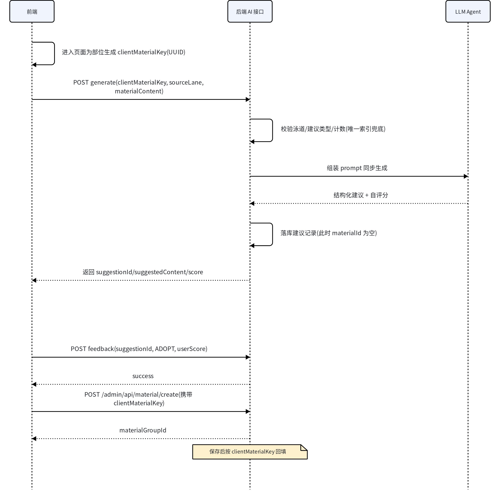

# 20260819_素材模版内容AI生成建议接口文档(前端)

## 一、概述

本文档面向前端开发，描述「素材模版 AI 生成建议」相关接口。该功能在素材模版创建 / 编辑时，根据用户录入的部位原文（body，后续 head/footer）实时生成 AI 建议内容，并提供采纳 / 忽略 / 打分反馈。

- 基础地址：/admin/api/ai-suggestion
- 鉴权：与现有素材模板接口（/admin/api/material/*）一致，沿用现有 admin 后台登录态 / 令牌，无需额外配置。
- 请求方式：均为 POST，Content-Type: application/json。
- 核心链路：生成（generate）是同步阻塞接口，会等待 LLM 返回，前端需设置较长的请求超时（建议 ≥ 60s）并做好防重复提交。

## 三、接口详情

### 3.1 生成建议

- 路径：POST /admin/api/ai-suggestion/generate
- 说明：同步生成部位建议并返回完整结果，「重新生成」用同一 clientMaterialKey 再次调用；后端自动分配下一轮 generationSeq，超 3 条返回上限错误。

**请求参数**：

| 字段 | 类型 | 必填 | 说明 |
|---|---|---|---|
| sourceLane | String | 是 | 泳道代码，见 2.4 枚举 |
| materialGroupId | Long | 否 | 素材组 id，编辑场景传入 |
| clientMaterialKey | String | 是 | 前端生成、该部位稳定的临时 key（UUID），多次生成复用同一值 |
| suggestType | String | 是 | 建议类型，`GENERAL` / `COST_FIRST` |
| materialType | String | 是 | 部位类型，`BODY` / `HEADER` / `FOOTER`，默认 `BODY` |
| materialContent | Object | 是 | 部位原文结构，见下 |

**materialContent 结构**：

| 字段 | 类型 | 必填 | 说明 |
|---|---|---|---|
| type | String | 是 | 内容子类型，BODY 填 `TEXT` |
| content | String | 是 | 部位原文文本 |
| userFeedback | String | 否 | 用户附加要求 / 负面反馈（如「不能超过 1500 万」） |

**请求示例**：

```json
{
  "sourceLane": "MARKETING_DEFAULT",
  "materialGroupId": 1001,
  "clientMaterialKey": "body-uuid-abc123",
  "suggestType": "GENERAL",
  "materialType": "BODY",
  "materialContent": {
    "type": "TEXT",
    "content": "资金周转困难？找我，最高可借 2000 万",
    "userFeedback": "不能超过 1500 万"
  }
}
```

**响应参数（data）**：

| 字段 | 类型 | 说明 |
|---|---|---|
| suggestionId | Long | 建议记录 id，后续 feedback 使用 |
| generationSeq | Integer | 生成轮次，1~3 |
| suggestedContent | String | AI 建议的部位文本 |
| score | Double | AI 自评分（置信度），范围 0~1，如 0.92 |
| scoreReason | String | 自评分依据说明 |

**响应示例**：

```json
{
  "code": 200,
  "message": "Success",
  "traceId": "3f2a1b9c0d4e5f6a",
  "data": {
    "suggestionId": 901,
    "generationSeq": 1,
    "suggestedContent": "资金周转有压力？最高可借 2000 万，最快当天放款。",
    "score": 0.92,
    "scoreReason": "命中 R1 合规话术、R5 转化钩子"
  }
}
```

### 3.2 查询该部位全部建议

- 路径：POST /admin/api/ai-suggestion/list
- 说明：查询某部位已生成的全部建议（≤3 条），用于回显历史建议与采纳状态。

**请求参数**：

| 字段 | 类型 | 必填 | 说明 |
|---|---|---|---|
| sourceLane | String | 是 | 泳道代码 |
| materialType | String | 是 | 部位类型 |
| suggestType | String | 是 | 建议类型 |
| clientMaterialKey | String | 是 | 部位临时 key |

**请求示例**：

```json
{
  "sourceLane": "MARKETING_DEFAULT",
  "materialType": "BODY",
  "suggestType": "GENERAL",
  "clientMaterialKey": "body-uuid-abc123"
}
```

**响应参数（data）**：

| 字段 | 类型 | 说明 |
|---|---|---|
| suggestions | Array | 建议列表 |

`suggestions[]` 元素：

| 字段 | 类型 | 说明 |
|---|---|---|
| suggestionId | Long | 建议记录 id |
| generationSeq | Integer | 生成轮次 |
| suggestedContent | String | 建议部位文本 |
| score | Double | AI 自评分 0~1 |
| scoreReason | String | 自评分依据 |
| feedbackType | String | 已反馈类型，未反馈为 null |

**响应示例**：

```json
{
  "code": 200,
  "message": "Success",
  "data": {
    "suggestions": [
      { "suggestionId": 901, "generationSeq": 1, "suggestedContent": "…", "score": 0.92, "scoreReason": "…", "feedbackType": "ADOPT" },
      { "suggestionId": 902, "generationSeq": 2, "suggestedContent": "…", "score": 0.88, "scoreReason": "…", "feedbackType": null }
    ]
  }
}
```

### 3.3 提交反馈（采纳 / 忽略 / 打分）

- 路径：POST /admin/api/ai-suggestion/feedback
- 说明：采纳 / 忽略 / 打分合并在一个接口，打分（userScore）与反馈类型一起写回。

**请求参数**：

| 字段 | 类型 | 必填 | 说明 |
|---|---|---|---|
| suggestionId | Long | 是 | 建议记录 id |
| feedbackType | String | 是 | `ADOPT` / `REJECT` / `IGNORE` |
| userScore | Integer | 否 | 用户打分，范围 1~5 |
| comment | String | 否 | 反馈备注 |

**请求示例**：

```json
{
  "suggestionId": 901,
  "feedbackType": "ADOPT",
  "userScore": 4,
  "comment": "语义更贴合泳道风格，已采纳"
}
```

**响应示例**：

```json
{
  "code": 200,
  "message": "Success",
  "data": { "success": true }
}
```

### 3.4 查询规则（只读，排查用）

- 路径：POST /admin/api/ai-suggestion/rule/page
- 说明：按泳道分页查询规则，前端现阶段通常无需调用，仅用于排查 / 调试。

**请求参数**：

| 字段 | 类型 | 必填 | 说明 |
|---|---|---|---|
| sourceLane | String | 是 | 泳道代码 |
| materialType | String | 是 | 部位类型 |
| pageNo | Integer | 否 | 页码，默认 1 |
| pageSize | Integer | 否 | 每页条数，默认 20 |

**请求示例**：

```json
{
  "sourceLane": "MARKETING_DEFAULT",
  "materialType": "BODY",
  "pageNo": 1,
  "pageSize": 20
}
```

**响应参数（data）**：

| 字段 | 类型 | 说明 |
|---|---|---|
| total | Long | 总条数 |
| rules | Array | 规则列表 |

`rules[]` 元素：

| 字段 | 类型 | 说明 |
|---|---|---|
| id | Long | 规则 id |
| ruleCode | String | 规则编码 |
| ruleName | String | 规则名称 |
| ruleLevel | String | 规则层级 |
| ruleType | String | 规则类型 |
| ruleContent | String | 规则内容（JSON 字符串） |
| priority | Integer | 优先级，值越大越靠前 |
| enabled | Boolean | 是否启用 |

**响应示例**：

```json
{
  "code": 200,
  "message": "Success",
  "data": {
    "total": 12,
    "rules": [
      { "id": 1001, "ruleCode": "MKT_R01", "ruleName": "合规红线", "ruleLevel": "RED_LINE", "ruleType": "CONSTRAINT", "ruleContent": "{}", "priority": 90, "enabled": true }
    ]
  }
}
```

## 四、前端交互约定

1. clientMaterialKey 生成：进入页面时为每个部位输入框生成一个 UUID，编辑回显时需保存并带回同一值；「重新生成」必须复用相同 key（后端用它做次数统计与幂等）。
2. 次数控制（前端本地统计）：前端维护「该部位已生成次数」，达到 3 次即禁用「生成 / 重新生成」按钮；后端以唯一索引兜底，超限返回 400「已达生成上限」。
3. 同步阻塞与超时：generate 会等待 LLM 返回，需设置请求超时 ≥ 60s；请求期间展示 loading 骨架，并禁用生成按钮防重复提交，返回后再恢复。
4. 按钮状态机：
   - 可生成（已生成 < 3）→ 可点击；
   - 请求中 → 显示 loading，禁用；
   - 已生成 ≥ 3 → 禁用「重新生成」。
5. 采纳 / 忽略：点击「采纳」将 suggestedContent 回填到部位输入框并调用 feedback（ADOPT）；「忽略」调用 feedback（IGNORE / REJECT）。
6. 保存后关联：保存素材模版时，把 clientMaterialKey 一并传给素材创建 / 更新接口，供后端回填 materialId 关联。
7. 错误处理：异常时读取 message 做 toast 提示，并携带 traceId 便于排查。

## 五、调用时序



> （飞书画板，token: KzdKwdMgShnFkJbYuCKcJHwgnG2）

交互补充：

1. 用户点击根据反馈重新生成
2. 用户点击不太行
3. 用户点击可以接受
4. 用户点击很好
