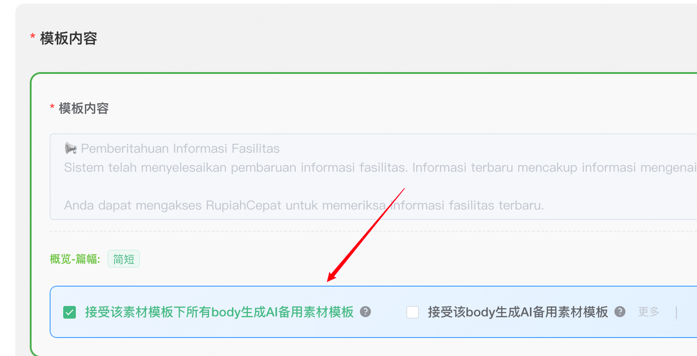
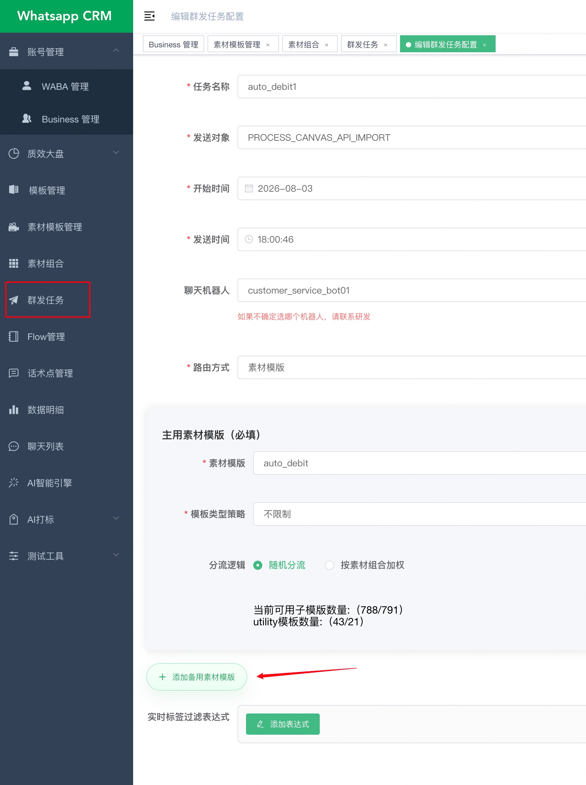

# 20260819_AI备用素材模版PRD

# 1. 背景&目标

## 背景

当前创建群发任务已经支持配置备用素材模版功能，需要依赖运营人工配置

## 目标

- 目标： 创建素材模版时可以直接选择AI生成内容作为备用素材模版，用于创建群发任务时运营未选择备用素材模版时的自动定位为群发任务的备用素材模版
- 预估收益： 在未配置备用素材模版时，marketing类型成功率约在80%左右，AI备用素材模版如果稳定性评级达标，则可以以更低成本更高触达率（utility触达率约95%以上）发送剩余20%失败的部分，若AI备用素材模版稳定性评级不达标，则不使用该AI备用素材模版，不影响正常发送
   - 备用素材模版使用时机：在使用主用素材模板发送消息失败且状态码为：131049-营销限流,130472-实验用户限流 时，在失败重试阶段使用备用素材模板

# 2. UI效果图

## 新建/编辑素材模版

## 创建群发任务

此处页面交互无改动，仅作功能说明

## AI备用素材模版特性说明

AI备用素材模版head、foot、button部分均和原主模版一致（内容和数量），仅对body部分做AI建议，AI body数量取决于运营勾选的AI内容数量，可能少于原素材模版body数量

# 3. 评审记录
