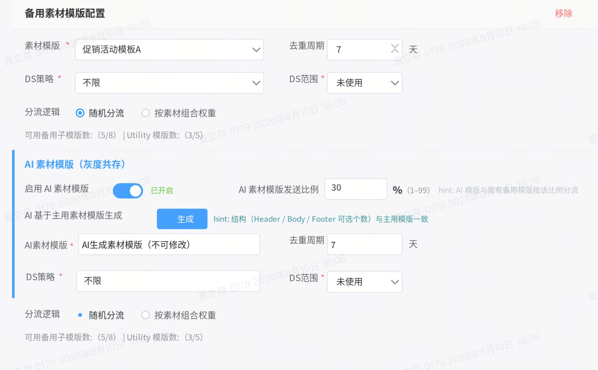

# draft

# 三、功能说明

## 3.1 功能一：素材模版 AI 建议（Body 文案优化）

- 入口：【素材模版-新增素材模版-模版内容】部分，在【预览】【删除】按钮后新增【AI 建议】按钮。
- 对比面板：点击后内联展开对比面板（不跳转弹窗），包含：原内容（左）/ AI 建议内容（右）、AI 建议说明、反馈输入框（选填）、拒绝建议 / 接受建议按钮、关闭按钮。
- 接受建议：原内容替换为 AI 建议内容，面板关闭，二次确认，变量带入等
- 拒绝建议：保留原内容，面板关闭。
- 反馈：选填，接受或拒绝时均可填写，用于增强模型分析能力。

## 3.2 功能二：备用素材模版 AI 生成（灰度共存）

- 入口：【群发任务-群发任务配置（新建/编辑）-提那家备用素材模版】配置区，新增"启用 AI 素材模版"开关。
- 开启后展示：生成 / 重新生成按钮、结构对齐hint、AI 发送比例输入框。
- 生成：基于主用素材模版生成结构（Header/Body/Footer 可选个数）一致的备用模版？？？
   - 具体结构对齐信息包括哪些
- 发送比例：输入 1–99，AI 模版与现有备用模版按该比例分流（如 AI 30% / 现有 70%）。
- 生成中：按钮 loading，比例输入框禁用，防止未完成时提交。
- 生成失败：红色错误提示，可点击"生成"重新生成。
- 开关关闭：AI 相关配置不提交，与现状完全一致。

# 四、UI 效果图

## 4.1 AI 建议 UI 效果图

下方为 Body 元素 AI 建议的对比面板效果图，展示原内容与 AI 建议内容对比、AI 说明、反馈输入与接受 / 拒绝操作。

- 创建素材模版提交时，前期二次弹窗提示，后期稳定后去掉（无产品人员推广，需要流程强制感知营销同事）
- 【AI建议】按钮名称替换为【降低5-10倍whatsapp发送成本参考】？

## 4.2 备用素材模版 AI 生成 UI 效果图

下方画板展示方案二的四个关键状态：① AI 开启后的完整配置界面；② AI 生成中（loading）；③ AI 生成失败（错误提示 + 重试）；④ 流量分流示意（AI 比例 vs 现有备用模版比例）。

# 五、待解决问题

## 5.1 素材模版 AI 建议

- AI 建议接口及参数待定，反馈上报接口待定。
- 接受建议后是否需要二次确认 / 可撤销，待评审。
- 差异高亮（原内容与建议内容的差异标注）列为 P1，是否首版上线待定。
- 重新生成（对同一内容再次获取建议）列为 P2。

## 5.2 备用素材模版 AI 生成

- 业务目标方向是什么？
   - 当前备用素材模版兜底方向偏向于哪方面？
      - 通过提高成本（类型设置为marketing）的方式提高发送率？   这个不对，原来素材模版目的是使用高稳定性评级utility类型备用素材模版补发marketing类型模版高失败率部分（marketing成功率约为80%）
      - 同类兜底？即类型和主用模版一致，只是用于主用模版异常时用备用兜底
   - AI生成模版用于哪个方向？
      - 优化文本内容，在降本（使用utility伪装）的同时保证发送率？是否可行
- AI 创建素材模版的耗时，是否需要异步生成 + 进度提示，待评估。
- 创建后按权重选择素材模版的耗时需验证。
   - 看了下是同步生成素材组，时效性应该没有问题
- 校验逻辑？
   - 已审核通过的模版数等校验？？？
- 后端发送流程需按比例分流，改动范围待评估。
- AI 生成内容的质量校验机制
   - 数据统计分析？
