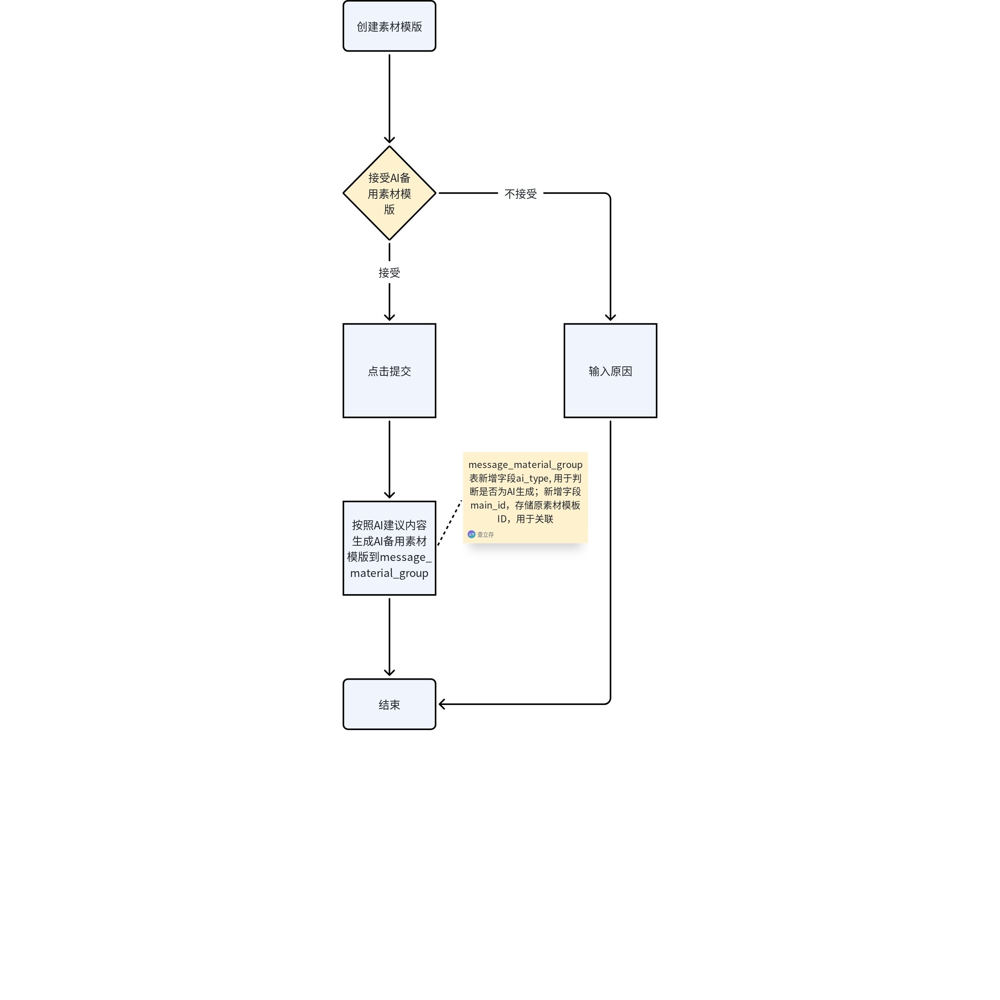
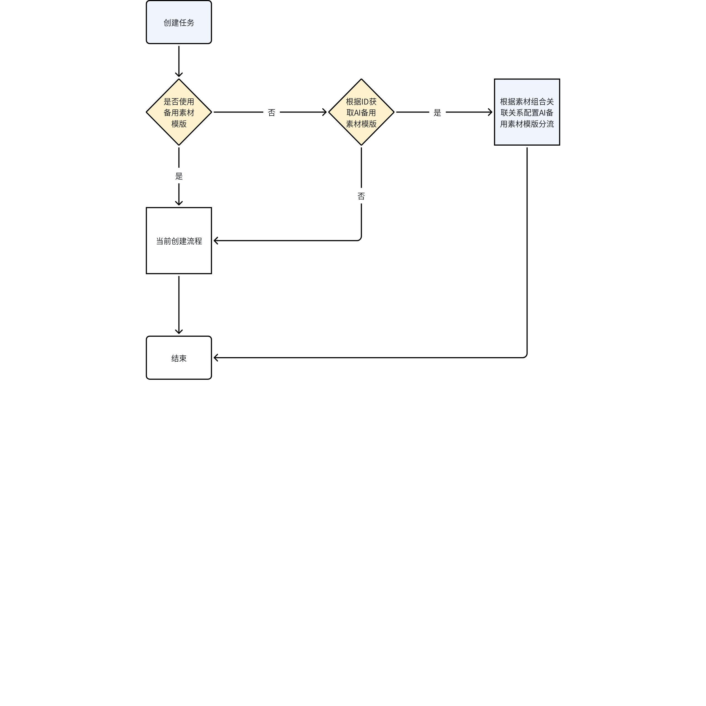
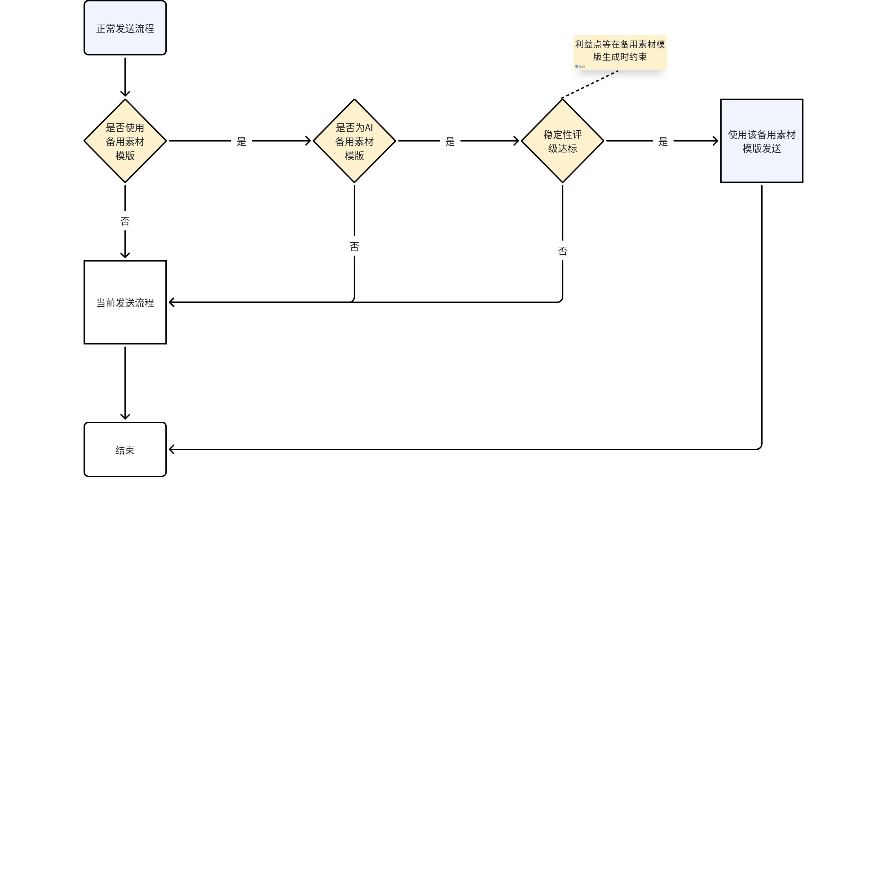

# 流程

# 流程图

简化版用于沟通说明

## 创建素材模版

> （飞书画板，token: JqQTwq15KhjAz8bDbMycDE7cnuh）

- message_material_group

## 生成素材

素材表同样新增ai_type，main_id字段，用于关联组合关系

- message_material

## 生成素材组合

组合表同样新增ai_type，main_id字段，用于关联组合关系

- message_material_combination

## ~~生成子模版~~

~~子模版表同样新增ai_type，main_id字段，用于关联组合关系~~

- message_template
- message_template_waba

## 启停

- 停用、停止生成等操作 关联备用模版
   - 素材模版、素材组合

## 新建任务？

> （飞书画板，token: C9a7wzvHMhLm9JbShM8cMFyQnWb）

## 发送消息？

> （飞书画板，token: GTOJw0xDfha7yPbS0tjcuYikn8e）

稳定性评级发送时是必须判断的

## 监控设计？

因为在message_material_group表中新增了类型，防止勿用，做数据监控

定时任务查message_record表中template字段是否有AI备用模版的发送记录？
