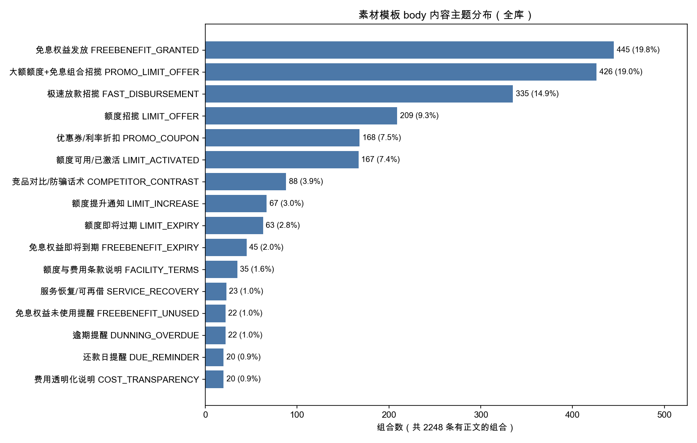

# 20261021_素材body内容主题全量分析

> 📌
> **口径**：`message_material_group` = 素材模板；`message_material_combination` = 素材组合；`message_material` = 素材（MongoDB）。
> **范围**：全库，不抽样。932 个素材模板 / 2269 条素材组合 / 1219 条去重素材正文 / 2248 行有正文。
> **方法**：规则引擎（正则）+ 文本簇归一化，25 个内容主题（闭集）、5 种文案形态，覆盖率 100%。统计时点为 2026-10-21。

# 核心结论

先说三条最需要决策层知道的事实。

1. 这是一套「拉新素材库」，不是「全生命周期素材库」。拉新招揽类（免息、额度、速度、优惠券）合计 77.8%，贷后类（还款提醒、逾期、未还）合计仅 2.2%。
2. 「伪装系统通知」已从个别手法变成默认写作范式。892 行（39.7%）、跨 653 个模板以系统通知口吻开头。其中 74.8% 在通知外壳里嵌了营销钩子。
3. 最大的合规暴露面是「15 detik + 200 juta」，且库内自相矛盾。15 detik 出现 897 行（39.9%）、200 juta 出现 706 行（31.4%）；而竞品对比文案又在说「200 juta 不可信，我们只给 5–10 juta」。

# 取数口径与库压力

本轮从「最近 50 个模板」扩到全库，最大风险是打穿生产库。做法是先用小样本探针验证批量能力，再串行跑全量。

## 关键突破：Mongo 的 $in 是可用的

历史结论「$ 操作符在 DBS 平台静默失效」是错的。用真实 ObjectId 做 4 组对照：单条精确查返回 1 行，`$in` 对象写法、`$in` 双引号写法、`$or` 写法各返回 2 行。

当年失败是语法问题（嵌套层级 + 引号），不是平台限制。这一步把「1219 次点查」压成「25 次批量查」，是能把全量跑下来的前提。

## 降压力设计

| 手段 | 做法 |
|---|---|
| 分页 | MySQL 用 `id < lastId order by id desc limit 50` 的 keyset 游标，禁用 OFFSET |
| 批量 | Mongo 按 `_id $in` 每批 50 个 ObjectId |
| 并发 | 全程串行，零并发 |
| 间隔 | 每批之间 sleep 0.5 秒 |
| 只读 | 只发 SELECT / find，无任何写操作 |

## 实测压力

| 通道 | 请求数 | 服务端累计耗时 | 单次最大 | 单次平均 |
|---|---|---|---|---|
| MySQL（keyset 游标） | 65 | 11.0 秒 | 203 ms | 170 ms |
| Mongo（$in 批量 50 条） | 25 | 1.1 秒 | 50 ms | 43 ms |

合计 90 次请求、约 82 秒完成全库，零缺失（`missing.json` 为空）。

# 全库规模事实

| 指标 | 数值 |
|---|---|
| 素材模板 | 932 |
| 素材组合 | 2269 |
| 有正文的行 | 2248 |
| 正文为空的行 | 21 |
| 去重素材正文 | 1219 |
| 文本簇（归一化去重后） | 907 |
| 只出现 1 次的簇 | 533（58.8%） |
| 正文总字符数 | 229,457 |

长尾很重：近六成文案只出现一次，说明素材生产基本是「一次一稿」。模板状态分布为 ENABLED 595、DISABLED 295、NOT_ENABLED 42；组合状态为 ACTIVE 2182、INACTIVE 87。

# 内容主题分布

按「主主题」统计行数（每行只计一个主主题，合计 2248）；多标签全量共 6814 个，平均每条 3.0 个主题。

*25 个内容主题的行数分布（Top 16）*

| 内容主题 | 行数 | 占比 | 涉及模板 |
|---|---|---|---|
| 免息权益发放 FREEBENEFIT_GRANTED | 445 | 19.80% | 170 |
| 限时额度邀约 PROMO_LIMIT_OFFER | 426 | 18.95% | 74 |
| 极速到账 FAST_DISBURSEMENT | 335 | 14.90% | 232 |
| 额度邀约 LIMIT_OFFER | 209 | 9.30% | 129 |
| 优惠券 PROMO_COUPON | 168 | 7.47% | 82 |
| 额度已激活 LIMIT_ACTIVATED | 167 | 7.43% | 83 |
| 竞品对比 COMPETITOR_CONTRAST | 88 | 3.91% | 8 |
| 提额 LIMIT_INCREASE | 67 | 2.98% | 39 |
| 额度即将到期 LIMIT_EXPIRY | 63 | 2.80% | 13 |
| 免息权益即将到期 FREEBENEFIT_EXPIRY | 45 | 2.00% | 39 |
| 额度条款说明 FACILITY_TERMS | 35 | 1.56% | 31 |
| 服务恢复 SERVICE_RECOVERY | 23 | 1.02% | 7 |
| 免息权益未使用 FREEBENEFIT_UNUSED | 22 | 0.98% | 22 |
| 逾期催收 DUNNING_OVERDUE | 22 | 0.98% | 20 |
| 到期提醒 DUE_REMINDER | 20 | 0.89% | 12 |
| 成本透明 COST_TRANSPARENCY | 20 | 0.89% | 3 |
| 场景营销 SCENARIO_MARKETING | 20 | 0.89% | 4 |
| KYC 认证 KYC_VERIFY | 17 | 0.76% | 7 |
| 账户信息更新 ACCOUNT_UPDATE | 12 | 0.53% | 9 |
| 申请状态 APPLY_STATUS | 11 | 0.49% | 9 |
| 注册状态 REGISTRATION_STATUS | 10 | 0.44% | 7 |
| 未还款提示 DUNNING_UNPAID | 8 | 0.36% | 5 |
| 测试占位 TEST_PLACEHOLDER | 6 | 0.27% | 1 |
| 信任建立 TRUST_BUILDING | 5 | 0.22% | 2 |
| 客服引导 CUSTOMER_SERVICE | 4 | 0.18% | 3 |

前 6 个主题合计 1750 行，占 77.8%。`COMPETITOR_CONTRAST` 只用 8 个模板就产出了 88 行，是单位模板产出最高的主题，说明它是被集中投流的固定话术包。

# 文案形态分布

| 文案形态 | 簇数 | 行数 | 行占比 | 涉及模板 |
|---|---|---|---|---|
| 伪装系统通知 DISGUISED_SYSTEM_NOTICE | 552 | 892 | 39.7% | 653 |
| 营销直推 MARKETING_PITCH | 165 | 825 | 36.7% | 154 |
| 其他 OTHER | 106 | 339 | 15.1% | 82 |
| 交易事务 TRANSACTIONAL | 43 | 121 | 5.4% | 47 |
| 催收 DUNNING | 41 | 71 | 3.2% | 35 |

伪装通知的典型开头高度同质：`📢 Pemberitahuan Sistem…`、`📢 Pemberitahuan Informasi Fasilitas…`、`📢 Pemberitahuan Status Akun…`。892 行里有 818 行明确带 `Pemberitahuan / Notifikasi / Pembaruan` 这类系统词。

同时，74.8%（667 行）在通知外壳里嵌了营销钩子（200 juta、15 detik、免息、点击、申请等），真正「只讲状态、不卖东西」的纯通知只有 225 行。也就是说，绝大多数通知并不承担告知职能。

# 期限档位分布

正文中能提取到明确期限的有 642 行（占 2248 行正文的 28.6%），其余正文不含期限表述。

| 期限（天） | 行数 |
|---|---|
| 3 | 22 |
| 5 | 18 |
| 7 | 50 |
| 9 | 2 |
| 10 | 16 |
| 14 | 7 |
| 15 | 35 |
| 20 | 61 |
| 30 | 408 |
| 40 | 2 |
| 45 | 6 |
| 50 | 2 |
| 60 | 18 |

30 天占 63.6%（408/642），远超其他档位，与「30 hari bebas bunga」（408 行）的免息活动周期完全重合。这不是期限设计的自然分布，而是活动周期直接决定文案周期。

# 按素材模板聚合

## 扇出分布

| 每个模板的组合数 | 模板数 |
|---|---|
| 1 | 653（70.1%） |
| 2 | 155 |
| 3 | 40 |
| 4 | 14 |
| 5 | 5 |
| 6–10 | 38 |
| 11–20 | 19 |
| > 20 | 8 |

653 个模板（70.1%）只有 1 条组合，即「一个模板 = 一条文案」，没有做 A/B 或多文案轮换。只有 65 个模板挂了 6 条以上组合，是实际在做文案实验的部分。

## 扇出 Top 15

| 模板 ID | 模板名 | 组合数 | 主主题 | 主题数 |
|---|---|---|---|---|
| 80 | 200juta15detik_unreg | 108 | 限时额度邀约 | 3 |
| 74 | newgood_quota_200juta_618 | 100 | 限时额度邀约 | 4 |
| 1000161 | sucai_free30d_01 | 91 | 免息权益发放 | 2 |
| 1000160 | sucai_200juta_01 | 91 | 免息权益发放 | 2 |
| 59 | 200juta15detik | 62 | 限时额度邀约 | 1 |
| 17 | 100juta5menit_2 | 38 | 限时额度邀约 | 1 |
| 60 | newgood_quota_200juta | 24 | 限时额度邀约 | 1 |
| 1 | newgood_quota | 24 | 限时额度邀约 | 1 |
| 2000533 | newgotlimit_09_02_ai_backup | 20 | 额度即将到期 | 3 |
| 2000532 | newgotlimit_09_02 | 20 | 额度即将到期 | 2 |
| 46 | innerwhite_flow_0509 | 20 | 限时额度邀约 | 1 |
| 44 | huabu_quality12_registerd_260509 | 20 | 优惠券 | 2 |
| 2000081 | old_increase_01 | 18 | 提额 | 1 |
| 76 | sucai_01_1 | 16 | 竞品对比 | 2 |
| 1000089 | sucai_qy_04 | 15 | 免息权益发放 | 3 |

模板 80 `200juta15detik_unreg` 有 108 条组合，但只引用 9 个去重素材，单个素材被重复挂载 12 次；模板 1 `newgood_quota` 的 24 条组合更是只用了 1 个素材。**组合数量不等于文案多样性**，这是后续做素材治理要区分的关键。

扇出 Top 8 里有 6 个名字带 `200juta` 或 `100juta`，说明大额额度是投流重点。

## 主题集中度

| 一个模板包含的主题数 | 模板数 |
|---|---|
| 1 | 860 |
| 2 | 60 |
| 3 | 9 |
| 4 | 1 |

92.5% 的模板是单一主题，模板本身在做「一件事」。多主题模板（70 个）通常是 `_ai_backup` 与其正式版混在一个模板里，或者模板复用了不同业务的正文。

集中度基于 930 个模板统计：`2000673 yl_limited_01` 与 `2000651 carousel01` 的唯一组合正文为空，无主题，已自然排除。

# 合规风险扫描（OJK 红线）

按印尼 OJK 对线上借贷广告的常见监管口径，设 8 条规则做全库扫描。

| 规则 | 含义 | 簇数 | 行数 | 涉及模板 | 判定 |
|---|---|---|---|---|---|
| 003 | 5/10/15 秒到账 | 252 | 662 | 303 | 高危 |
| 008 | 宣称 200 juta 额度 | 156 | 709 | 124 | 高危 |
| 001 | 审批率 99% / 100% | 16 | 69 | 10 | 关注 |
| 005 | 100% 安全 / 绝对可靠 | 10 | 54 | 6 | 关注 |
| 006 | 无门槛 / 无复杂条件 | 3 | 39 | 2 | 关注 |
| 004 | 全印尼最低 / 第一 | 1 | 2 | 1 | 少量 |
| 007 | 委外催收 / 第三方移交 | 2 | 2 | 1 | 少量 |
| 002 | 保证获批 / 保证到账 | 0 | 0 | 0 | 无 |

## 两个最大的暴露面

**极速到账（003）——662 行、303 个模板。**`15 detik` 出现在 897 行正文中（占 39.9%），是出现频率最高的一个数字。其中 667 行已经用了 `mulai dari 15 detik`（「从 15 秒起」）这类合规表述，但仍有 230 行是「Cair dalam 15 detik」「Dana cair cuma 15 detik」这类确定性承诺，分布在 51 个模板里。

**200 juta 额度（008）——709 行、124 个模板。**问题不在于能不能给到 2 亿，而在于把极端上限当成普适卖点反复呈现。`maksimal`（最高）这个词大部分文案是有的，但资质条件说明通常被放在末尾一长串 emoji 之后，或者干脆不写。

剔除竞品对比话术后，正向上限宣称有 628 行、122 个模板，其中 76 行（30 个模板）连 `maksimal / hingga / sampai / syarat` 这类限定词都没有，直接写成 `Rp200 JUTA ADA DI SINI`、`Rp200 JUTA LIMIT BESAR TERSEDIA UNTUKMU`。

**上限数字被高频、醒目地呈现，限定条件被弱化**，这是这条规则判高危的真实原因。

## 一个值得单独说的发现：竞品对比话术在「纠正」自己

`COMPETITOR_CONTRAST` 的 88 行里，81 行是这样写的：

> Jangan mudah tergiur limit besar Rp200 juta yang belum tentu cair. Rupiah Cepat hadir dengan limit realistis Rp5–10 juta jauh lebih aman dan nyata.

同一家公司在**同一批素材库里**同时存在两套说法：一套说自己能给 2 亿，一套说「别人说 2 亿不可信、我们只给 5–10 juta 才实在」。

更关键的是，这两套说法在**同一个模板内**并存，不是不同模板的风格差异：

| 模板 | 正向宣称 200 juta | 否定 200 juta | 状态 |
|---|---|---|---|
| 80 200juta15detik_unreg | 60 行 | 36 行 | ENABLED |
| 74 newgood_quota_200juta_618 | 50 行 | 30 行 | ENABLED |
| 2000414 yl_backup_0919 | 4 行 | 1 行 | ENABLED |

这不是文案风格差异，是**同一主体在同一渠道上的前后矛盾陈述**，属于比单条违规更容易被投诉的形态。用户如果在同一时段收到同一模板下的两条素材，会直接看到自相矛盾。

## 规则 002 的修正

初版规则 `pasti (disetujui|cair)` 扫出 26 行「保证到账」，逐条核对后全部是误判——命中的是 `belum tentu pasti cair`（「不一定能到账」，是否定句）。加入负向断言 `(?<!belum tentu )` / `(?<!tidak )` 后归零。

因此结论是：**全库没有出现「保证获批 / 保证到账」的直接承诺**，这一点是合规的。但要注意，`kompetitor` 类文案里大量出现「pasti cair」的否定形式，说明这类词在语料中高频存在，规则一旦放宽就会误报。

# 数据质量问题

| # | 问题 | 数量 | 位置 | 影响 |
|---|---|---|---|---|
| 1 | 组合的 `body_material_id` 为空 | 21 行 | 10 个模板，如 2000405 yl_card_0915（6）、2000528 newexpiredlimit_09_02（3） | 该组合下发时无正文，用户可能收到空消息 |
| 2 | 测试占位文案 test1 / test2 | 6 行 | 模板 39 liuyu_test | 生产模板里残留测试数据 |
| 3 | 正文混入中文「第1轮 成本优先」 | 2 行 | 2000744 / 2000745 | AI 生成时的中文前缀未清理 |
| 4 | 正文混入微信撤回提示「你撤回了一条消息」 | 6 行 | 1000169 old_sleep_chat1 / 1000170 old_sleep_chat2 | 文案从微信聊天复制而来，带上了系统提示 |
| 5 | 句子缺词 | ≥1 簇 | 簇 #051 `Pinjaman Rp {{1}} Anda telah !` | `telah` 后缺动词，用户可见病句 |
| 6 | 品牌拼写混用 | — | RupiahCepat 765 行 vs Rupiah Cepat 530 行 | 同一品牌两种写法，未统一 |
| 7 | `_ai_backup` 模板占比过高 | 216 / 932 个模板（308 行） | 全库 | 备份模板与正式版并存，实际投放时容易混淆 |

## 关于 _ai_backup

216 个模板名带 `_ai_backup`，且几乎都与一个同名正式模板成对出现（如 `2000532 newgotlimit_09_02` 与 `2000533 newgotlimit_09_02_ai_backup`）。从阶段九的抽样看，两版正文往往只差一个前导空格。

这意味着**当前素材库有近四分之一的容量是 AI 备用素材的副本**。做容量治理、主题去重、合规扫描时，都应把 `_ai_backup` 单独标记，否则会重复计数。

## 空正文的成因

21 行空正文全部是 `body_material_id` 为空字符串，而不是「指向了一个不存在的素材」。也就是组合配置层面就没有绑定正文，属于**配置缺失**，不是数据同步问题。建议加一条约束：组合启用前校验 `body_material_id` 非空。

# 发散性结论

## 这是一套「拉新素材库」，不是「全生命周期素材库」

拉新招揽类（免息/额度/速度/优惠券）合计 77.8%，贷后类（还款提醒/逾期/未还）合计 2.2%。素材库的产能几乎全压在前端获客。

从业务上讲，这可能是有意为之（贷后触达走另一套系统或人工），也可能是素材运营的资源倾斜。**如果是后者，贷后触达的素材丰富度不足会直接影响回收率**——毕竟 50 条贷后文案要覆盖全部存量用户的所有账期状态。

## 伪装系统通知是系统性手法，不是个别现象

892 行（39.7%）以系统通知口吻开头，跨 653 个模板。这么大的比例说明它已经是**默认写作范式**。查证后确认，这不是运营同学的自发偏好，而是 `ai_material_suggestion_rule` 表里的明文规则在驱动：

| 规则码 | 规则名 | 内容要点 | 优先级 |
|---|---|---|---|
| AI_SUGG_000 | 营销伪装整体策略指南 | 将营销文案伪装成系统通知：用「系统检测到/已为您准备」替代「快来领取」；用「状态通知/额度提醒」替代「促销活动」 | 900 |
| AI_SUGG_001 | 推荐使用系统事务性词汇 | 使用 Sistem / Otomatis / Status / Log / Konfigurasi，增加官方通知感知 | 850 |
| AI_CONS_001 | 风险词伪装为中性词 | 将 Dapatkan / Sekarang / Cepat / Promo / Kesempatan 伪装为 tersedia / status / konfigurasi | 800 |
| AI_CONS_002 | 表情符号优先使用中性通知类 | 优先 📢✅⚠️，避免 😍🎉🤑 | 799 |
| AI_SUGG_003 | 使用陈述句隐含行动号召 | 全部用陈述句描述客观状态，禁止祈使句催促行动 | 848 |

这 5 条规则（在 `AI_BACKUP_MATERIAL_GROUP` 与 `COST_FIRST` 两条 lane 各一份，共 10 条记录）全部 `enabled=1`，且优先级为 799–900，低于 OJK 系列红线（1000）但高于通用约束（848–950）。

也就是说，问题不在运营执行，而在**规则设计本身**：系统被明确要求把商业推广包装成系统通知。这与同表里的 `OJK_CONS_009`（信息必须真实、清晰、完整、非误导）在目标上直接冲突，后者优先级 1000 却无法拦住前者，因为前者控制的是*表达形式*，后者约束的是*信息真伪*，两者在规则引擎里不构成冲突。

这种手法的收益是打开率，风险有两个：

1. 监管层面，把商业推广伪装成系统通知，在印尼属于容易引起 OJK 关注的行为；
2. 用户层面，长期使用会钝化对「系统通知」的敏感度，真正的账务通知（还款日、逾期）反而可能被忽略——而这类通知只占 3.2%。

## 数字承诺高度集中，且互相矛盾

`15 detik` 897 行、`200 juta` 706 行、`30 hari` 408 行、`0,01` 83 行。四个数字撑起了整套素材的说服力。问题在于：

- 15 秒是确定性表述，实际到账受银行清算、风控复核影响，做不到确定性；
- 200 juta 是上限，但呈现方式像普适承诺；
- 0,01%/天 是「最低」利率，同样需要限定；
- 30 天免息是真实活动，但和「200 juta」叠在一起讲时，容易被理解为「借 2 亿也免息 30 天」。

另一组数据是 `COMPETITOR_CONTRAST` 里的「我们只给 5–10 juta，2 亿不可信」。两套数字在同库共存，是当前最大的表述风险点。

## 文案复用率低，模板扇出集中

907 个文本簇对应 2248 行正文，533 个簇只出现 1 次（58.8%）。同时 70.1% 的模板只有 1 条组合。两个数字指向同一个事实：**素材生产以「一模板一文案」为主流，缺少成体系的文案家族**。少数模板（65 个）承担了大部分文案轮换，且轮换的往往是同一个素材反复挂载。

# 产物与复现

| 脚本 | 作用 |
|---|---|
| `fetch_all_material_bodies.py` | 全量取数：MySQL keyset 分页 + Mongo $in 批量，输出 groups / combos / bodies / timing |
| `cluster_full_bodies.py` | 文本归一化去重，2248 行聚成 907 簇 |
| `classify_full.py` | 25 个内容主题 + 5 种文案形态规则引擎分类，覆盖率 100% |
| `aggregate_full.py` | 模板聚合、8 条 OJK 红线扫描、期限分档、图表生成 |
| `probe_mongo_in.py` | $in / $or 可用性对照探针 |

| 数据文件 | 内容 |
|---|---|
| `groups.json` | 932 个素材模板 |
| `combos.json` | 2269 条素材组合 |
| `bodies.json` | 1219 条素材正文 |
| `rows.json` | 2269 行扁平表 |
| `clusters.json` | 907 个文本簇 |
| `classified.json` | 簇级主题与形态 |
| `enriched_rows.json` | 2248 行行级明细（含主题列表） |
| `groups_aggregated.json` | 930 个模板聚合结果 |
| `risk_scan.json` | 8 条 OJK 红线命中 |
| `timing.json` | 90 次请求逐条耗时 |
| `theme_distribution_full.png` | 主题分布图 |

> 💡
> 本报告的统计口径为「素材组合行」，分母 2248 行有正文的组合；主题数按主主题单计（合计 2248），多标签全量为 6814。占比均为行数占比，非模板数占比。所有数字可用 `enriched_rows.json` 复算。
