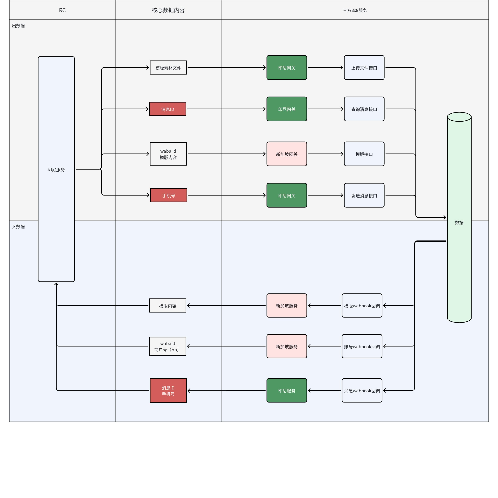

# 20260811-8x8对接网络合规问题确认

# 背景 

## 合规问题

1. 8x8模版回调只能从新加坡IP发起，但是咱们印尼服务不能对印尼以外IP加白名单
2. 调用8x8接口到底是使用.com域名还是.id域名，现在.com域名上传文件接口返回403，.id域名创建模版返回404；这个怎么解决或者混合使用是否有合规性问题？

## 当前网络数据交互

> （飞书画板，token: R1kCwBLDuhGK2BbtvqIcDDuBn9g）

背景：新接入8x8三方

无端点合规性问题部分：

- 8x8的模版内容、商户号、wabaId、手机号等信息都是存储在【印尼】的
- 发送、拉取、回调消息（含手机号等敏感信息）是通过【印尼】网关进行交互

新接入8x8通道问题（部分端点 不在印尼）：

- 创建模板，RC会给三方8x8传【模板内容】【商户号】【Waba ID】(公开信息或营销素材)，三方网关在【新加坡】
- Webhook回调，三方8x8把模板、商户、Waba信息(含字段变动)回传RC，三方8x8服务在【新加坡】

目前想要使用的方案是否有安全等合规问题？

- 对于端点不在印尼的数据交互，通过公网域名转发，同时运维在网关层加IP白名单，代码里IP白名单、接口鉴权等校验

问题：

8x8的数据存储在印尼，但是模版、wabaId、商户号（均不含用户手机号等消息敏感信息）回调我们更新状态是从新加坡IP发起，由于我们印尼环境不能对印尼外的IP进行加白，故希望沿用Vonage方案使用公网接收回调的方式来接收回调

## 8x8域名

chatapps.8x8.com：13.215.119.242、13.228.223.246、18.136.190.220-新加坡

chatapps.8x8.id：34.34.217.244-印尼

# 参考历史处理方案

关于1，

发送消息，RC会给三方Vonage传【手机号】，三方Vonage的网关在【印尼】

创建模板，查询模板、商户、Waba账户信息，RC会给三方Vonage传【模板内容】【商户号】【Waba ID】(公开信息或营销素材)，三方接口服务不在印尼

查询消息详情，RC会给三方Vonage传【消息ID】，三方Vonage接口服务【不在印尼】

Webhook回调，三方Vonage把消息、模板、商户、Waba信息(含字段变动)回传RC，三方Vonage服务IP不在印尼，RC用公网域名接收
