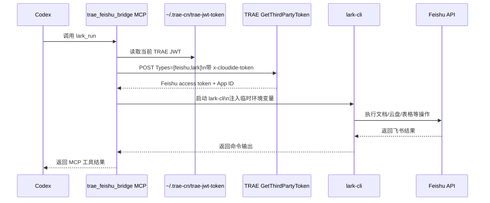

# TRAE 授权飞书懒加载 MCP 桥接实现与维护说明

## 1. 文档目的

本文说明 Codex 通过本机 TRAE 授权访问飞书的实现方式，供后续维护、故障排查、功能扩展、临时关闭和恢复时参考。

当前实现支持 Codex 在明确需要读写飞书时，按需调用本地 MCP 服务。普通代码编辑、文件读取、数据库查询和其他不涉及飞书的请求不会触发 TRAE 授权调用。

本文对应的实现状态截至 **2026 年 11 月 6 日**，当前桥接版本为 `0.2.0`。

## 2. 背景与问题定位

Codex 本身无法直接完成企业飞书 OAuth 授权，但本机 TRAE 已经具备企业飞书授权。最初方案尝试在 TRAE 中安装一个自定义扩展，由扩展监听 `127.0.0.1:18763`，向外暴露 TRAE 的飞书 token。

经过实际排查，旧方案存在以下问题：

- TRAE CN 虽然扫描到了自定义扩展目录，但当前运行会话没有激活该扩展。
- `127.0.0.1:18763` 没有监听服务，导致 Codex 调用时始终收到 `TRAE broker is unavailable`。
- TRAE 的飞书 token 实际由 TRAE 内部 Lark 插件运行时注入到 `lark-cli` 子进程，普通进程环境无法直接复用。
- 直接调用普通 `lark-cli` 配置会使用本地 CLI 的默认 App 配置，可能返回 `invalid_client`，不能代表 TRAE 的授权是否有效。

最终采用的方案是复用 TRAE 当前会话 JWT：

1. TRAE 将当前会话 JWT 保存在 `~/.trae-cn/trae-jwt-token`。
2. 桥接工具在实际飞书调用时读取该 JWT。
3. 桥接工具调用 TRAE 官方 `GetThirdPartyToken` 接口，换取 Feishu/Lark 第三方访问 token。
4. 桥接工具将 token、App ID 和品牌注入本次 `lark-cli` 子进程。
5. `lark-cli` 完成飞书读写后退出，token 不写入文件。

该方案不依赖自定义 TRAE 扩展，也不依赖 `127.0.0.1:18763`。

## 3. 当前整体架构



关键点是：MCP 服务启动和工具发现阶段不会读取 JWT。只有调用 `lark_whoami` 或 `lark_run` 时才会进入授权链路。

## 4. 文件和配置位置

### 4.1 当前工作区文件

| 路径 | 作用 |
|---|---|
| `/Users/opay-20260271/code-temp/ai-md/whatsapp_crm_docs/tools/trae-feishu-bridge/server.py` | MCP stdio 服务主程序；负责懒加载、JWT 换 token、调用 `lark-cli` 和返回 JSON-RPC 结果 |
| `/Users/opay-20260271/code-temp/ai-md/whatsapp_crm_docs/tools/trae-feishu-bridge/run.sh` | MCP 启动脚本 |
| `/Users/opay-20260271/code-temp/ai-md/whatsapp_crm_docs/tools/trae-feishu-bridge/tests/test_bridge.py` | 懒加载、授权交换、安全和参数校验测试 |
| `/Users/opay-20260271/code-temp/ai-md/whatsapp_crm_docs/tools/trae-feishu-bridge/README.md` | 工具目录级简要说明 |

### 4.2 Codex 全局配置

配置文件：

```text
/Users/opay-20260271/.codex/config.toml
```

当前注册项：

```toml
[mcp_servers.trae_feishu_bridge]
type = "stdio"
command = "/Users/opay-20260271/code-temp/ai-md/whatsapp_crm_docs/tools/trae-feishu-bridge/run.sh"
startup_timeout_sec = 30
```

当前还为 `lark_whoami` 配置了审批模式：

```toml
[mcp_servers.trae_feishu_bridge.tools.lark_whoami]
approval_mode = "approve"
```

如果后续调整 MCP 服务路径，必须同步修改这个配置，否则 Codex 会继续启动旧路径。

### 4.3 TRAE 授权文件

默认 JWT 文件：

```text
/Users/opay-20260271/.trae-cn/trae-jwt-token
```

该文件属于 TRAE 会话状态，不应复制到仓库、写入文档、打印到日志或提交 Git。桥接工具只读取它，不修改它。

## 5. 授权和懒加载实现

### 5.1 默认配置

`server.py` 中的关键默认值：

```python
DEFAULT_TRAE_JWT_PATH = "/Users/opay-20260271/.trae-cn/trae-jwt-token"
DEFAULT_TRAE_TOKEN_URL = "https://api.trae.cn/trae/api/v3/GetThirdPartyToken"
DEFAULT_LARK_CLI = "/opt/homebrew/bin/lark-cli"
DEFAULT_TIMEOUT = 120
MAX_TIMEOUT = 600
```

### 5.2 每次调用的授权过程

`fetch_trae_access_token()` 执行以下步骤：

1. 读取 `TRAE_JWT_PATH` 指定的文件。
2. 使用 POST 请求访问 `TRAE_THIRD_PARTY_TOKEN_URL`。
3. 请求体为：

   ```json
   {
     "Types": ["feishu", "lark"]
   }
   ```

4. 请求头携带：

   ```text
   Content-Type: application/json
   x-cloudide-token: <当前 TRAE JWT>
   ```

5. 从返回的 `Result` 中选择 `Type=feishu` 或 `Type=lark` 的记录。
6. 提取 `AccessToken`、App ID；如果返回中没有 App ID，则使用品牌对应的备用 App ID。

授权 token 只保存在 Python 进程内存和 `lark-cli` 子进程环境中。命令结束后，桥接进程不会主动把 token 写入任何文件。

### 5.3 工具启动阶段

启动阶段只处理 MCP JSON-RPC：

- `initialize`
- `ping`
- `tools/list`
- `notifications/initialized`

这些路径不会调用 `fetch_trae_access_token()`，因此不会读取 JWT，也不会访问 TRAE 接口。

### 5.4 实际调用阶段

有两个工具会触发授权：

| 工具 | 是否获取飞书 token | 作用 |
|---|---:|---|
| `bridge_health` | 否 | 检查 JWT 文件和 `lark-cli` 是否存在 |
| `lark_whoami` | 是 | 获取当前 Feishu 用户身份 |
| `lark_run` | 是 | 执行指定的 `lark-cli` 飞书命令 |

## 6. MCP 工具说明

### 6.1 `bridge_health`

用途：检查桥接运行前提，不申请飞书 token。

典型返回：

```json
{
  "ok": true,
  "jwt_path_available": true,
  "lark_cli": "/opt/homebrew/bin/lark-cli"
}
```

`ok=false` 时优先检查：

- JWT 文件是否存在；
- 当前用户是否有读取权限；
- `lark-cli` 是否存在且可执行。

### 6.2 `lark_whoami`

用途：验证 TRAE JWT 能否换取 Feishu token，并确认当前身份。

该工具不会修改飞书数据，适合做连通性和授权排查。

### 6.3 `lark_run`

用途：执行任意允许的 `lark-cli` 命令，支持飞书文档、Wiki、云盘、表格、Base、日历、任务等能力。

示例参数：

```json
{
  "args": [
    "docs",
    "+fetch",
    "--doc",
    "https://feishu.cn/docx/xxx",
    "--doc-format",
    "markdown",
    "--as",
    "user"
  ],
  "timeout": 120
}
```

文档写入示例：

```json
{
  "args": [
    "docs",
    "+update",
    "--doc",
    "https://feishu.cn/docx/xxx",
    "--command",
    "append",
    "--doc-format",
    "markdown",
    "--content",
    "新增内容",
    "--as",
    "user"
  ],
  "timeout": 120
}
```

实际使用时，应先遵循对应的 `lark-*` 技能说明，尤其是文档更新、表格、Base 和高风险写操作。

## 7. 安全限制

### 7.1 禁止本地授权配置命令

桥接工具拒绝以下本地授权或配置命令：

```text
auth login
auth logout
config init
config remove
profile add
profile remove
profile use
```

这样可以防止 Codex 通过桥接工具覆盖 TRAE 或 Lark CLI 的本地授权配置。

### 7.2 不返回敏感凭据

桥接工具会对 `lark-cli` 标准输出和错误输出中的当前 access token 做替换，避免 token 被返回给 Codex。

错误消息也不会包含：

- TRAE JWT 内容；
- Feishu access token；
- 原始 TRAE 授权响应；
- App Secret。

### 7.3 不修改 TRAE 文件

桥接工具默认只读取：

```text
/Users/opay-20260271/.trae-cn/trae-jwt-token
```

它不会修改 `.trae` 或 `.trae-cn` 下的文件。

## 8. 环境变量

可以通过环境变量覆盖默认路径和命令：

| 变量 | 默认值 | 用途 |
|---|---|---|
| `TRAE_JWT_PATH` | `/Users/opay-20260271/.trae-cn/trae-jwt-token` | 覆盖 TRAE JWT 文件路径 |
| `TRAE_THIRD_PARTY_TOKEN_URL` | `https://api.trae.cn/trae/api/v3/GetThirdPartyToken` | 覆盖 TRAE 授权交换接口 |
| `LARK_CLI` | `/opt/homebrew/bin/lark-cli` | 覆盖 `lark-cli` 路径 |
| `LARKSUITE_CLI_BRAND` | `feishu` | 覆盖品牌选择 |

一般情况下不需要配置这些变量。只有 TRAE 安装位置、CLI 路径或环境发生变化时才需要调整。

## 9. 使用和验证流程

### 9.1 启动前检查

在 Codex 中调用 `bridge_health`，或者在本地执行 MCP 启动协议：

```bash
printf '%s\n' '{"jsonrpc":"2.0","id":1,"method":"tools/call","params":{"name":"bridge_health","arguments":{}}}' \
  | /Users/opay-20260271/code-temp/ai-md/whatsapp_crm_docs/tools/trae-feishu-bridge/run.sh
```

### 9.2 身份验证

使用 `lark_whoami` 验证 TRAE JWT 交换链路。成功时应看到：

- `identity` 为 `user` 或当前指定身份；
- `tokenStatus` 为 `ready`；
- 有效的 Feishu App ID；
- 如果使用用户身份，会出现当前用户信息。

### 9.3 文档只读验证

```text
读取这个飞书文档：https://q6oisf77xb.feishu.cn/wiki/F9Mmw8yfCiwaT1k6gsycRMCtnYe
```

### 9.4 文档写入验证

应先明确写入内容和位置。测试连通性时建议使用文档末尾追加一行，避免覆盖原文：

```text
在这个飞书文档末尾追加一行“TRAE Feishu Bridge 连通性验证”。
```

写入后必须重新读取文档，确认：

- 返回 `result=success`；
- revision 发生变化；
- 新内容确实存在；
- 文档 ID 未发生变化。

## 10. 常见故障排查

### 10.1 `TRAE session JWT is unavailable`

检查：

```bash
ls -l /Users/opay-20260271/.trae-cn/trae-jwt-token
```

处理方式：

1. 确认 TRAE CN 已登录并正常运行。
2. 重新打开或重新登录 TRAE。
3. 确认 JWT 文件重新生成或更新时间刷新。
4. 再次调用 `bridge_health` 和 `lark_whoami`。

不要手工修改 JWT 文件。

### 10.2 `TRAE authorization exchange failed with HTTP 401`

可能原因：

- TRAE JWT 已过期；
- TRAE 会话已退出；
- 当前 JWT 已被撤销；
- TRAE 官方接口发生变化。

处理方式：

1. 先在 TRAE 中确认账号仍然登录。
2. 重新登录或重启 TRAE。
3. 检查 JWT 文件是否刷新。
4. 再执行身份验证。

### 10.3 `TRAE authorization exchange failed with HTTP 403`

可能原因：

- 企业授权范围不足；
- 当前账号没有对应 Feishu 权限；
- TRAE 侧策略拒绝当前请求。

此时不要执行 `lark-cli auth login` 试图绕过 TRAE 授权，应先在 TRAE 中确认企业授权状态。

### 10.4 `lark-cli executable was not found`

检查：

```bash
ls -l /opt/homebrew/bin/lark-cli
which lark-cli
```

如果 CLI 路径改变，可以通过 `LARK_CLI` 覆盖，或修改 `resolve_lark_cli()` 的候选路径。

### 10.5 `invalid_client`

如果直接执行普通 `lark-cli` 返回：

```text
The specified app is not enabled.
```

通常表示使用了本地 CLI 默认 App 配置，而不是 TRAE 换出的 App ID 和 access token。应通过 `trae_feishu_bridge` 的 `lark_whoami` 或 `lark_run` 调用，不要直接依赖普通 `lark-cli` 的本地 profile。

### 10.6 旧错误：`TRAE broker is unavailable`

这是旧版 `127.0.0.1:18763` broker 方案的错误。当前实现不再使用该 broker。

如果仍然看到该错误，通常意味着：

- Codex 仍在使用旧的 MCP 进程；
- Codex 没有重新加载 `/Users/opay-20260271/.codex/config.toml`；
- 当前 MCP 配置仍指向旧脚本或旧工作区。

处理方式：

1. 重启 Codex。
2. 确认配置中的 command 指向当前 `run.sh`。
3. 重新调用 `bridge_health`。
4. 检查启动返回的 `serverInfo.version` 是否为 `0.2.0`。

## 11. 关闭、恢复和回滚

### 11.1 临时关闭飞书桥接

编辑：

```text
/Users/opay-20260271/.codex/config.toml
```

删除或注释以下配置段：

```toml
[mcp_servers.trae_feishu_bridge]
type = "stdio"
command = "/Users/opay-20260271/code-temp/ai-md/whatsapp_crm_docs/tools/trae-feishu-bridge/run.sh"
startup_timeout_sec = 30
```

同时删除其子配置：

```toml
[mcp_servers.trae_feishu_bridge.tools.lark_whoami]
approval_mode = "approve"
```

重启 Codex 后，Codex 将不再发现该 MCP 服务。

### 11.2 恢复桥接

恢复上述配置后重启 Codex，然后依次执行：

1. `bridge_health`
2. `lark_whoami`
3. 一次飞书只读操作

### 11.3 代码级回滚

如果需要回滚当前桥接代码：

- 保留或删除 Codex 配置均可；
- 若删除工具目录，必须同时删除 Codex 配置中的 `mcp_servers.trae_feishu_bridge`；
- 不要删除或覆盖 `/Users/opay-20260271/.trae-cn/trae-jwt-token`；
- 不要修改旧的 TRAE 扩展目录来尝试恢复旧方案。

本仓库按约定不自动提交 Git，后续需要回滚时使用现有工作区差异或外部备份。

### 11.4 仅停止当前 MCP 子进程

MCP 服务是 stdio 子进程。关闭 Codex 或重启 Codex 后，该进程会随会话结束，不需要单独停止端口服务，因为当前方案没有常驻 HTTP broker。

## 12. 测试和验收

测试文件：

```text
tools/trae-feishu-bridge/tests/test_bridge.py
```

运行：

```bash
python3 -m unittest discover \
  -s tools/trae-feishu-bridge/tests \
  -p 'test_*.py' \
  -v
```

当前测试覆盖：

- MCP 工具注册阶段不读取 TRAE JWT；
- 实际 `lark_run` 调用时才获取授权；
- TRAE JWT 能正确换取 Feishu token；
- JWT 不出现在错误信息中；
- 本地授权配置命令被拒绝。

验收时还应执行一次实际只读调用，例如 `lark_whoami` 或 `docs +fetch`。涉及写入时，写入后必须回读验证 revision 和正文。

## 13. 后续改动注意事项

### 13.1 修改授权接口

如果 TRAE 官方接口路径、请求体或返回结构变化，应修改：

```text
tools/trae-feishu-bridge/server.py
```

重点检查：

- `DEFAULT_TRAE_TOKEN_URL`；
- `fetch_trae_access_token()`；
- `_extract_token_and_app_id()`；
- 对 `Result` / `result` 字段的兼容；
- `AccessToken`、App ID 和 `Type` 字段解析。

修改后必须补充单元测试，并完成真实 `lark_whoami` 验证。

### 13.2 修改懒加载行为

不要在以下函数中读取 JWT或调用 TRAE 接口：

- `build_tool_definitions()`；
- `main()` 的启动初始化路径；
- `bridge_health()`。

授权读取必须留在实际工具调用路径中。

### 13.3 增加飞书能力

优先通过 `lark_run` 复用 `lark-cli` 已有能力，不要为每个飞书接口重复实现 token 获取逻辑。

新增能力时：

1. 先读取对应的 Lark skill 和 command reference；
2. 确认读写风险和必要参数；
3. 复用 `lark_run`；
4. 对高风险写入保留明确的用户确认机制；
5. 写操作后回读或查询异步任务状态。

### 13.4 更新 `lark-cli`

当前运行时可能提示有新版本。更新前要确认：

- 新版本是否仍支持 `LARKSUITE_CLI_USER_ACCESS_TOKEN`；
- `LARKSUITE_CLI_APP_ID` 和 `LARKSUITE_CLI_BRAND` 的含义是否变化；
- 文档命令参数和返回结构是否兼容。

更新后至少验证：

```text
lark_whoami
文档读取
文档追加后回读
```

## 14. 当前实现结论

当前有效链路是：

```text
Codex
  -> trae_feishu_bridge MCP
  -> ~/.trae-cn/trae-jwt-token
  -> TRAE GetThirdPartyToken
  -> lark-cli 子进程
  -> Feishu API
```

当前不需要：

- 自定义 TRAE `trae-feishu-bridge` 扩展；
- `127.0.0.1:18763` broker；
- Codex 直接执行 `lark-cli auth login`；
- 将 Feishu token 写入本地配置文件；
- 让 Codex 定时任务主动刷新授权。

只要 TRAE 会话 JWT 有效，Codex 在实际调用飞书能力时就会按需换取最新 Feishu token。
